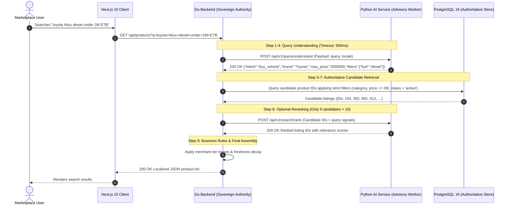

# HUNTIQ AI — Phase 2: Architecture Completion and Implementation Blueprint

**Document Path:** `ai/docs/architecture/PHASE-2-IMPLEMENTATION-BLUEPRINT.md`  
**Document Version:** 1.0.0  
**Phase:** Phase 2 — Verified Architecture Completion & Implementation Blueprint  
**Status:** Canonical Implementation Blueprint (Documentation Only — Awaiting Owner Approval for Phase 3)  
**Authors:** Principal Python Architect, Search & Information-Retrieval Engineer, Multilingual NLP Specialist, Application Security Lead & Reliability Engineer  
**Workspace Root:** `/home/poven/GO PROJECT/sellbuy`  
**AI Service Root:** `/home/poven/GO PROJECT/sellbuy/ai`  

---

## Table of Contents

1. [A. Executive Summary and Verified Baseline](#a-executive-summary-and-verified-baseline)
2. [B. HUNTIQ Scope and Architectural Boundaries](#b-huntiq-scope-and-architectural-boundaries)
3. [C. Target Folder Structure and File-by-File Responsibilities](#c-target-folder-structure-and-file-by-file-responsibilities)
4. [D. Existing-to-Target Migration Map](#d-existing-to-target-migration-map)
5. [E. Python Packaging and Dependency Strategy](#e-python-packaging-and-dependency-strategy)
6. [F. Search and Query-Understanding Pipeline](#f-search-and-query-understanding-pipeline)
7. [G. Multilingual Correctness](#g-multilingual-correctness)
8. [H. Algorithm Roadmap and Selection Criteria](#h-algorithm-roadmap-and-selection-criteria)
9. [I. Versioned API and Go Integration Contract](#i-versioned-api-and-go-integration-contract)
10. [J. Security, Privacy, and Trust Boundaries](#j-security-privacy-and-trust-boundaries)
11. [K. Evaluation and Acceptance Criteria](#k-evaluation-and-acceptance-criteria)
12. [L. Reliability, Deployment, and Observability](#l-reliability-deployment-and-observability)
13. [M. Phased Implementation Plan](#m-phased-implementation-plan)
14. [N. Decision Register and Open Questions](#n-decision-register-and-open-questions)

---

## A. Executive Summary and Verified Baseline

### 1. Purpose and Operational Context
HUNTIQ is a multi-category marketplace and brokerage platform built primarily for the Ethiopian market. The core platform runs on a **Go 1.23+ Fiber v2** backend (`backend/`), a **PostgreSQL 16** database with pgxpool and full-text search extensions, and a **Next.js 15 App Router** frontend (`frontend/`). 

The Python AI platform (`ai/`) is designed as an internal, stateless microservice dedicated to search intelligence, natural-language query understanding, category prediction, candidate ranking, and content safety. It does **not** replace the Go backend, manage user identity, execute database writes, or maintain authoritative business state.

### 2. Verified Baseline Inventory
An exhaustive, non-destructive audit of `/home/poven/GO PROJECT/sellbuy/ai` and the wider HUNTIQ platform confirms the following verified baseline:

* **Python Runtime Environment:** Pinned to `Python >=3.12` in `.python-version` and `pyproject.toml` (verified running on Python 3.14.8 on Linux).
* **AI Service Scaffold (`src/huntiq_ai/`):**
  - Application factory in `main.py` configuring Starlette middleware: `CorrelationIdMiddleware` for distributed tracing and `PayloadLimitMiddleware` enforcing a strict **64 KB (65,536 bytes)** body limit.
  - Operational health probes in `api/routes/health.py` exposing `GET /health/live` and `GET /health/ready`.
  - Typed settings in `core/config.py` using `pydantic-settings` with fail-fast validation in production (rejecting default secrets and requiring $\ge 32$ characters).
  - RFC 7807 problem details error handling in `core/errors.py`.
  - Structured JSON logging in `core/logging.py`.
  - Inter-service authentication in `core/security.py` validating `X-HUNTIQ-AI-SECRET` using constant-time comparison (`secrets.compare_digest`).
* **Offline Data Platform (`data-platform/`):**
  - Independent project file at `data-platform/pyproject.toml` managing `data_quality`.
  - JSONSchema specifications in `data-contracts/schemas/` for `manifest_schema.json`, `query_intent_contract.json`, and `category_suggestion_contract.json`.
  - Taxonomy export schema in `taxonomy/schemas/taxonomy_export.schema.json`.
  - Data quality gate in `data_quality/validator.py` with an Ethiopian mobile phone regex (`(?:\+251\s?|0)[79]\d{2}[\s.-]?\d{3}[\s.-]?\d{3}|(?:\+251\s?|0)[79]\d{8}`), email scanner, duplicate detector, and train/test leakage detector.
  - Physical dataset folders in `ml/datasets/` (`raw/`, `interim/`, `processed/`, `evaluation/`) all containing only `.gitkeep`.
  - Checked-in synthetic fixtures: `sample_manifest.json` and `sample_query_intent_dataset.json`.
* **Automated Test Results (100% Pass):**
  - `ai/tests/`: 15 passed in 0.24s (testing configuration, health probes, correlation ID preservation, secret authentication, and 64KB payload bounding).
  - `ai/data-platform/tests/`: 10 passed in 0.06s (testing PII scanning, duplicate detection, split leakage detection, and dataset manifest schema compliance).
  - Combined test suite: **25 passed, 0 failed**.

### 3. Implemented vs. Planned Matrix

| Capability / Component | Status | Verified Evidence |
| :--- | :--- | :--- |
| Health & readiness probes | **Implemented** | `src/huntiq_ai/api/routes/health.py` |
| Security authentication middleware | **Implemented** | `src/huntiq_ai/core/security.py` |
| Request payload size bounding (64 KB) | **Implemented** | `src/huntiq_ai/main.py:32-58` |
| RFC 7807 structured error formatting | **Implemented** | `src/huntiq_ai/core/errors.py` |
| PII scanning (Ethiopian phone regex) | **Implemented** | `data-platform/data_quality/validator.py:41` |
| Train/test leakage detector | **Implemented** | `data-platform/data_quality/validator.py:143` |
| Dataset manifest schema & validation | **Implemented** | `data-contracts/schemas/manifest_schema.json` |
| Predictive query understanding endpoint | **Unimplemented** | `src/huntiq_ai/api/routes/` has no prediction routes |
| Category suggestion inference route | **Unimplemented** | No suggestion endpoint exists |
| Trained ML model weights | **Unimplemented** | `ml/models/` contains only `.gitkeep`; readiness returns `models_loaded: false` |
| Collected marketplace training datasets | **Unimplemented** | `ml/datasets/{raw, interim, processed, evaluation}` are empty |
| Feature extraction & cleaning pipelines | **Unimplemented** | `data-platform/ml/pipelines/` directory does not exist on disk |
| Model training scripts | **Unimplemented** | `data-platform/ml/training/` directory does not exist on disk |
| Go backend AI client integration | **Unimplemented** | `backend/` calls no AI service; `AIClient` exists only as a markdown snippet |
| Multilingual Ge'ez script normalizer | **Unimplemented** | Neither Python nor Go normalizes Amharic/Tigrinya homophones |

### 4. Critical Verified Upstream Baseline Findings
Inspection of the Go backend and PostgreSQL migration scripts revealed two significant architectural issues that directly impact search and AI integration:

1. **The PostgreSQL `normalize_query` Defect (Migration 019):**  
   In `backend/internal/database/migrations/019_query_understanding.sql:166`, the function `normalize_query(p_query TEXT)` executes:
   ```sql
   v_normalized := REGEXP_REPLACE(v_normalized, '[^a-z0-9\s-]', '', 'g');
   ```
   *Verified Consequence:* This regex strips **all non-ASCII Unicode characters**, reducing Amharic queries (e.g. `"ስልክ"`), Tigrinya queries (e.g. `"ኮምፒውተር"`), and mixed-script queries to empty strings or fragmented tokens. It also strips the apostrophe (`hudhaa`) used in Afaan Oromoo (e.g. `"qo'annoo"` becomes `"qoannoo"`).
2. **Disconnected Brand Catalogs (Migration 019 vs. 031):**  
   The stored procedure `extract_brands(p_query TEXT)` queries `brand_dictionary`, which was seeded in migration 019 with only **31 brands**. Meanwhile, migration 031 and `backend/cmd/seed-taxonomy/catalogs.go` created an authoritative catalog of **72 brands** in the `brands` table, including domestic Ethiopian manufacturers (Anbessa Shoe, Kangaroo Shoe, Sheba Leather, Mugher Cement, Derba Cement, Habesha Cement) and heavy machinery brands (CAT, Komatsu, SANY, DeWalt, Makita). `extract_brands` cannot match any of these 41 additional brands.
3. **Untracked Governance Documentation:**  
   Four planning documents in `ai/docs/` (`models/MODEL_EVALUATION.md`, `models/MODEL_LIFECYCLE.md`, `training/DATASET_LIFECYCLE.md`, and `training/TRAINING_PIPELINE.md`) exist on disk but are untracked in Git status.

---

## B. HUNTIQ Scope and Architectural Boundaries

To avoid monolithic blurring or duplicate sources of truth, the HUNTIQ architecture establishes four immutable operational boundaries:

```
┌────────────────────────────────────────────────────────────────────────┐
│                   PILLAR 2: PRESENTATION LAYER                         │
│   Next.js 15 App Router + React 18 + Tailwind CSS (Port 3000)          │
│   - Localized UI rendering (English, Amharic, Afaan Oromoo, Tigrinya)  │
│   - Communicates EXCLUSIVELY with the Go Backend (Port 8080)          │
└───────────────────────────────────┬────────────────────────────────────┘
                                    │ HTTPS / REST
                                    ▼
┌────────────────────────────────────────────────────────────────────────┐
│                   PILLAR 1: SOVEREIGN AUTHORITY                        │
│   HUNTIQ Go Backend (Fiber v2) + PostgreSQL 16 (Port 8080)             │
│   - Sole authority for Identity, Auth, Sessions, RBAC, Payments       │
│   - Sole authority for DB mutations, Listings, and Admin Taxonomy      │
│   - Enforces strict validation & deterministic fallback on AI output   │
└───────────────────┬────────────────────────────────┬───────────────────┘
                    │                                │
    Internal HTTP   │ Private Network                │ Sanitized Offline
    X-HUNTIQ-SECRET │ Port 8000 (<=500ms)            │ Database Exports
                    ▼                                ▼
┌──────────────────────────────────────┐  ┌──────────────────────────────┐
│     PILLAR 3A: ONLINE INFERENCE      │  │ PILLAR 3B: OFFLINE PLATFORM  │
│ HUNTIQ Python AI Service (FastAPI)   │  │ Offline ML & Data Platform   │
│ - Stateless advisory prediction      │  │ - PII scrubbing & validation │
│ - Query understanding & parsing      │  │ - Model training & tuning    │
│ - Category suggestion & ranking      │  │ - Baseline benchmarking      │
│ - ZERO database read/write access    │  │ - Model card governance      │
└──────────────────────────────────────┘  └──────────────────────────────┘
```

### 1. Invariant System Boundaries
* **Go Backend & PostgreSQL are Authoritative:**  
  All user authentication, session lifecycle, listing approvals, category hierarchy storage (`category_hierarchy`), attribute definitions (`attribute_definitions`), wallet ledgers, and transactions belong exclusively in `backend/`. The AI service never writes to PostgreSQL and has no direct database connection credentials.
* **Python AI Service is an Internal Advisory Worker:**  
  Deployed strictly on an isolated private loopback interface (`127.0.0.1:8000`). Requests from Go are authenticated via `X-HUNTIQ-AI-SECRET`. Predictions are returned as confidence-scored recommendations. If the AI service is unreachable, slow ($>500\text{ms}$), or returns low confidence ($<0.70$), Go immediately falls back to its deterministic PostgreSQL search logic.
* **Marketplace Domain Scope:**  
  HUNTIQ is a universal multi-category marketplace and brokerage platform, **not an inventory-owning retailer**. The architecture supports dynamic administrator-managed categories across:
  - Products & General Merchandise
  - Electronics, Mobile & IT
  - Property, Residential Rentals & Land
  - Vehicles, Motorcycles & bajaj
  - Employment, Job Postings & CV Profiles
  - Agriculture, Livestock & Machinery
  - Local Commercial Services & Construction
  The AI system must **never hard-code a static category list** into Python application code. It dynamically synchronizes with the database taxonomy via versioned exports conforming to `taxonomy_export.schema.json`.
* **Out of Scope (Explicitly Prohibited):**  
  No warehousing, inventory optimization, order fulfillment pipelines, wholesale logistics, or autonomous financial settlement logic belong in the AI platform.

---

## C. Target Folder Structure and File-by-File Responsibilities

To support real functionality without speculative complexity, we propose a clean hexagonal layout organized within a unified `uv` workspace.

### 1. Target Directory Tree

```
ai/
├── .dockerignore
├── .env.example
├── .python-version
├── AGENTS.md
├── Dockerfile
├── README.md
├── pyproject.toml                                     # Workspace root configuration
├── uv.lock                                            # Monorepo deterministic lockfile
│
├── src/huntiq_ai/                                     # Online Inference Microservice
│   ├── __init__.py
│   ├── main.py                                        # App factory, lifespan, global middleware
│   │
│   ├── api/                                           # API Transport Layer (FastAPI)
│   │   ├── __init__.py
│   │   ├── router.py                                  # Mounts sub-routers
│   │   ├── dependencies.py                            # DI providers for auth, services, model runners
│   │   └── routes/
│   │       ├── __init__.py
│   │       ├── health.py                              # /health/live and /health/ready probes
│   │       ├── query.py                               # POST /api/v1/query/understand
│   │       ├── search.py                              # POST /api/v1/search/plan
│   │       ├── suggest.py                             # POST /api/v1/suggest/category
│   │       └── recommend.py                           # POST /api/v1/recommend/similar
│   │
│   ├── core/                                          # Cross-Cutting Infrastructure
│   │   ├── __init__.py
│   │   ├── config.py                                  # Pydantic BaseSettings & env parsing
│   │   ├── errors.py                                  # AIPlatformError hierarchy & RFC 7807 formatter
│   │   ├── logging.py                                 # Structured JSON logging with PII sanitization
│   │   ├── security.py                                # Constant-time secret authentication
│   │   └── telemetry.py                               # Correlation IDs, timing hooks, request metrics
│   │
│   ├── schemas/                                       # Typed Request/Response Contracts (Pydantic v2)
│   │   ├── __init__.py
│   │   ├── common.py                                  # Shared enums (locales), metadata, error models
│   │   ├── health.py                                  # Health probe response models
│   │   ├── query.py                                   # Query understanding request & response models
│   │   ├── search.py                                  # Search plan, hard filters, soft ranking models
│   │   ├── suggestion.py                              # Category prediction request & scored suggestions
│   │   └── recommendation.py                          # Recommendation request & candidate models
│   │
│   ├── domain/                                        # Pure Algorithmic Core (Zero HTTP Imports)
│   │   ├── __init__.py
│   │   ├── linguistic/                                # Multilingual Linguistic Normalization
│   │   │   ├── __init__.py
│   │   │   ├── normalizer.py                          # Unicode NFC normalization, whitespace trimming
│   │   │   ├── geez.py                                # Amharic/Tigrinya homophone & punctuation mapper
│   │   │   ├── latin.py                               # Afaan Oromoo/English accent & apostrophe handler
│   │   │   └── spelling.py                            # Trigram similarity & Levenshtein typo-tolerance
│   │   │
│   │   ├── query/                                     # Query Understanding Engines
│   │   │   ├── __init__.py
│   │   │   ├── parser.py                              # Deterministic rule parser (price, currency, condition)
│   │   │   ├── intent.py                              # Intent classification engine
│   │   │   ├── entities.py                            # Named entity & attribute extractor
│   │   │   └── confidence.py                          # Confidence calibrator & clarification gate
│   │   │
│   │   ├── search/                                    # Retrieval Planning & Fusion
│   │   │   ├── __init__.py
│   │   │   ├── planner.py                             # Transforms query to validated SearchPlan
│   │   │   ├── lexical.py                             # In-memory BM25 candidate scorer
│   │   │   ├── semantic.py                            # Dense vector similarity scorer
│   │   │   └── hybrid.py                              # Reciprocal Rank Fusion (RRF) combiner
│   │   │
│   │   ├── ranking/                                   # Candidate Reranking & Boosting
│   │   │   ├── __init__.py
│   │   │   ├── scorer.py                              # Multi-feature baseline scorer
│   │   │   ├── ltr.py                                 # Learning-to-Rank inference runner (GBDT)
│   │   │   └── business_rules.py                      # Merchant tier, freshness, and stock boosts
│   │   │
│   │   ├── recommendation/                            # Recommendation Engines
│   │   │   ├── __init__.py
│   │   │   ├── content_based.py                       # Attribute & TF-IDF similarity matcher
│   │   │   └── collaborative.py                       # User-item matrix recommender (gated future)
│   │   │
│   │   └── moderation/                                # Content Safety & Abuse Prevention
│   │       ├── __init__.py
│   │       ├── contact_leak.py                        # Phone number & Telegram handle leak detector
│   │       └── abuse_filter.py                        # Prohibited terms & scam pattern matcher
│   │
│   ├── infrastructure/                                # Model Loaders & In-Memory Adapters
│   │   ├── __init__.py
│   │   ├── models/                                    # Model Artifact Management
│   │   │   ├── __init__.py
│   │   │   ├── registry.py                            # Artifact loader, SHA-256 verifier, memory cache
│   │   │   ├── sklearn_runner.py                      # Scikit-learn model wrapper
│   │   │   └── onnx_runner.py                         # High-performance ONNX Runtime session runner
│   │   │
│   │   ├── embeddings/                                # Embedding Providers
│   │   │   ├── __init__.py
│   │   │   ├── base.py                                # Abstract base class for embedding providers
│   │   │   ├── local_embedding.py                     # Quantized local ONNX embedding runner
│   │   │   └── mock.py                                # Deterministic mock embeddings for test suite
│   │   │
│   │   └── taxonomy/                                  # In-Memory Taxonomy Snapshot Cache
│   │       ├── __init__.py
│   │       ├── store.py                               # Read-only tree store loaded from JSON snapshot
│   │       └── resolver.py                            # Fast slug/ID/path traversal & attribute lookups
│   │
│   └── services/                                      # Application Use Case Orchestrators
│       ├── __init__.py
│       ├── query_service.py                           # Orchestrates linguistic parsing -> intent -> entities
│       ├── search_service.py                          # Orchestrates plan -> candidate generation -> ranking
│       ├── suggest_service.py                         # Orchestrates listing title/desc -> category ranking
│       └── recommend_service.py                       # Orchestrates listing context -> similar items
│
├── data-platform/                                     # Offline ML, Data Governance & Quality (Workspace Member)
│   ├── AGENTS.md
│   ├── README.md
│   ├── pyproject.toml                                 # Member package configuration
│   │
│   ├── data-contracts/                                # Canonical Shared Schemas
│   │   ├── README.md
│   │   └── schemas/
│   │       ├── manifest_schema.json                   # Dataset manifest specification
│   │       ├── query_intent_contract.json             # Query intent classification contract
│   │       ├── category_suggestion_contract.json      # Category suggestion contract
│   │       ├── search_plan_contract.json              # Validated search plan contract
│   │       ├── ranking_judgment_contract.json         # Search relevance judgment contract
│   │       └── moderation_contract.json               # Content moderation violation contract
│   │
│   ├── taxonomy/                                      # Authoritative Taxonomy Snapshots
│   │   ├── README.md
│   │   ├── schemas/
│   │   │   └── taxonomy_export.schema.json            # JSONSchema for Go backend taxonomy dump
│   │   ├── manifests/                                 # Versioned snapshot manifests (.gitkeep)
│   │   ├── sources/                                   # Raw JSON exports from PostgreSQL (.gitkeep)
│   │   ├── generated/                                 # Processed tree structures & fast lookups (.gitkeep)
│   │   └── reports/                                   # Category coverage & orphan audit reports (.gitkeep)
│   │
│   ├── data_quality/                                  # Data Quality Gates & Hygiene Tools
│   │   ├── __init__.py
│   │   ├── README.md
│   │   ├── validator.py                               # Quality gates: PII, duplicates, split leakage
│   │   ├── scrubbers.py                               # Masking utilities for Ethiopian phones & emails
│   │   └── drift.py                                   # Distribution and concept drift metrics
│   │
│   ├── ml/                                            # Machine Learning Lifecycle
│   │   ├── README.md
│   │   ├── datasets/                                  # Physical Data Storage (Gitignored except fixtures)
│   │   │   ├── raw/                                   # Immutable raw exports (.gitkeep)
│   │   │   ├── interim/                               # Scrubbed & anonymized records (.gitkeep)
│   │   │   ├── processed/                             # Feature-engineered splits (.gitkeep)
│   │   │   ├── evaluation/                            # Fixed held-out test benchmarks (.gitkeep)
│   │   │   └── synthetic_fixtures/                    # Versioned synthetic test fixtures
│   │   │       ├── sample_manifest.json
│   │   │       ├── sample_query_intent_dataset.json
│   │   │       └── sample_taxonomy_export.json
│   │   │
│   │   ├── pipelines/                                 # Extraction & Cleaning Pipelines
│   │   │   ├── __init__.py
│   │   │   ├── export_taxonomy.py                     # Extracts & validates taxonomy from Go API
│   │   │   ├── clean_queries.py                       # Scrubs, deduplicates, and splits query logs
│   │   │   └── prepare_listings.py                    # Prepares title/description training pairs
│   │   │
│   │   ├── labeling/                                  # Annotation Rubrics & Golden Sets
│   │   │   ├── README.md
│   │   │   ├── labeling_guidelines.md                 # Rubric for intent, entity, and relevance labels
│   │   │   └── gold_standard/                         # Fixed, human-verified evaluation sets (.gitkeep)
│   │   │
│   │   ├── training/                                  # Offline Training Workflows
│   │   │   ├── __init__.py
│   │   │   ├── configs/                               # Reproducible hyperparameter configs (.yaml)
│   │   │   │   ├── intent_baseline.yaml
│   │   │   │   └── category_baseline.yaml
│   │   │   ├── train_intent.py                        # Intent classifier trainer
│   │   │   ├── train_category.py                      # Hierarchical category suggestion trainer
│   │   │   ├── train_ner.py                           # Entity & attribute extraction trainer
│   │   │   └── train_ltr.py                           # Learning-to-Rank LightGBM trainer
│   │   │
│   │   ├── evaluation/                                # Offline Benchmarking & Analysis
│   │   │   ├── __init__.py
│   │   │   ├── baseline_bench.py                      # Evaluates PostgreSQL FTS baseline on test set
│   │   │   ├── evaluate_model.py                      # Evaluates candidate model metrics vs baseline
│   │   │   └── error_analysis.py                      # Produces error confusion matrices & audit logs
│   │   │
│   │   ├── models/                                    # Staged model artifacts (.gitkeep)
│   │   └── model_cards/                               # Audited Model Cards (Committed to Git)
│   │       ├── MODEL_CARD_TEMPLATE.md
│   │       └── baseline_postgres_fts.md               # Baseline performance documentation
│   │
│   └── tests/                                         # Data Platform Test Suite
│       ├── conftest.py
│       ├── test_data_quality_validator.py             # Quality gate tests
│       ├── test_manifest_schema.py                    # Manifest validation tests
│       ├── test_scrubbers.py                          # PII scrubber tests
│       └── test_pipelines.py                          # Data pipeline smoke tests
│
├── tests/                                             # Online Inference Test Suite
│   ├── conftest.py                                    # Shared fixtures (FastAPI client, mock settings)
│   ├── unit/                                          # Fine-Grained Unit Tests
│   │   ├── test_config.py                             # Configuration tests
│   │   ├── test_security.py                           # Secret auth & size bounding tests
│   │   ├── test_health.py                             # Health probe tests
│   │   ├── test_linguistic_normalizer.py              # Normalization & unicode NFC tests
│   │   ├── test_geez_processing.py                    # Amharic/Tigrinya character handling tests
│   │   ├── test_spelling.py                           # Typo tolerance & trigram similarity tests
│   │   ├── test_query_parser.py                       # Regex rule extraction tests
│   │   ├── test_entity_extractor.py                   # Brand, model, attribute extraction tests
│   │   ├── test_search_planner.py                     # Hard filter vs soft ranking mapping tests
│   │   ├── test_bm25_retrieval.py                     # BM25 scoring tests
│   │   ├── test_hybrid_retrieval.py                   # Reciprocal Rank Fusion tests
│   │   ├── test_ranking.py                            # Ranking feature scoring tests
│   │   ├── test_recommendation.py                     # Content-based recommendation tests
│   │   └── test_content_moderation.py                 # Phone/Telegram contact leak tests
│   ├── contract/                                      # Cross-Service Contract Verification
│   │   ├── test_contract.py                           # OpenAPI and RFC 7807 compliance tests
│   │   ├── test_query_contracts.py                    # Query API schema validation tests
│   │   └── test_search_contracts.py                   # Search plan schema validation tests
│   ├── integration/                                   # Full Request Lifecycle Flows
│   │   ├── test_query_flow.py                         # End-to-end query understanding flow
│   │   └── test_search_flow.py                        # End-to-end search planning & candidate flow
│   └── fixtures/                                      # Synthetic Test Data
│       ├── sample_queries.json
│       ├── sample_catalog.json
│       └── sample_taxonomy.json
│
└── docs/                                              # Comprehensive Documentation & Runbooks
    ├── README.md                                      # Documentation index
    ├── architecture/
    │   ├── ai-architecture.md                         # Topology, threat model, boundaries
    │   ├── ai-integration.md                          # Go-to-Python HTTP REST contract
    │   ├── retrieval-pipeline.md                      # Multi-stage retrieval and ranking architecture
    │   └── PHASE-2-IMPLEMENTATION-BLUEPRINT.md        # THIS DOCUMENT
    ├── decisions/
    │   ├── ADR-001-ai-platform-boundaries.md          # Core architecture decision
    │   ├── ADR-002-package-workspace-strategy.md      # uv workspace package management decision
    │   └── ADR-003-multilingual-retrieval-design.md   # Ge'ez and Latin multilingual strategy
    ├── models/
    │   ├── MODEL_LIFECYCLE.md                         # Full model lifecycle documentation
    │   └── MODEL_EVALUATION.md                        # Evaluation standards and acceptance gates
    ├── training/
    │   ├── DATASET_LIFECYCLE.md                       # Data governance and time-split policy
    │   └── TRAINING_PIPELINE.md                       # End-to-end training workflow documentation
    ├── security/
    │   └── ai-data-security.md                        # Data security and PII policy
    ├── testing/
    │   └── ai-testing.md                              # Quality gates and test strategies
    ├── runbooks/
    │   ├── ai-local-development.md                    # Local setup instructions
    │   ├── model-deployment-runbook.md                # Controlled artifact promotion runbook
    │   └── emergency-fallback-runbook.md              # Fallback operation guide
    └── audits/
        └── ai-platform-foundation-audit.md            # Repository foundation audit
```

### 2. File Responsibility Matrix

The table below documents every key file in the proposed target tree:

| File Path | Responsibility & Purpose | Primary Inputs & Outputs | Key Dependencies | Associated Tests | Status |
| :--- | :--- | :--- | :--- | :--- | :--- |
| `src/huntiq_ai/main.py` | FastAPI application factory, lifespan startup/shutdown, middleware registration. | Input: System signals.<br>Output: Configured `FastAPI` instance. | `core/config.py`, `core/logging.py`, `core/errors.py` | `tests/contract/test_contract.py` | Existing (Retain) |
| `src/huntiq_ai/core/config.py` | Central typed configuration with production safety checks. | Input: Environment variables (`.env`).<br>Output: Cached `Settings` singleton. | `pydantic-settings` | `tests/unit/test_config.py` | Existing (Retain) |
| `src/huntiq_ai/core/security.py` | Inter-service authentication using constant-time token comparison. | Input: `X-HUNTIQ-AI-SECRET` header.<br>Output: Validated token or 401 error. | `core/config.py`, `core/errors.py` | `tests/unit/test_security.py` | Existing (Retain) |
| `src/huntiq_ai/core/errors.py` | Exception hierarchy and RFC 7807 problem details formatter. | Input: Exceptions.<br>Output: Uniform JSON responses. | `starlette.responses` | `tests/contract/test_contract.py` | Existing (Retain) |
| `src/huntiq_ai/core/logging.py` | Safe structured JSON logging with automatic PII masking. | Input: Log events.<br>Output: Sanitized JSON stdout. | `logging`, `json` | `tests/unit/test_config.py` | Existing (Retain) |
| `src/huntiq_ai/core/telemetry.py` | Latency histograms, request metrics, correlation propagation. | Input: Request timing.<br>Output: Metrics and trace headers. | `time`, `uuid` | `tests/unit/test_health.py` | Proposed (Phase 3) |
| `src/huntiq_ai/api/router.py` | Central router aggregator mounting sub-routers. | Input: Sub-routers.<br>Output: Unified `APIRouter`. | `api/routes/` | `tests/contract/test_contract.py` | Existing (Extend later) |
| `src/huntiq_ai/api/routes/health.py`| `/health/live` and `/health/ready` probe handlers. | Input: HTTP GET.<br>Output: Liveness & Readiness JSON. | `core/config.py`, `schemas/health.py` | `tests/unit/test_health.py` | Existing (Retain) |
| `src/huntiq_ai/api/routes/query.py` | Handles `POST /api/v1/query/understand`. | Input: `QueryUnderstandingRequest`.<br>Output: `QueryUnderstandingResponse`. | `services/query_service.py` | `tests/integration/test_query_flow.py` | Proposed (Phase 5) |
| `src/huntiq_ai/api/routes/search.py`| Handles `POST /api/v1/search/plan`. | Input: `SearchPlanRequest`.<br>Output: `SearchPlanResponse`. | `services/search_service.py` | `tests/integration/test_search_flow.py` | Proposed (Phase 6) |
| `src/huntiq_ai/api/routes/suggest.py`| Handles `POST /api/v1/suggest/category`. | Input: `CategorySuggestionRequest`.<br>Output: `CategorySuggestionResponse`. | `services/suggest_service.py` | `tests/unit/test_suggestion.py` | Proposed (Phase 5) |
| `src/huntiq_ai/domain/linguistic/normalizer.py` | Unicode NFC normalization, whitespace consolidation, case folding. | Input: Raw text string.<br>Output: Cleaned text string. | `unicodedata`, `re` | `tests/unit/test_linguistic_normalizer.py` | Proposed (Phase 4) |
| `src/huntiq_ai/domain/linguistic/geez.py` | Amharic/Tigrinya homophone mapping and Ethiopic punctuation handling. | Input: Ge'ez text.<br>Output: Canonicalized Ge'ez text. | `re` | `tests/unit/test_geez_processing.py` | Proposed (Phase 4) |
| `src/huntiq_ai/domain/linguistic/latin.py` | Afaan Oromoo and English apostrophe (`hudhaa`) & token normalization. | Input: Latin text.<br>Output: Preserved tokens. | `re` | `tests/unit/test_linguistic_normalizer.py` | Proposed (Phase 4) |
| `src/huntiq_ai/domain/linguistic/spelling.py` | Trigram similarity and Levenshtein distance against catalog terms. | Input: Misspelled token.<br>Output: Closest catalog term + score. | `difflib` | `tests/unit/test_spelling.py` | Proposed (Phase 4) |
| `src/huntiq_ai/domain/query/parser.py` | Deterministic regex rule parser for price, currency, and condition. | Input: Normalized query.<br>Output: Filter dictionary + clean tokens. | `re`, `domain/linguistic/` | `tests/unit/test_query_parser.py` | Proposed (Phase 5) |
| `src/huntiq_ai/domain/query/intent.py` | Intent classification engine (7 marketplace intents). | Input: Clean query tokens.<br>Output: Intent label + confidence. | `infrastructure/models/` | `tests/unit/test_query_flow.py` | Proposed (Phase 5) |
| `src/huntiq_ai/domain/query/entities.py`| Brand, model, and category-specific attribute extractor. | Input: Query tokens.<br>Output: Key-value attributes. | `infrastructure/taxonomy/` | `tests/unit/test_entity_extractor.py` | Proposed (Phase 5) |
| `src/huntiq_ai/domain/search/planner.py` | Compiles extracted signals into validated `SearchPlan`. | Input: Intent + Entities.<br>Output: `SearchPlan` (Hard vs Soft). | `domain/query/` | `tests/unit/test_search_planner.py` | Proposed (Phase 6) |
| `src/huntiq_ai/domain/search/hybrid.py` | Reciprocal Rank Fusion (RRF) algorithm combining ranking lists. | Input: Lexical & semantic ranks.<br>Output: Fused candidate scores. | None (pure math) | `tests/unit/test_hybrid_retrieval.py` | Proposed (Phase 6) |
| `src/huntiq_ai/domain/ranking/scorer.py` | Multi-feature candidate scoring engine. | Input: Candidate listings + signals.<br>Output: Scored listing list. | `domain/search/` | `tests/unit/test_ranking.py` | Proposed (Phase 7) |
| `src/huntiq_ai/domain/moderation/contact_leak.py` | Detects phone numbers and Telegram handles in seller listings. | Input: Text string.<br>Output: Violation flags + match spans. | `re` | `tests/unit/test_content_moderation.py` | Proposed (Phase 8) |
| `src/huntiq_ai/infrastructure/models/registry.py` | Model loading, SHA-256 verification against manifests, memory caching. | Input: Model name.<br>Output: Loaded runtime session. | `hashlib`, `core/errors.py` | `tests/unit/test_model_registry.py` | Proposed (Phase 5) |
| `src/huntiq_ai/infrastructure/taxonomy/store.py` | Fast in-memory hierarchy lookup cache loaded from JSON snapshot. | Input: Taxonomy snapshot.<br>Output: Traversal & schema checks. | `json`, `pathlib` | `tests/unit/test_taxonomy_store.py` | Proposed (Phase 4) |
| `data-platform/data_quality/validator.py` | Quality gates: PII detection, duplicate detection, train/test leakage. | Input: Dataset records.<br>Output: `DataQualityReport`. | `re`, `dataclasses` | `data-platform/tests/test_data_quality_validator.py` | Existing (Retain) |
| `data-platform/data_quality/scrubbers.py` | Automated sanitization & masking for Ethiopian phone numbers & emails. | Input: Raw records.<br>Output: Scrubbed records. | `re` | `data-platform/tests/test_scrubbers.py` | Proposed (Phase 4) |
| `data-platform/ml/pipelines/export_taxonomy.py` | Pulls canonical category hierarchy from Go API and validates contract. | Input: Go API endpoint.<br>Output: Validated snapshot JSON. | `httpx`, `data_quality/` | `data-platform/tests/test_pipelines.py` | Proposed (Phase 4) |
| `data-platform/ml/evaluation/baseline_bench.py` | Measures PostgreSQL FTS baseline on held-out test split. | Input: Evaluation dataset.<br>Output: Baseline metrics report. | `data-contracts/` | `data-platform/tests/test_bench.py` | Proposed (Phase 5) |

---

## D. Existing-to-Target Migration Map

The table below specifies the disposition of every current directory and key file, preserving existing tests and history while preparing for Phase 3:

| Current Directory / File | Proposed Action | Target Location | Technical Justification & Impact |
| :--- | :--- | :--- | :--- |
| `ai/pyproject.toml` | **REORGANIZE** | `ai/pyproject.toml` | Reconfigure as a unified `uv` workspace root with members `.` and `data-platform`. Zero code breakage; unifies lockfile management. |
| `ai/uv.lock` | **EXTEND LATER** | `ai/uv.lock` | Maintain existing lockfile; will be updated during workspace unification in Phase 3. |
| `ai/.python-version` | **REMAIN IN PLACE** | `ai/.python-version` | Preserves the pinned Python version (`>=3.12`). |
| `ai/.env.example` | **REMAIN IN PLACE** | `ai/.env.example` | Retains template settings for local and test runs. |
| `ai/Dockerfile` | **REMAIN IN PLACE** | `ai/Dockerfile` | Retains multi-stage lean container scaffold. |
| `ai/.dockerignore` | **REMAIN IN PLACE** | `ai/.dockerignore` | Retains build context exclusion rules. |
| `ai/AGENTS.md` | **REMAIN IN PLACE** | `ai/AGENTS.md` | Core developer and agent operating instructions. |
| `ai/README.md` | **REMAIN IN PLACE** | `ai/README.md` | Developer overview document. |
| `ai/src/huntiq_ai/main.py` | **EXTEND LATER** | `ai/src/huntiq_ai/main.py` | Keep existing factory; will register new predictive routers as they are built. |
| `ai/src/huntiq_ai/api/router.py` | **EXTEND LATER** | `ai/src/huntiq_ai/api/router.py` | Keep existing router aggregator; will mount query, search, and suggestion sub-routers. |
| `ai/src/huntiq_ai/api/routes/health.py` | **REMAIN IN PLACE** | `ai/src/huntiq_ai/api/routes/health.py` | Keep existing operational liveness and readiness probe implementations. |
| `ai/src/huntiq_ai/core/config.py` | **REMAIN IN PLACE** | `ai/src/huntiq_ai/core/config.py` | Keep existing Pydantic settings with secret validation. |
| `ai/src/huntiq_ai/core/security.py` | **REMAIN IN PLACE** | `ai/src/huntiq_ai/core/security.py` | Keep existing constant-time token verification. |
| `ai/src/huntiq_ai/core/errors.py` | **REMAIN IN PLACE** | `ai/src/huntiq_ai/core/errors.py` | Keep existing RFC 7807 error formatters. |
| `ai/src/huntiq_ai/core/logging.py` | **REMAIN IN PLACE** | `ai/src/huntiq_ai/core/logging.py` | Keep existing JSON logging formatter. |
| `ai/src/huntiq_ai/schemas/health.py` | **REMAIN IN PLACE** | `ai/src/huntiq_ai/schemas/health.py` | Keep existing health response models. |
| `ai/tests/` | **EXTEND LATER** | `ai/tests/` | Keep all 15 existing unit and contract tests; add unit tests for new domain modules. |
| `ai/data-platform/pyproject.toml` | **REORGANIZE** | `ai/data-platform/pyproject.toml` | Convert to workspace member format inheriting shared dev dependencies from root. |
| `ai/data-platform/uv.lock` | **CONSOLIDATE LATER** | N/A (Merged into `ai/uv.lock`) | Deprecate standalone lockfile in favor of the unified root `ai/uv.lock` in Phase 3. |
| `ai/data-platform/data_quality/validator.py` | **REMAIN IN PLACE** | `ai/data-platform/data_quality/validator.py` | Keep existing PII scanner, duplicate detector, and leakage verifier. |
| `ai/data-platform/data-contracts/schemas/*` | **REMAIN IN PLACE** | `ai/data-platform/data-contracts/schemas/*` | Keep canonical JSONSchema contracts for manifests and intent. |
| `ai/data-platform/taxonomy/schemas/*` | **REMAIN IN PLACE** | `ai/data-platform/taxonomy/schemas/*` | Keep canonical taxonomy export schema. |
| `ai/data-platform/ml/model_cards/MODEL_CARD_TEMPLATE.md` | **REMAIN IN PLACE** | Same | Keep model card governance template. |
| `ai/data-platform/ml/datasets/synthetic_fixtures/*` | **REMAIN IN PLACE** | Same | Keep checked-in synthetic test fixtures. |
| `ai/data-platform/tests/` | **EXTEND LATER** | `ai/data-platform/tests/` | Keep all 10 existing quality tests; add pipeline tests in Phase 4. |
| `ai/docs/models/MODEL_EVALUATION.md` | **TRACK IN GIT** | `ai/docs/models/MODEL_EVALUATION.md` | Track previously uncommitted baseline evaluation strategy. |
| `ai/docs/models/MODEL_LIFECYCLE.md` | **TRACK IN GIT** | `ai/docs/models/MODEL_LIFECYCLE.md` | Track previously uncommitted model governance lifecycle document. |
| `ai/docs/training/DATASET_LIFECYCLE.md`| **TRACK IN GIT** | `ai/docs/training/DATASET_LIFECYCLE.md`| Track previously uncommitted dataset lifecycle document. |
| `ai/docs/training/TRAINING_PIPELINE.md`| **TRACK IN GIT** | `ai/docs/training/TRAINING_PIPELINE.md`| Track previously uncommitted 10-stage training pipeline document. |

---

## E. Python Packaging and Dependency Strategy

### 1. Comparison of Architectural Alternatives

* **Alternative 1: Fully Monolithic Merge (Single `pyproject.toml`)**
  * *Trade-off:* Combines runtime inference and offline data platform into one package.
  * *Evaluation:* Rejected. Forces the production serving container to pull in heavy data-processing packages (Pandas, PyArrow, Jupyter) or creates complex optional-dependency tags that blur domain boundaries.
* **Alternative 2: Completely Independent Disconnected Projects (Current State)**
  * *Trade-off:* Keeps `ai/pyproject.toml` and `ai/data-platform/pyproject.toml` completely isolated with separate virtualenvs.
  * *Evaluation:* Rejected. Results in duplicate `.venv` storage (~1.5GB duplicated), divergent dependency versions (Pydantic, Ruff, Pytest), and duplicate CI test jobs.
* **Alternative 3 (Recommended): Unified `uv` Workspace Monorepo**
  * *Trade-off:* Configures a single `uv` workspace at `ai/pyproject.toml` managing two workspace members:
    1. Member `huntiq-ai` (`src/huntiq_ai/`): Lean runtime inference worker.
    2. Member `huntiq-data-platform` (`data-platform/`): Offline governance and ML platform.
  * *Evaluation:* **Adopted.** Generates a single deterministic `uv.lock` at `ai/uv.lock`, harmonizes linter and test tooling, and allows a single command (`uv run pytest`) to test all 25 tests. In production, Docker builds use:
    ```bash
    uv sync --package huntiq-ai --no-dev
    ```
    This produces a lean **~120MB container** with zero offline ML training dependencies.

### 2. Dependency Allocation Matrix

```
┌────────────────────────────────────────────────────────────────────────┐
│                        SHARED WORKSPACE DEV GROUP                      │
│   pytest>=8.3.0, pytest-cov>=6.0.0, pytest-asyncio>=0.24.0,            │
│   httpx>=0.27.0, ruff>=0.7.0                                           │
└───────────────────┬────────────────────────────────┬───────────────────┘
                    │                                │
                    ▼                                ▼
┌──────────────────────────────────────┐  ┌──────────────────────────────┐
│     PACKAGE: huntiq-ai (Runtime)     │  │ PACKAGE: huntiq-data-platform│
│ - fastapi>=0.115.0                   │  │ - pydantic>=2.9.0            │
│ - uvicorn[standard]>=0.32.0          │  │ - pyarrow>=17.0.0            │
│ - pydantic>=2.9.0                    │  │ - pandas>=2.2.0              │
│ - pydantic-settings>=2.6.0           │  │ - pyyaml>=6.0.0              │
│ OPTIONAL [ml]:                       │  │ OPTIONAL [train]:            │
│ - joblib>=1.4.0                      │  │ - scikit-learn>=1.5.0        │
│ - onnxruntime>=1.19.0                │  │ - lightgbm>=4.5.0            │
└──────────────────────────────────────┘  └──────────────────────────────┘
```

---

## F. Search and Query-Understanding Pipeline

The search pipeline is structured as a staged hybrid sequence across the Go backend, PostgreSQL, and the Python AI service. Go and PostgreSQL retain final authority over all query executions and filter enforcement.



### 1. Step-by-Step Processing Sequence

1. **Step 1 — Unicode-Safe Normalization:**  
   Raw query input is normalized in `domain/linguistic/normalizer.py`. Unicode is converted to **NFC form**. Whitespace is consolidated. Unlike the defective PostgreSQL function, **meaningful Ethiopic Unicode characters (U+1200 to U+137F) and Afaan Oromoo apostrophes are strictly preserved**.
2. **Step 2 — Script and Locale Detection:**  
   `domain/linguistic/` detects whether the input is Ge'ez script (Amharic/Tigrinya), Latin script (English/Afaan Oromoo), or mixed-script (e.g. `"samsung ስልክ"`).
3. **Step 3 — Deterministic Entity & Attribute Extraction:**  
   `domain/query/parser.py` extracts explicit operational tokens:
   - Price bounds: `"under 2M"`, `"ከ 50000 ብር በታች"` $\rightarrow$ `max_price: 2000000`.
   - Currencies: `ETB`, `USD`, `ብር`.
   - Conditions: `"new"`, `"used"`, `"አዲስ"`, `"ያገለገለ"`.
   `domain/query/entities.py` matches known catalog brands and models against the in-memory taxonomy store.
4. **Step 4 — Validated Search Plan Generation:**  
   `domain/search/planner.py` compiles extracted signals into a typed `SearchPlan` dividing criteria into:
   - **Hard Filters (Strict SQL WHERE):** Category ID, price range, condition, location ID, active status.
   - **Soft Signals (Ranking Boosts):** Detected brand name, search tokens, semantic intent vector.
5. **Step 5 — Authoritative Candidate Retrieval (in Go/PostgreSQL):**  
   The Go backend queries PostgreSQL using the hard filters from the `SearchPlan`. This guarantees that deleted, pending, out-of-stock, or unauthorized listings are **never retrieved**.
6. **Step 6 — Semantic Enrichment (Optional):**  
   For exploratory queries with zero or sparse exact lexical matches, `domain/search/semantic.py` generates a dense vector and performs cosine similarity against candidate listing embeddings.
7. **Step 7 — Business Rule Enforcement (in Go):**  
   The Go backend enforces authoritative platform rules: verified seller badge boosts, premium merchant placement, and freshness decay.
8. **Step 8 — Candidate Reranking:**  
   `domain/ranking/scorer.py` evaluates candidate features (BM25 score, attribute match ratio, merchant rating) using Reciprocal Rank Fusion (RRF) or an offline-trained GBDT.
9. **Step 9 — Structured Response Assembly:**  
   The Go backend serializes the ranked listings into localized JSON and records the search event asynchronously in `search_analytics`.

---

## G. Multilingual Correctness

HUNTIQ targets four primary Ethiopian languages. One universal normalization rule cannot be applied across all four without corrupting language semantics.

```
┌────────────────────────────────────────────────────────────────────────┐
│                   HUNTIQ MULTILINGUAL MATRIX                           │
├───────────────┬──────────────┬──────────────┬──────────────────────────┤
│ Language      │ ISO Code     │ Script       │ Specialized Handling     │
├───────────────┼──────────────┼──────────────┼──────────────────────────┤
│ English       │ en           │ Latin        │ Lowercase, ASCII tokens  │
│ Amharic       │ am           │ Ge'ez        │ Homophones, Punctuation  │
│ Afaan Oromoo  │ om           │ Latin        │ Hudhaa apostrophes       │
│ Tigrinya      │ ti           │ Ge'ez        │ Tigrinya consonants      │
└───────────────┴──────────────┴──────────────┴──────────────────────────┘
```

### 1. Script-Specific Linguistic Rules

* **Amharic (`am` / አማርኛ):**
  - **Homophone Equivalence:** Ge'ez contains multiple glyphs representing identical sounds in modern Amharic. `domain/linguistic/geez.py` normalizes these to canonical base forms:
    - `ሀ`, `ሐ`, `ኀ` $\rightarrow$ canonical `ሀ`
    - `ሠ`, `ሰ` $\rightarrow$ canonical `ሰ`
    - `አ`, `ዐ` $\rightarrow$ canonical `አ`
    - `ጸ`, `ፀ` $\rightarrow$ canonical `ጸ`
  - **Ethiopic Punctuation Removal:** Standard regex `[^\w]` fails to strip Ethiopic punctuation. The normalizer explicitly strips: word separator `፡` (U+1361), full stop `።` (U+1362), comma `፣` (U+1363), semicolon `፤` (U+1364), and question mark `፧` (U+1367).
  - **Ethiopic Numerals:** Supports both Western digits (`1`, `2`) and Ge'ez numerals (`፩`, `፪`, `፲`, `፻`).
* **Afaan Oromoo (`om`):**
  - **Glottal Stop Preservation (`hudhaa`):** Uses the Latin script with apostrophes to represent glottal stops (e.g. `qo'annoo`, `har'a`, `nyaata`). Stripping apostrophes corrupts word semantics. The normalizer preserves internal apostrophes preceded and followed by letters (`\b\w+'\w+\b`).
* **Tigrinya (`ti` / ትግርኛ):**
  - Uses Ge'ez script with specialized Tigrinya phonemes (`ቐ`, `ቘ`, `ቨ`, `ዠ`, `ጨ`). These characters fall within `\u1200-\u137F` and must be preserved without Latin folding.
* **Mixed-Script & Transliteration:**
  - Common marketplace queries combine English brand names with Amharic keywords (e.g. `"samsung ስልክ"`, `"toyota vitz አዲስ አበባ"`). The normalizer tokenizes Latin and Ge'ez characters into distinct token streams without dropping either script.

### 2. Upstream Database Migration Remediation Plan
To fix the PostgreSQL defect in migration 019 where `normalize_query()` strips all non-ASCII characters, we specify a future idempotent database migration:
* **Proposed Migration:** `035_fix_query_normalization_multilingual.sql`
* **Remediation SQL:**
  ```sql
  CREATE OR REPLACE FUNCTION normalize_query(p_query TEXT)
  RETURNS TEXT AS $$
  DECLARE
      v_normalized TEXT;
  BEGIN
      -- 1. Lowercase
      v_normalized := LOWER(TRIM(p_query));
      
      -- 2. Preserve ASCII alphanumeric, Ethiopic Unicode (\u1200-\u137F), 
      --    internal apostrophes (Afaan Oromoo hudhaa), spaces, and hyphens.
      v_normalized := REGEXP_REPLACE(v_normalized, '[^a-z0-9\u1200-\u137F\s\''-]', '', 'g');
      
      -- 3. Consolidate multiple spaces
      v_normalized := REGEXP_REPLACE(v_normalized, '\s+', ' ', 'g');
      
      -- 4. Trim
      RETURN TRIM(v_normalized);
  END;
  $$ LANGUAGE plpgsql IMMUTABLE;
  ```
* **Governance Boundary:** This migration is **documented only**. It will be submitted to the database owner for formal review and execution in Phase 4.

---

## H. Algorithm Roadmap and Selection Criteria

The algorithmic capabilities are organized into four sequential stages. No model is deployed without demonstrating a statistically significant improvement over the deterministic baseline.

```
┌────────────────────────────────────────────────────────────────────────┐
│ STAGE 1: RELIABLE BASELINE (Required Now — Deterministic / Non-AI)     │
│ - Rule-based query parsing & price/condition regex extraction         │
│ - Multilingual Unicode-preserving normalization (Ge'ez & Latin)       │
│ - PostgreSQL FTS baseline benchmarking on held-out evaluation set     │
│ - Brand dictionary catalog synchronization (72 verified brands)       │
└───────────────────────────────────┬────────────────────────────────────┘
                                    │
                                    ▼
┌────────────────────────────────────────────────────────────────────────┐
│ STAGE 2: QUERY UNDERSTANDING (Phase 5 — Lightweight Supervised ML)     │
│ - Query intent classification (TF-IDF + Logistic Regression / FastText)│
│ - Category suggestion from listing title/description                   │
│ - Named entity extraction (catalog vocabulary matching)               │
└───────────────────────────────────┬────────────────────────────────────┘
                                    │
                                    ▼
┌────────────────────────────────────────────────────────────────────────┐
│ STAGE 3: RELEVANCE IMPROVEMENT (Phase 6/7 — Hybrid Retrieval & Rerank) │
│ - In-memory BM25 lexical candidate scoring                            │
│ - Reciprocal Rank Fusion (RRF) combining lexical & semantic scores    │
│ - Learning-to-Rank (LightGBM / LambdaMART) trained on click logs      │
└───────────────────────────────────┬────────────────────────────────────┘
                                    │
                                    ▼
┌────────────────────────────────────────────────────────────────────────┐
│ STAGE 4: OPTIONAL CAPABILITIES (Phase 8+ — Gated on Interaction Volume)│
│ - Content-based recommendations using attribute cosine similarity      │
│ - Seller contact leak detection (phone regex & Telegram handle filter) │
│ - Collaborative filtering (deferred until >= 100k user interactions)   │
└────────────────────────────────────────────────────────────────────────┘
```

### 1. Algorithm Specification & Activation Matrix

| Algorithm Family | Problem Solved | Required Data | Baseline Comparison | Evaluation Metric | Runtime & Compute Cost | Failure Mode | Status |
| :--- | :--- | :--- | :--- | :--- | :--- | :--- | :--- |
| **Deterministic Rule Parser** | Extracts prices, currencies, conditions from query. | None (regex patterns). | Raw search string with no extraction. | Precision & Recall on synthetic set. | Sub-millisecond CPU. | Unrecognized pattern left as raw text. | **Required (Phase 4)** |
| **Ge'ez Homophone Normalizer** | Standardizes spelling variants in Amharic & Tigrinya. | Ge'ez character mapping table. | Raw character matching. | Character recall on Amharic test set. | Sub-millisecond CPU. | Character left unmodified. | **Required (Phase 4)** |
| **Intent Classifier** | Routes query to one of 7 marketplace intents. | 2,000+ labeled query intent pairs. | Keyword rule baseline. | Macro F1 $\ge 0.85$, Latency $\le 50\text{ms}$. | 5–15ms CPU. | Defaults to `ambiguous` intent; serves standard FTS. | **Planned (Phase 5)** |
| **Category Predictor** | Suggests taxonomy IDs from listing title/desc. | 5,000+ listing title/category pairs. | PostgreSQL FTS keyword match. | Accuracy@3 $\ge 85\%$, Latency $\le 80\text{ms}$. | 20–50ms CPU. | Empty suggestion list; seller selects manually. | **Planned (Phase 5)** |
| **Reciprocal Rank Fusion (RRF)** | Fuses lexical BM25 and semantic vector ranks. | Ranked candidate lists. | Single lexical rank list. | MRR $\ge 0.70$, NDCG@10 $\ge 0.65$. | 1–3ms CPU. | Falls back to lexical-only order. | **Planned (Phase 6)** |
| **Learning-to-Rank (LTR)** | Reranks candidates using engagement features. | 20,000+ search click logs from `search_analytics`. | Baseline weighted linear scorer. | NDCG@10 relative improvement $\ge 10\%$. | 15–30ms CPU. | Falls back to baseline scorer. | **Planned (Phase 7)** |
| **Content-Based Recs** | Finds similar listings based on attributes. | Listing attributes & category tags. | Random same-category listings. | Category & price overlap precision $\ge 80\%$. | 10–25ms CPU. | Empty recommendations; UI shows popular items. | **Optional (Phase 8)** |
| **Contact Leak Filter** | Detects phone numbers/Telegram links in listings. | Regex patterns & keyword dictionaries. | Manual admin review. | Detection Recall $= 100\%$ on test set. | Sub-millisecond CPU. | Flags listing for manual admin review. | **Optional (Phase 8)** |
| **Collaborative Filtering** | Personalized user recommendations. | Matrix of user clicks, saves, inquiries. | Popularity baseline. | Hit Rate@10, Coverage. | High memory matrix compute. | Falls back to content-based recs. | **Deferred (Phase 8+)** |

---

## I. Versioned API and Go Integration Contract

### 1. Transport & Network Parameters
* **Base URL:** `http://127.0.0.1:8000` (configurable via Go environment variable `AI_SERVICE_URL`).
* **Transport Protocol:** HTTP/1.1 with persistent keep-alive connection pooling (`MaxIdleConns: 100`, `IdleConnTimeout: 90s`).
* **Enforced Timeout:** Hard **500ms** timeout enforced via Go `context.WithTimeout`.
* **Payload Bound:** Maximum request body size of **64 KB** (enforced by `PayloadLimitMiddleware`).
* **Required Headers:**
  - `X-HUNTIQ-AI-SECRET`: Cryptographically random pre-shared token.
  - `X-Correlation-ID`: Distributed tracing identifier (`cid-[uuid]`).
  - `Content-Type`: `application/json`.
  - `Accept`: `application/json`.

### 2. Predictive API Endpoints

#### Endpoint 1: Query Understanding (`POST /api/v1/query/understand`)
* **Request Schema (`schemas/query.py`):**
  ```json
  {
    "query": "samsung a16 128gb new addis ababa",
    "locale": "am",
    "session_id": "sess-48f9-a21b",
    "user_id": 1042
  }
  ```
* **Response Schema (200 OK):**
  ```json
  {
    "normalized_query": "samsung a16 128gb new addis ababa",
    "primary_intent": "buy_product",
    "confidence": 0.94,
    "suggested_category_ids": [142, 105],
    "extracted_entities": {
      "brand": "Samsung",
      "model": "Galaxy A16",
      "attributes": {
        "storage": "128GB",
        "condition": "new"
      },
      "location": {
        "region": "Addis Ababa"
      }
    },
    "execution_time_ms": 14.2
  }
  ```

#### Endpoint 2: Search Planning (`POST /api/v1/search/plan`)
* **Request Schema (`schemas/search.py`):**
  ```json
  {
    "query": "toyota hilux diesel under 2000000 etb",
    "locale": "en",
    "applied_category_id": 3704
  }
  ```
* **Response Schema (200 OK):**
  ```json
  {
    "plan_version": "1.0",
    "hard_filters": {
      "category_id": 3704,
      "max_price": 2000000.0,
      "currency": "ETB",
      "attributes": {
        "fuel_type": "diesel"
      }
    },
    "soft_signals": {
      "boost_terms": ["hilux", "toyota"],
      "brand_id": 14
    },
    "fallback_lexical_query": "toyota hilux diesel",
    "confidence": 0.96,
    "execution_time_ms": 16.8
  }
  ```

#### Endpoint 3: Category Suggestion (`POST /api/v1/suggest/category`)
* **Request Schema (`schemas/suggestion.py`):**
  ```json
  {
    "title": "Toyota Hilux Double Cab 2022 Diesel",
    "description": "Clean white pickup, manual transmission, 4WD, 45000km, imported from Dubai.",
    "locale": "en",
    "top_k": 3
  }
  ```
* **Response Schema (200 OK):**
  ```json
  {
    "suggestions": [
      {
        "category_id": 3704,
        "category_slug": "commercial-pickup-trucks",
        "confidence": 0.95
      },
      {
        "category_id": 3700,
        "category_slug": "vehicles-cars",
        "confidence": 0.04
      }
    ],
    "execution_time_ms": 22.1
  }
  ```

### 3. Error Contract (RFC 7807)
All error responses strictly follow the RFC 7807 problem details specification:
```json
{
  "error": {
    "code": "UNAUTHORIZED",
    "message": "Missing or invalid internal service authentication secret",
    "correlation_id": "cid-98a7-4b12-98ef",
    "timestamp": "2026-10-26T08:15:30Z"
  }
}
```

### 4. Recommended Go Client Implementation Pattern

```go
package aiclient

import (
	"bytes"
	"context"
	"encoding/json"
	"fmt"
	"net/http"
	"time"
)

type AIClient struct {
	baseURL    string
	secretKey  string
	httpClient *http.Client
}

func NewAIClient(baseURL, secretKey string) *AIClient {
	return &AIClient{
		baseURL:   baseURL,
		secretKey: secretKey,
		httpClient: &http.Client{
			Timeout: 500 * time.Millisecond,
			Transport: &http.Transport{
				MaxIdleConns:        100,
				IdleConnTimeout:     90 * time.Second,
				DisableCompression: false,
			},
		},
	}
}

// UnderstandQuery sends query to AI worker with strict timeout and fallback
func (c *AIClient) UnderstandQuery(ctx context.Context, query, locale string) (*QueryUnderstandingResponse, error) {
	reqCtx, cancel := context.WithTimeout(ctx, 400*time.Millisecond)
	defer cancel()

	payload, _ := json.Marshal(map[string]string{
		"query":  query,
		"locale": locale,
	})

	req, err := http.NewRequestWithContext(reqCtx, http.MethodPost, c.baseURL+"/api/v1/query/understand", bytes.NewReader(payload))
	if err != nil {
		return nil, err
	}

	req.Header.Set("X-HUNTIQ-AI-SECRET", c.secretKey)
	req.Header.Set("Content-Type", "application/json")

	resp, err := c.httpClient.Do(req)
	if err != nil {
		// Non-fatal: AI worker timed out or unreachable, trigger immediate deterministic fallback
		return nil, fmt.Errorf("ai service unreachable: %w", err)
	}
	defer resp.Body.Close()

	if resp.StatusCode != http.StatusOK {
		return nil, fmt.Errorf("ai service returned non-200 status: %d", resp.StatusCode)
	}

	var result QueryUnderstandingResponse
	if err := json.NewDecoder(resp.Body).Decode(&result); err != nil {
		return nil, err
	}

	return &result, nil
}
```

---

## J. Security, Privacy, and Trust Boundaries

### 1. Inter-Service Security
* **Private Network Ingress:** The AI service port (`8000`) is bound exclusively to `127.0.0.1` or internal container subnets. It is never mapped to `0.0.0.0` or exposed via public load balancers.
* **Constant-Time Secret Verification:** `src/huntiq_ai/core/security.py` uses `secrets.compare_digest` to prevent timing side-channel attacks on `X-HUNTIQ-AI-SECRET`.
* **Zero Database Credentials:** The AI service holds no PostgreSQL usernames, passwords, or hostnames. All data is received through typed JSON payloads from Go.
* **Payload Size Bounding:** All incoming HTTP requests are capped at 64 KB, rejecting oversized JSON memory-exhaustion payloads before parsing.

### 2. Privacy & PII Scrubbing
* **Pre-Processing Scrubbing:** All raw exports from PostgreSQL are scrubbed in `data-platform/` before entering `interim/` or `processed/` dataset storage.
* **Ethiopian Mobile Phone Masking:** The `DataQualityValidator` and `scrubbers.py` scan for and replace Ethiopian mobile numbers (`+251 9...`, `09...`, `+251 7...`, `07...`) with `[PHONE_REDACTED]`.
* **Prohibited Datasets:** User passwords, credit card numbers, OTP tokens, identity documents, and CV attachments are strictly excluded from dataset collection.

### 3. Model Output Validation & Untrusted Output Policy
* **Untrusted AI Output Rule:** The Go backend treats every response from the AI service as an unverified suggestion.
* **Foreign Key Verification:** Category IDs returned by the AI service are checked against the active `category_hierarchy` table before applying them in queries. If an ID does not exist or is inactive, it is discarded.
* **Zero Arbitrary SQL:** The AI service returns structured parameter values (integers, strings, floats), never raw SQL clauses or fragments.

---

## K. Evaluation and Acceptance Criteria

All candidate models must satisfy baseline-first acceptance criteria measured against the held-out evaluation set before deployment approval.

```
┌────────────────────────────────────────────────────────────────────────┐
│                   MODEL ACCEPTANCE QUALITY GATES                       │
├─────────────────────┬───────────────────────────┬──────────────────────┤
│ Task                │ Minimum Metric Target     │ Latency Budget       │
├─────────────────────┼───────────────────────────┼──────────────────────┤
│ Intent Classify     │ Macro F1 >= 0.85          │ p95 <= 50ms          │
│ Category Suggestion │ Accuracy@3 >= 85%         │ p95 <= 80ms          │
│ Entity Extraction   │ Precision >= 0.90         │ p95 <= 30ms          │
│ Search Retrieval    │ Recall@20 >= 0.90         │ p95 <= 100ms         │
│ Search Ranking      │ NDCG@10 >= 0.65           │ p95 <= 40ms          │
│ Contact Leak Detect │ Recall = 100%             │ p95 <= 5ms           │
└─────────────────────┴───────────────────────────┴──────────────────────┘
```

### 1. Acceptance Gates
1. **Gate 1 — Measured Baseline Superiority:**  
   The candidate model must measurably outperform the PostgreSQL FTS baseline on the held-out test split by at least **$\ge 10\%$ relative improvement**.
2. **Gate 2 — Latency Budget Adherence:**  
   Model inference compute time must remain $\le 80\text{ms}$ at p95 under a concurrent load of 50 requests/sec, ensuring the complete round trip fits comfortably inside Go's 500ms timeout budget.
3. **Gate 3 — Zero Data Leakage:**  
   `DataQualityValidator.detect_leakage()` must return zero overlapping query strings between the training split and the held-out test split.
4. **Gate 4 — Signed Model Card:**  
   A completed markdown model card conforming to `MODEL_CARD_TEMPLATE.md` must be committed to Git, signed off by the ML engineer, platform architect, and security lead.

---

## L. Reliability, Deployment, and Observability

### 1. Health Probes & Model Readiness
* **Liveness Probe (`GET /health/live`):**  
  Returns `200 OK` with `status: "live"` if the Python process event loop is active and responsive. Used by container orchestrators for container restarts.
* **Readiness Probe (`GET /health/ready`):**  
  Returns `200 OK` with `status: "ready"` and `models_loaded: true` only when all required model artifacts are loaded in memory and their SHA-256 checksums match `models/manifest.json`. If a model fails to load, `models_loaded` remains `false`, signaling the orchestrator not to route production traffic.

### 2. Observability & Distributed Tracing
* **Correlation ID Propagation:**  
  `CorrelationIdMiddleware` captures `X-Correlation-ID` from incoming requests (or generates a new one with prefix `cid-`) and attaches it to `request.state`. All log messages emitted during the request include `correlation_id` in their structured JSON context.
* **Structured Safe Logging:**  
  Logs are formatted as single-line JSON strings to stdout. Log messages pass through a sanitization filter that strips passwords, secret tokens, and phone numbers before writing.

### 3. Graceful Fallback & Circuit Breaking
The Go backend implements a circuit breaker around calls to the AI service:
* **Closed State:** Normal operation. Requests flow to the Python AI service.
* **Open State:** If error rate exceeds $5\%$ over a rolling 1-minute window, the circuit breaker opens. Requests bypass the AI service immediately and execute deterministic PostgreSQL FTS.
* **Half-Open State:** After 30 seconds, a probe request tests AI service health. If successful, the circuit breaker resets to Closed.

---

## M. Phased Implementation Plan

Implementation proceeds in eight strictly ordered phases:

```
Phase 2: Architecture Completion & Implementation Blueprint (THIS DOCUMENT)
   │
   ▼
Phase 3: uv Workspace Unification & Shared Schemas
   │
   ▼
Phase 4: Unicode Correctness & Multilingual Linguistic Engine
   │
   ▼
Phase 5: Query Understanding & Validated Search Plans
   │
   ▼
Phase 6: Candidate Retrieval Integration & Go Fallback
   │
   ▼
Phase 7: Ranking Engine & Business Rule Boosters
   │
   ▼
Phase 8: Recommendations, Content Safety & Automated Moderation
```

### Phase Details and Acceptance Criteria

#### Phase 2: Architecture Completion & Implementation Blueprint (Current Phase)
* **Deliverable:** `ai/docs/architecture/PHASE-2-IMPLEMENTATION-BLUEPRINT.md` (documentation only).
* **Acceptance Criteria:** Full architectural blueprint presented; zero code or file changes executed; explicit owner approval requested.

#### Phase 3: uv Workspace Unification & Shared Schemas
* **Deliverable:** Unified `ai/pyproject.toml` workspace linking `.` and `data-platform/`; single `ai/uv.lock`; shared `schemas/common.py`.
* **Acceptance Criteria:** `uv sync` resolves in a single command; all 25 existing unit and contract tests pass without error.

#### Phase 4: Unicode Correctness & Multilingual Linguistic Engine
* **Deliverable:** `domain/linguistic/` (`normalizer.py`, `geez.py`, `latin.py`, `spelling.py`); proposed database migration `035_fix_query_normalization_multilingual.sql`.
* **Acceptance Criteria:** 100% test pass on Amharic homophone mapping, Ge'ez punctuation stripping, and Afaan Oromoo apostrophe preservation; zero non-ASCII characters destroyed.

#### Phase 5: Query Understanding & Validated Search Plans
* **Deliverable:** `domain/query/` (`parser.py`, `intent.py`, `entities.py`); API routes `/api/v1/query/understand` and `/api/v1/suggest/category`; trained baseline intent model.
* **Acceptance Criteria:** Intent model achieves Macro F1 $\ge 0.85$; category suggestion achieves Accuracy@3 $\ge 85\%$; p95 latency $\le 80\text{ms}$; model card committed.

#### Phase 6: Candidate Retrieval Integration & Go Fallback
* **Deliverable:** `domain/search/` (`planner.py`, `hybrid.py`); Go backend `AIClient` in `backend/internal/service/ai/`.
* **Acceptance Criteria:** Go backend calls AI service with 500ms timeout; simulated AI failure triggers seamless fallback to PostgreSQL FTS with zero dropped buyer searches.

#### Phase 7: Ranking Engine & Business Rule Boosters
* **Deliverable:** `domain/ranking/` (`scorer.py`, `business_rules.py`); offline training script for GBDT reranker.
* **Acceptance Criteria:** Reranker applies verified seller boosts and stock penalties; verified $\ge 10\%$ relative improvement in NDCG@10 over baseline.

#### Phase 8: Recommendations, Content Safety & Moderation
* **Deliverable:** `domain/recommendation/content_based.py`; `domain/moderation/contact_leak.py`.
* **Acceptance Criteria:** Phone number and Telegram link leakage detection achieves $100\%$ recall on test evaluation set; similar product recommendations return valid catalog items.

---

## N. Decision Register and Open Questions

### 1. Decisions Recommended Now

| Decision ID | Summary of Decision | Architectural Rationale |
| :--- | :--- | :--- |
| **DEC-001** | Unified `uv` Workspace Monorepo | Replaces dual `pyproject.toml` files with a single workspace root, unifying `uv.lock`, harmonizing dependencies, and keeping offline ML libraries out of the production serving container. |
| **DEC-002** | Staged Hybrid Retrieval Pipeline | Go and PostgreSQL retain sole authority over strict SQL filter enforcement, permissions, and initial candidate generation. Python AI provides query understanding and soft ranking signals. |
| **DEC-003** | Multilingual Script-Specific Normalization | Separates normalization into dedicated Ge'ez (`geez.py`) and Latin (`latin.py`) engines, preserving Ethiopian Unicode ranges (`\u1200-\u137F`) and Afaan Oromoo apostrophes. |
| **DEC-004** | Baseline-First Model Evaluation | Prohibits deploying any ML model that cannot measurably outperform the non-AI PostgreSQL baseline by at least $\ge 10\%$ relative improvement on a fixed held-out evaluation set. |
| **DEC-005** | Untrusted AI Output Policy | The Go backend treats every response from the AI service as an untrusted recommendation, validating all returned IDs against PostgreSQL foreign keys before applying them in queries. |

### 2. High-Priority Items Requiring Owner Approval

1. **Approval Item 1: Database Migration `035_fix_query_normalization_multilingual.sql`**  
   *Context:* In migration 019, `normalize_query(p_query TEXT)` strips all non-ASCII characters, destroying all Amharic and Tigrinya queries.  
   *Action Required:* Owner approval to prepare and apply an idempotent database migration in Phase 4 that updates `normalize_query` to preserve Ethiopic Unicode characters (`\u1200-\u137F`) and internal apostrophes.
2. **Approval Item 2: Brand Dictionary Catalog Synchronization (Finding AUD-007)**  
   *Context:* `extract_brands()` in migration 019 queries `brand_dictionary` (31 brands), while migration 031 created the authoritative `brands` catalog with 72 brands, missing domestic Ethiopian manufacturers and heavy machinery brands.  
   *Action Required:* Owner approval to create a database view or trigger synchronizing `brand_dictionary` from `brands` so search recognition covers all 72 verified brands.
3. **Approval Item 3: Transition to Phase 3 (`uv` Workspace Unification)**  
   *Action Required:* Explicit owner authorization to begin Phase 3 (reorganizing `pyproject.toml` into a unified `uv` workspace and consolidating lockfiles).

---

*End of Document. Phase 2 Complete — Awaiting Owner Approval for Phase 3.*
