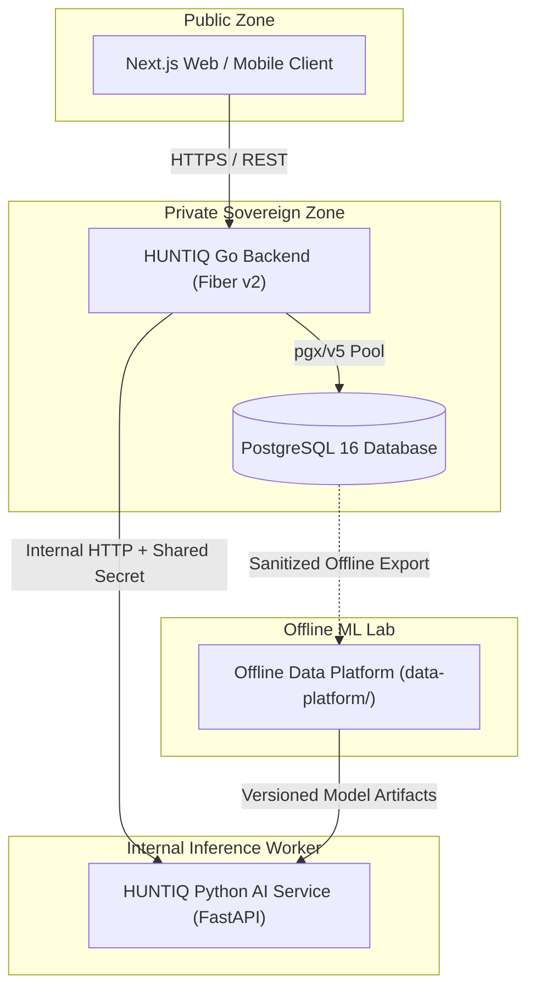
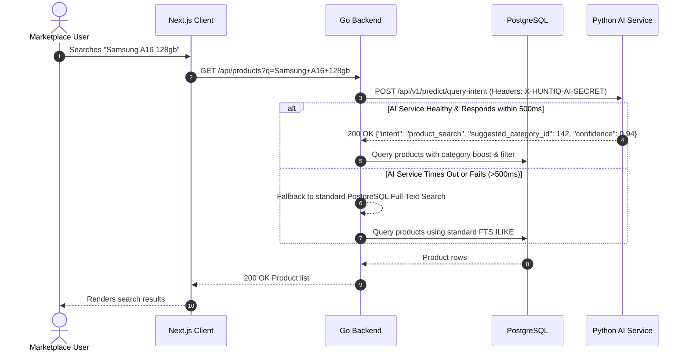

# HUNTIQ AI Platform Architecture

**Document Version:** 1.0.0  
**Status:** Canonical Foundation Design  
**Target:** Production-Minded Extensible AI Architecture  

---

## 1. System Overview

HUNTIQ's AI Platform is structured as an isolated, asynchronous subsystem designed to assist the marketplace with intelligent discovery, categorization, search intent resolution, and listing quality verification.

The architecture strictly separates **production inference** from **offline data management and training**:

---

## 2. Core Subsystems and Responsibilities

### 2.1 HUNTIQ Go Backend (`backend/`)
- **Authority:** Sovereign authority over all persistent state, identity, and business operations.
- **Responsibilities:**
  - Authenticates and authorizes all users (JWT, roles: admin, seller, buyer).
  - Handles client traffic and routes marketplace listing creations and search requests.
  - Formulates feature payloads for AI inference calls.
  - Enforces strict validation and fallbacks on all AI predictions.
  - Executes all SQL reads and writes to PostgreSQL.

### 2.2 HUNTIQ Python AI Service (`ai/`)
- **Authority:** Stateless prediction worker.
- **Responsibilities:**
  - Listens on internal loopback/private interface (e.g. `127.0.0.1:8000`).
  - Authenticates incoming requests from the Go backend via `X-HUNTIQ-AI-SECRET`.
  - Exposes operational endpoints:
    - `GET /health/live`: Liveness check (process responsive).
    - `GET /health/ready`: Readiness check (configuration loaded, models ready).
  - Future endpoints:
    - `POST /api/v1/predict/query-intent`: Query intent and category disambiguation.
    - `POST /api/v1/predict/category-suggestion`: Predicts canonical category IDs from title and description.
    - `POST /api/v1/predict/duplicate-detection`: Detects candidate duplicate listings.
  - Logs structured JSON with request correlation IDs without leaking sensitive PII.

### 2.3 Offline Data Platform (`data-platform/`)
- **Authority:** Offline dataset governance, curation, training, and model cards.
- **Responsibilities:**
  - Stores data contracts and schemas (`data-contracts/`).
  - Governs dataset versions across `raw/`, `interim/`, `processed/`, and `evaluation/`.
  - Manages training scripts, evaluation benchmarks, and model artifacts.
  - Enforces data quality, provenance, and privacy stripping (PII scrubbing).
  - Maintains Model Cards (`data-platform/ml/model_cards/`) detailing training datasets, evaluation metrics, and operational limitations.

---

## 3. Trust Boundaries & Security Architecture

### Trust Boundary Rules:
1. **No External Exposure:** The AI service port (`8000`) is never bound to public interfaces (`0.0.0.0` in production without firewall) and is inaccessible to public traffic.
2. **Mutual Secret Authentication:** Every request from Go to Python must include a cryptographically random pre-shared token in `X-HUNTIQ-AI-SECRET`. Requests lacking this header or with an invalid token receive `401 Unauthorized`.
3. **No Database Writes:** The AI service has no database write credentials. It cannot update, insert, or delete marketplace records.
4. **Input Size & Bounding:** All incoming JSON payloads to the AI service are strictly limited in size (default maximum 64KB) to eliminate memory exhaustion attacks.

---

## 4. Failure Modes and Resilience Strategy

| Failure Scenario | AI Service Behavior | Go Backend Behavior | User Impact |
| :--- | :--- | :--- | :--- |
| **AI Service Crash / Down** | Container orchestrator restarts service; readiness probe fails. | Catches connection error immediately; activates deterministic fallback. | None. Standard marketplace search/listing works seamlessly. |
| **Network Timeout (>500ms)** | Inference continues or aborts based on client disconnect. | Aborts request context via Go `context.WithTimeout`; logs warning; serves fallback. | None. Latency impact capped at 500ms max. |
| **Low Confidence Score (<0.60)** | AI returns output with `confidence: 0.42`. | Go business logic inspects threshold; discards suggestion when below 0.70 threshold. | None. User sees standard taxonomy picker or fallback search. |
| **Invalid Output Schema** | N/A (Pydantic validates before serializing). | Go unmarshaling returns error; logs schema mismatch; falls back. | None. Corrupted predictions are rejected safely. |

---

## 5. Technology Selection Rationale

- **FastAPI:** High performance, native `asyncio`, automatic OpenAPI documentation generation, and native integration with `Pydantic v2`.
- **uv:** Up to 10x-100x faster than traditional pip/pip-tools, manages Python installations cleanly, supports workspace standards (`pyproject.toml`), and creates deterministic lockfiles (`uv.lock`).
- **Pydantic v2:** Rust-backed validation engine guaranteeing sub-millisecond serialization and strict schema adherence.
- **Ruff:** Ultra-fast Python linter and formatter replacing Flake8, Black, and isort with zero configuration friction.
