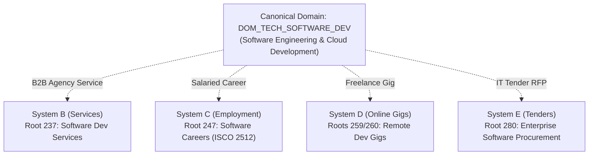

# HUNTIQ — Final Taxonomy & Classification Architecture Specification

**Project:** HUNTIQ Universal Marketplace Platform  
**Architecture Pillar:** Pillar 1 (Go Backend Sovereign Authority & PostgreSQL 16)  
**Classification Model:** Seven Independent Systems with Orthogonal Dimensions  
**Version:** 2.0.0 (Consolidated & Validated)  

---

## 1. Architectural Philosophy: The WHAT vs. The HOW

The foundational principle of the HUNTIQ Universal Marketplace Classification Framework is the strict separation between the intrinsic nature of an item or opportunity (**the WHAT**) and the operational, commercial, or physical conditions under which it is offered (**the HOW**).

```
┌─────────────────────────────────────────────────────────────────────────────┐
│                       CANONICAL TAXONOMY (The WHAT)                         │
│   Answers: What is being offered, manufactured, harvested, or published?    │
│   Examples: Teff Grain, Touchscreen Smartphone, Software Engineering, Villa │
└──────────────────────────────────────┬──────────────────────────────────────┘
                                       │
                                       ▼
┌─────────────────────────────────────────────────────────────────────────────┐
│                   ORTHOGONAL MARKETPLACE DIMENSIONS (The HOW)               │
│   Answers: Under what economic terms, condition, and arrangement is it      │
│   transacted, delivered, or performed?                                      │
├──────────────────────────────┬──────────────────────────────┬───────────────┤
│ Transaction Mode:            │ Fulfillment / Presence:      │ Condition:    │
│  - for_sale                  │  - on_site                   │  - new        │
│  - for_rent                  │  - remote (100%)             │  - open_box   │
│  - for_lease                 │  - hybrid                    │  - refurbished│
│  - job_hiring                │  - courier_delivery          │  - used_good  │
│  - gig_seeking               │  - store_pickup              │  - used_fair  │
│  - tender_bidding            │                              │               │
└──────────────────────────────┴──────────────────────────────┴───────────────┘
```

### Governing Invariant
**No marketplace dimension (transaction mode, condition, location, work arrangement, or promotion) shall ever be instantiated as a taxonomy node.**

- An apartment is classified as an *Apartment* whether it is listed *For Sale* or *For Rent*.
- A smartphone is classified as a *Smartphone* whether it is *Brand New* or *Certified Refurbished*.
- Software engineering is anchored to *Software Engineering* whether it is an *Agency B2B Contract*, a *Full-Time Salaried Career*, or a *Freelance Remote Gig*.

---

## 2. The Seven Independent Classification Systems

HUNTIQ partitions the entire marketplace landscape into seven distinct, non-overlapping classification systems:

### System A — Products & Physical Assets (147 Root Families)
Tangible merchandise, agricultural commodities, machinery, vehicles, and physical real estate assets.
- **Economic Mechanics:** Transfer of ownership, physical lease, or rental.
- **Key Dimensions:** `condition` (`new`, `refurbished`, `used`), `transaction_mode` (`for_sale`, `for_rent`, `for_lease`), `fulfillment` (`pickup`, `delivery`).
- **Core Sectors:** Agriculture, Food & FMCG, Consumer Electronics, Vehicles & Automotive Assets, Real Estate & Land, Building Materials, Home & Living, Apparel & Cultural Attire, Healthcare Supplies, Industrial Machinery, Energy & Utilities, Sports & Specialized.

### System B — Services & Professional Offerings (16 Root Families)
Contractual professional, trade, and agency services delivered by licensed practitioners or corporate entities.
- **Economic Mechanics:** Fee-for-service, hourly billing, or retainer agreements.
- **Key Dimensions:** `delivery_mode` (`on_premise`, `in_shop`, `remote`), `pricing_model` (`hourly`, `fixed_quote`, `milestone`).
- **Core Sectors:** Legal & Corporate Compliance, Accounting & Tax Advisory, Architecture & Structural Engineering, Software Development Agencies, Cybersecurity, Translation & Interpretation, Freight & Logistics, Property Management, Technical Trades.

### System C — Employment & Occupations (12 Occupational Roots)
Direct employment vacancies and careers aligned with the International Standard Classification of Occupations (ISCO-08).
- **Economic Mechanics:** Salaried employment contracts between employer and employee.
- **Key Dimensions:** `employment_type` (`permanent`, `contract`, `part_time`, `internship`), `work_arrangement` (`on_site`, `hybrid`, `remote`), `seniority` (`entry_level`, `mid_level`, `senior`, `lead`, `executive`).
- **Core Sectors:** Software & Technology Careers, Executive Management, Banking & Finance Roles, Engineering & Architecture, Healthcare & Doctors, TVET Skilled Trades, Civil Service.

### System D — Freelance, Contract & Online Opportunities (10 Gig Roots)
Independent digital tasks, milestone contracts, and freelance gigs.
- **Economic Mechanics:** Task-based deliverables, freelance milestone compensation, international remote micro-work.
- **Key Dimensions:** `contract_type` (`milestone`, `hourly_gig`, `contest`), `currency` (`ETB`, `USD`, `EUR`), `work_arrangement` (`100% remote`).
- **Core Sectors:** Remote Software Engineering, Web & Mobile Development Gigs, Data Annotation & AI Labeling, Translation Gigs, Graphic & UI/UX Design Contracts, Virtual Assistance, Content Writing.

### System E — Tenders, Procurement, Grants & Scholarships (4 Opportunity Roots)
Formal competitive procurement notices, humanitarian grant funding calls, and academic scholarships.
- **Economic Mechanics:** Sealed competitive bidding, non-repayable grant financing, academic awards.
- **Key Dimensions:** `procurement_sector`, `bid_bond_cpo`, `closing_date`, `donor_agency`.
- **Core Sectors:** Public Government Procurement (FPPA), Corporate Private RFQs, NGO Humanitarian Funding, Academic Scholarships & Fellowships.

### System F — News, Announcements & Media Content (5 Content Roots)
Official regulatory public notices, Kebele announcements, commodity price bulletins, and published literature.
- **Economic Mechanics:** Editorial publication and regulatory compliance notices.
- **Key Dimensions:** `publisher_type` (`government`, `community`, `media_house`), `embargo_date`, `verified_publisher`.
- **Core Sectors:** Official Gazettes & Legal Notices, Community Cultural Notices, Agricultural Price Bulletins, Published Books, Digital Media Streaming.

### System G — Promotions, Advertising & Campaigns (2 Frameworks)
Merchant discount campaigns, clearance sales, and visibility placement banners.
- **Economic Mechanics:** Temporary marketing price reductions applied across any underlying category.
- **Key Dimensions:** `discount_percentage`, `flash_sale_duration`, `promoted_listing_id`.
- **Core Frameworks:** Commercial Retail Discount Events, B2B Service Promotional Packages.

---

## 3. Cross-System Reusable Skill & Domain Identity

Rather than creating four separate taxonomy trees for "Software", HUNTIQ establishes **shared canonical domain codes** linking across systems:



This guarantees that searchers looking for software engineering can filter by engagement modality without polluting the catalog with duplicated categories.

---

## 4. Arbitrary-Depth PostgreSQL Hierarchy

HUNTIQ implements an arbitrary-depth tree architecture using:
1. `parent_id` (Adjacency List with `ON DELETE RESTRICT` safety).
2. `path` (Materialized Path `/1/12/7631/` with B-Tree index for $O(\log n)$ subtree queries).
3. `level` (0-indexed integer tracking exact depth).
4. `cascade_category_hierarchy_path` trigger (Guarantees recursive consistency across all descendant paths when any node moves).

No hardcoded level constraints exist. The database natively supports 1 to 20 levels of nesting without schema modification.

---

## 5. Multilingual Localization Architecture

English is the canonical source language. Translations and aliases are normalized across English, Amharic, Afaan Oromoo, and Tigrinya:
- Canonical names: stored in `name_en`, `name_am`, `name_om`, `name_ti`.
- Search aliases: stored in `category_aliases (category_id, alias, language)`.
- Disambiguation: compound terms and leaf-level scoping prevent alias collision.
- Future language expansion: normalized tables enable adding 14+ additional Ethiopian languages without schema redesign.
