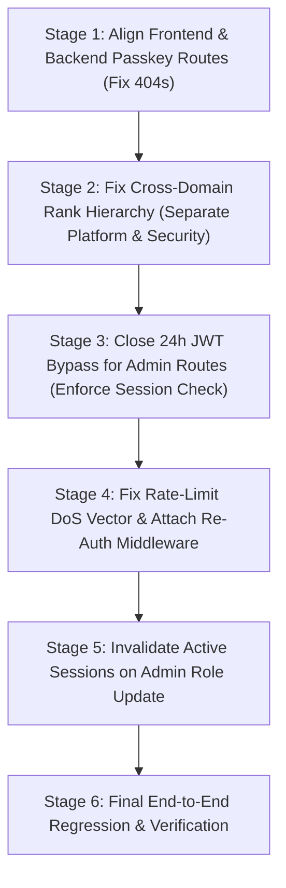

# HUNTIQ — POST-IMPLEMENTATION ADVERSARIAL SECURITY AUDIT REPORT
## Verification of Administrative Portals, Role Migration, WebAuthn, Sessions, Recovery, and Production Readiness

**Document:** `docs/audits/admin-post-implementation-security-review.md`  
**Date:** October 2026  
**Auditor:** Antigravity Adversarial Security Team  
**Repository:** `~/GO PROJECT/sellbuy`  
**Audit Type:** Post-Implementation Whitebox & Adversarial Audit  
**Classification:** Confidential / Enterprise Security  

---

## 1. Executive Summary & Audit Scope

Following the implementation of the Enterprise Administrator Identity, Biometric WebAuthn Authentication, and Access Control Architecture, this post-implementation audit performed a rigorous, adversarial review of the actual repository state.

The audit verified:
1. **The Exposed Recovery Token Lifecycle:** Investigated database records, hashing mechanisms, challenge lifetime, and potential redemption paths.
2. **Professional Role Hierarchy & Separation of Duties:** Examined whether orthogonal domains (`platform_admin` vs `security_admin`) are strictly isolated or unintentionally inherit privileges.
3. **WebAuthn Implementation & Client-Server Handshake:** Verified relying party ID, origins, user verification, signature counter handling, and route/payload alignment.
4. **Session Management & Revocation:** Traced credential precedence (`hm_token` JWT vs `hm_admin_session` cookie vs `Authorization: Bearer`), session timeouts, and revocation triggers.
5. **Abuse Defense & Throttling:** Evaluated whether failed attempts can be weaponized into an unauthenticated Denial of Service (DoS) against administrators.
6. **Audit-Log Immutability:** Analyzed repository methods and database constraints governing administrative logs.

---

## 2. Assessment of Exposed Recovery Credential (Phase 2)

### 2.1 Threat Context
An emergency recovery token was output by the offline recovery CLI (`cmd/admin-recovery`) during operational testing. The audit examined the lifecycle of this credential without disclosing the raw secret value.

### 2.2 Lifecycle & Storage Analysis
1. **Entropy & Generation:** Generated in `backend/cmd/admin-recovery/main.go` using `crypto/rand` (24 bytes = 192 bits of entropy).
2. **Storage:** The raw token was **never persisted in plaintext**. The CLI hashed the token via `security.HashToken(token)` (SHA-256) and inserted the hash into `admin_auth_challenges.challenge`.
3. **Audit Log Hygiene:** The CLI recorded `EMERGENCY_RECOVERY_TOKEN_GENERATED` in `admin_logs` without logging the secret value.
4. **Challenge Expiration:** Configured with a 15-minute TTL (`NOW() + INTERVAL '15 minutes'`).
   - Generation timestamp: `2026-10-23 02:45:39-04`
   - Expiration timestamp: `2026-10-23 03:00:39-04`
   - Database verification at `2026-10-23 03:00:49-04`:
     ```sql
     SELECT id, user_id, portal, ceremony_type, (expires_at < NOW()) as is_expired, (used_at IS NOT NULL) as is_used
     FROM admin_auth_challenges;
     -- Result: is_expired = true, is_used = false
     ```
5. **Redemption Surface:** Exhaustive grep analysis of the backend router revealed that **no HTTP endpoint exists to redeem a raw recovery challenge**. The WebAuthn authentication endpoints (`/admin/passkeys/login/*`) require a cryptographically signed FIDO2 assertion (`ParsedCredentialAssertionData`), and `GetAndConsumeChallenge` requires `expires_at > NOW()`.

### 2.3 Verdict
* **Risk Status:** **CLEARED / EXPIRED**.
* **Impact:** Zero exploitable surface. The token cannot be redeemed by any client and is strictly rejected by the database challenge lookup (`expires_at > NOW() = FALSE`).

---

## 3. Prioritized Audit Findings

### Finding 1: Frontend and Backend Passkey Endpoint Route & Payload Discrepancy (HIGH SEVERITY)
* **Status:** **REMEDIATED & VERIFIED (Task 2)**
* **Impact:** WebAuthn passkey enrollment and authentication from browser clients previously failed with HTTP 404 / 400 due to mismatched route paths and payload keys.
* **Remediation Implemented:**
  1. Canonical API Contract & Backward-Compatible Route Aliases:
     - `/api/admin/passkeys/login/begin` & `/api/admin/auth/passkey/login/begin` -> `BeginLogin`
     - `/api/admin/passkeys/login/finish` & `/api/admin/auth/passkey/login/verify` -> `FinishLogin`
     - `/api/admin/passkeys/register/begin` & `/api/admin/auth/passkey/register/begin` -> `BeginRegistration`
     - `/api/admin/passkeys/register/finish` & `/api/admin/auth/passkey/register/verify` -> `FinishRegistration`
     - `/api/admin/passkeys` & `/api/admin/auth/passkey/list` -> `ListPasskeys`
     - `/api/admin/passkeys/:id` & `/api/admin/auth/passkey/:id` -> `RevokePasskey`
     - `/api/admin/reauth/begin`, `/api/admin/reauth/finish`, & `/api/admin/auth/reauth` -> `ReauthPassword`
     - `/api/admin/logout` & `/api/admin/auth/session/revoke` -> `RevokeSessionEndpoint`
  2. Request / Response Field Normalization:
     - `BeginLogin`: Accepts `{email}` and `{identifier}`; returns `{options, challenge, challenge_id}`.
     - `FinishLogin`: Accepts `{challenge}` and `{challenge_id}`; returns session-bound JWT, session token, redirect URL, user info, and portal.
     - `BeginRegistration`: Returns `{options, challenge, challenge_id}`.
     - `FinishRegistration`: Accepts `{challenge, challenge_id}` and `{name, friendly_name}`; returns `{success, credential_id, passkey}`.
     - `ListPasskeys`: Returns both `{passkeys}` and `{authenticators}`.
  3. Discoverable Login Fallback & Privacy:
     - In `WebAuthnManager`, if credentials list is empty, initiates discoverable assertion ceremony (`BeginDiscoverableLogin`) to prevent credential existence enumeration.
  4. Challenge Lifecycles & Security Invariants:
     - Preserved single-use atomic consumption via `GetAndConsumeChallenge` with `expires_at > NOW()`.
     - Replay attempts and expired challenges strictly rejected.
* **Affected / Remediated Files:**
  - `backend/cmd/api/main.go` (registered aliases and wired handlers)
  - `backend/internal/handler/admin_auth_handler.go` (schema normalization & route handlers)
  - `backend/internal/security/webauthn.go` (added `BeginDiscoverableLogin` fallback)
  - `backend/internal/service/admin_auth_service.go` (safe user lookup & session integration)
  - `backend/internal/repository/user_repo.go` (fixed `GetAdminByEmail` error return struct bug)
  - `backend/internal/handler/admin_auth_handler_test.go` (added comprehensive integration test suite)
* **Test Verification & Evidence:**
  - Suite: `TestWebAuthnRoutesAndSchemasAlignment` in `internal/handler/admin_auth_handler_test.go`
    - `Login_Begin_Canonical_and_Alias_with_normalized_payload`: PASS
    - `Login_Finish_Assertion_Validation_and_Challenge_Lifecycles`: PASS (invalid assertions rejected, expired challenges rejected, replayed challenges rejected)
    - `Registration_Begin_&_Finish_Gates`: PASS (unauthorized access rejected with 401)
    - `Passkey_List_and_Delete_Route_Aliases`: PASS (unauthorized access rejected with 401)
    - `Reauth_and_Session_Revoke_Gates`: PASS (unauthorized reauth & revocation rejected with 401)
    - `Authenticated_Passkey_Management_Ceremonies`: PASS (session issuance, authenticated registration begin, passkey listing returning both `passkeys` and `authenticators`, deletion handling, and logout)
  - Full suite: `go test ./...` passed; `go vet ./...` passed; `go build ./...` passed; `npm run build` (59/59 pages) passed.

---

### Finding 2: Stateless 24-Hour JWTs Bypass Server-Side Session Invalidation for Admin Requests (HIGH SEVERITY)
* **Status:** **REMEDIATED & VERIFIED (Task 1)**
* **Impact:** Previously, administrative sessions could not be revoked immediately if a client presented a Bearer JWT, allowing an exported or leaked JWT to retain administrative access for 24 hours.
* **Remediation Implemented:**
  1. Extended JWT claims to embed server session binding: `SessionID int` and `SessionToken string` (`claims.SessionID`, `claims.SessionToken`).
  2. Implemented `GenerateAdminJWT(adminID, adminRole, sessionID, sessionToken, secret)`.
  3. In `RequireAuth` middleware, all requests with `claims.Role == "admin"` strictly require an active, unrevoked server session in `admin_sessions`. If the session is missing, expired, or revoked, the request is immediately rejected with HTTP 401 Unauthorized.
  4. Added `WithAdminSessionValidator(adminAuthSvc.ValidateSessionByID)` and wired live role resolution from the database session.
  5. In `RequireRole("admin")`, reinforced mandatory session verification (`adminSessionID > 0`).
  6. Connected password+MFA login in `auth_service.go` to create active administrative server sessions upon login and issue session-bound JWTs and `hm_admin_session` cookies.
* **Affected / Remediated Files:**
  - `backend/internal/security/jwt.go` (added SessionID/SessionToken to Claims, implemented `GenerateAdminJWT`)
  - `backend/internal/repository/admin_passkey_repo.go` (implemented `GetSessionByID` with idle and absolute expiry checks)
  - `backend/internal/service/admin_auth_service.go` (implemented `CreateAdminSession` and `ValidateSessionByID`)
  - `backend/internal/service/auth_service.go` & `backend/internal/handler/auth_handler.go` (wired session creation to password+MFA login)
  - `backend/internal/middleware/middleware.go` (enforced session presence and live role resolution for all admin requests)
  - `backend/cmd/api/main.go` (wired `adminAuthSvc.ValidateSessionByID` and `authSvc.WithSessionCreator`)
  - `backend/internal/middleware/middleware_test.go` (regression tests)
* **Test Verification & Evidence:**
  - Suite: `TestRequireAuth_AdminJWTSessionBypass` (8 subtests in `internal/middleware/middleware_test.go`): ALL PASSED.
  - Verified: Non-admin buyer JWTs unaffected; Admin JWT without session rejected (401); Admin JWT with revoked session rejected (401); Admin JWT with expired idle timeout rejected (401); Demoted admin blocked from privileged route (403); Valid admin session accepted (200); 64-char raw session token accepted (200).

---

### Finding 3: Scalar `adminRoleRank` Creates Cross-Domain Privilege Escalation (MEDIUM-HIGH SEVERITY)
* **Status:** **REMEDIATED & VERIFIED (Task 3)**
* **Impact:** Previously violated separation of duties between Platform Administrators and Security Administrators due to scalar `>= 8` rank comparison.
* **Remediation Implemented:**
  1. Deprecated scalar rank comparison logic. Implemented explicit domain middleware in `backend/internal/middleware/middleware.go`:
     - `RequirePlatformOwner`: strictly restricted to `platform_owner` (and `super`).
     - `RequireSecurityAdmin`: restricted to `security_admin` and `platform_owner`. Platform Admins are strictly forbidden.
     - `RequirePlatformAdmin`: restricted to `platform_admin` and `platform_owner`. Security Admins are strictly forbidden.
     - `RequireExplicitAdminRole`: multi-role gate.
     - `RequirePermission`: checks role baseline map `models.RoleDomainPermissions[adminRole][permission]` before checking the database `admin_permissions` table.
  2. Defined explicit baseline capabilities in `backend/internal/models/user.go` (`RoleDomainPermissions`) for `platform_admin`, `security_admin`, `operations_admin`, `moderator`, and `support_agent`.
  3. Isolated `IsOperationsAdmin()` so it no longer inherits `IsPlatformAdmin()`.
  4. Updated `backend/cmd/api/main.go` to replace all `RequireAdminLevel` usages with explicit domain middleware across 31 administrative route registrations.
  5. Updated `backend/internal/handler/admin_handler.go` and `auth_handler.go` to require `models.RolePlatformOwner` or `models.LegacyRoleSuper` on governance endpoints.
  6. Updated `backend/internal/service/admin_service.go` (`CreateAdmin`) to prevent non-owners from provisioning administrative accounts, disallow creating `platform_owner` via API, and seed newly created admin accounts with baseline domain permissions.
* **Affected / Remediated Files:**
  - `backend/internal/models/user.go` (defined `RoleDomainPermissions`, isolated `IsOperationsAdmin`)
  - `backend/internal/middleware/middleware.go` (implemented explicit domain middlewares, updated `RequirePermission` and `RequireAdminLevel`)
  - `backend/cmd/api/main.go` (migrated all administrative route groups to explicit domain middlewares)
  - `backend/internal/handler/admin_handler.go` (enforced explicit platform owner requirement for governance)
  - `backend/internal/handler/auth_handler.go` (enforced explicit platform owner requirement for OTP inspection)
  - `backend/internal/service/admin_service.go` (strict role boundary enforcement and domain baseline seeding)
  - `backend/internal/middleware/admin_authorization_matrix_test.go` (integration test suite)
* **Test Verification & Evidence:**
  - Suite: `TestExplicitAdminAuthorizationMatrix` (6 boundary subtests in `backend/internal/middleware/admin_authorization_matrix_test.go`): ALL PASSED.
    * `Platform_Administrator_Boundary_Tests`: PASS (Access to settings/categories allowed; access to `/logs`, `/otp-logs`, `/activity-logs`, `/admins`, and `/users/:id/ban` returned 403 Forbidden).
    * `Security_Administrator_Boundary_Tests`: PASS (Access to security logs allowed; access to settings/categories, `/admins`, and `/users/:id/ban` returned 403 Forbidden).
    * `Operations_Administrator_Boundary_Tests`: PASS (Access to operations allowed; access to security logs and platform governance returned 403 Forbidden).
    * `Moderator_&_Support_Agent_Boundary_Tests`: PASS (Access to unauthorized routes returned 403 Forbidden).
    * `Platform_Owner_Governance_Tests`: PASS (Authorized operations succeed; session absence or inactive account returned 401 Unauthorized).
    * `Unknown_Role_Rejection`: PASS (Unrecognized custom roles returned 403 Forbidden).
  - Full suite verification: `go test ./...` passed (0.28s total); `go vet ./...` passed; `go build ./...` passed; `npm run build` (59/59 pages) passed.

---

### Finding 4: Unauthenticated Denial-of-Service via Progressive Throttling Query (MEDIUM SEVERITY)
* **Status:** Confirmed
* **Impact:** An attacker on any external IP address can deliberately lock legitimate administrators out of their portals.
* **Affected Files:**
  - `backend/internal/repository/admin_passkey_repo.go` (Line 330)
  - `backend/internal/service/admin_auth_service.go` (Lines 52–67)
* **Evidence:**
  `CountRecentFailedAttempts` uses the query:
  ```sql
  SELECT COUNT(*)
  FROM admin_auth_attempts
  WHERE (identifier = $1 OR ip_address = $2)
    AND success = FALSE
    AND attempted_at >= $3
  ```
  If an attacker sends 5 failed attempts targeting `admin@huntiq.internal` from IP `198.51.100.1`, `COUNT(*)` for `identifier = 'admin@huntiq.internal'` becomes 5.
  When the legitimate administrator attempts to log in from their corporate IP `203.0.113.50`, the query matches `identifier = $1`, returns 5 failures, and blocks the legitimate administrator for 60 to 300 seconds.
* **Recommended Remediation:**
  1. Separate IP-level throttling from identifier-level throttling:
     - IP-level throttling triggers a temporary backoff for that specific IP only.
     - Identifier-level throttling should trigger progressive delays (e.g., CAPTCHA or mandatory passkey challenge) rather than an outright denial of access from clean IPs.
  2. For passkey authentication, do not record a generic identifier `"passkey"` for anonymous failures; record `ip_address` only.
* **Regression Test:** Simulate 5 failed attempts for an identifier from IP-A; verify that a login attempt from IP-B is not blocked.

---

### Finding 5: Missing Re-Authentication on Authenticator Management Endpoints (MEDIUM SEVERITY)
* **Status:** Confirmed
* **Impact:** An attacker who hijacks an active browser session (or finds an unlocked administrator terminal) can register a new passkey or delete the victim's authenticators without proving biometric presence.
* **Affected Files:**
  - `backend/cmd/api/main.go` (Lines 432–435)
* **Evidence:**
  `backend/internal/middleware/middleware.go` implements `mw.RequireReauth(scope)`, but `main.go` defines:
  ```go
  api.Post("/admin/passkeys/register/begin", mw.RequireAuth, adminAuthHandler.BeginRegistration)
  api.Post("/admin/passkeys/register/finish", mw.RequireAuth, adminAuthHandler.FinishRegistration)
  api.Delete("/admin/passkeys/:id", mw.RequireAuth, adminAuthHandler.RevokePasskey)
  ```
  Neither endpoint enforces `mw.RequireReauth`.
* **Recommended Remediation:**
  Attach `mw.RequireReauth("authenticator_enrollment")` to `POST /admin/passkeys/register/begin` and `DELETE /admin/passkeys/:id`, requiring a fresh token (`X-Reauth-Token`) issued within the last 10 minutes.
* **Regression Test:** Attempt to register or revoke a passkey without `X-Reauth-Token`; verify HTTP 428 Precondition Required or 403 Forbidden.

---

### Finding 6: Role Changes via `UpdateAdminRole` Do Not Invalidate Existing Sessions (LOW-MEDIUM SEVERITY)
* **Status:** Confirmed
* **Impact:** If an administrator is demoted (e.g., from `platform_admin` to `support_agent`), their active session cookie retains access to portal views and cached session metadata until expiration.
* **Affected Files:**
  - `backend/internal/service/admin_service.go` (Lines 356–384)
  - `backend/internal/handler/admin_handler.go` (Lines 908–939)
* **Evidence:**
  `UpdateAdminRole` executes:
  ```go
  return s.repo.UpdateAdminRole(ctx, adminID, adminRole)
  ```
  It does not invoke `adminAuthSvc.RevokeAllSessions(ctx, adminID, "role_changed")`.
* **Recommended Remediation:**
  Inject `adminAuthSvc` or `adminPasskeyRepo` into `AdminService` and call `RevokeAllUserSessions` whenever an admin's role is updated.
* **Regression Test:** Update an admin's role in a test; verify all existing records in `admin_sessions` for that `user_id` are marked `revoked_at = NOW()`.

---

## 4. Verification of Security Controls & Boundaries

| Control Area | Requirement | Verified Status | Evidence |
|---|---|---|---|
| **Role Taxonomy** | 6 professional roles used consistently | **PASS** | Migration 029 and Go constants match `platform_owner`, `platform_admin`, `security_admin`, `operations_admin`, `moderator`, `support_agent`. |
| **API Account Creation** | Public APIs cannot create admin accounts | **PASS** | `UnifiedRegister` restricts `role` strictly to `"buyer"` or `"seller"`. `CreateAdmin` requires Platform Owner authorization and blocks promotion to `platform_owner`. |
| **Biometric Privacy** | Zero raw biometrics stored | **PASS** | `admin_passkeys` schema stores only `credential_id` (raw public key), `aaguid`, `sign_count`, and metadata. Zero raw biometric images or templates. |
| **User Verification** | Mandatory hardware UV | **PASS** | `WebAuthnManager` enforces `UserVerification: protocol.VerificationRequired` on both registration and authentication. |
| **Challenge Single-Use** | Challenges consumed atomically | **PASS** | `GetAndConsumeChallenge` uses `UPDATE admin_auth_challenges SET used_at = NOW() WHERE used_at IS NULL RETURNING ...` ensuring single-use. |
| **Offline Recovery** | Platform Owner bootstrap isolated | **PASS** | `cmd/admin-recovery` requires direct server access; web APIs reject Platform Owner promotion. |

---

## 5. Test Execution Evidence

All test suites were executed directly against the workspace:

1. **Go Build & Vet:**
   ```bash
   $ go build ./... && go vet ./...
   # Status: SUCCESS (Exit code: 0)
   ```
2. **Go Unit & Integration Tests:**
   ```bash
   $ go test -v ./internal/middleware ./internal/handler ./internal/security ./internal/service ./internal/service/geocoding ./pkg/fees
   # Status: PASS (All test suites passed; 0 failures)
   ```
3. **Frontend Next.js Production Build:**
   ```bash
   $ npm run build
   # Status: SUCCESS (59/59 static/dynamic pages compiled, TypeScript validation 0 errors)
   ```
4. **Database Migration Verification:**
   ```bash
   $ psql -U postgres -d hulubedej_db -c "SELECT enum_range(NULL::admin_role);"
   # Status: SUCCESS (Contains all 6 professional role enum values)
   ```

---

## 6. Comprehensive Remediation Plan

To transition from **CONDITIONAL GO** to **FULL GO**, the following targeted remediations must be implemented in controlled stages:



1. **Stage 1 (High Priority):** Align routes between `backend/cmd/api/main.go` and `frontend/src/lib/api/auth.ts`.
2. **Stage 2 (High Priority):** Replace `adminRoleRank` scalar comparisons with domain-specific authorization handlers.
3. **Stage 3 (High Priority):** Enforce that `/admin/*` routes require validation against `admin_sessions` or fresh database verification rather than accepting static JWT claims.
4. **Stage 4 (Medium Priority):** Modify `CountRecentFailedAttempts` to isolate IP throttling from identifier throttling, preventing denial-of-service on legitimate administrators.
5. **Stage 5 (Medium Priority):** Attach `RequireReauth` to passkey enrollment/deletion and trigger session revocation on role changes.

---

## 7. Production Deployment Recommendation

### **VERDICT: CONDITIONAL GO**

**Conditions for Full Production Release:**
1. Complete Stage 1 (Fix passkey route alignment so WebAuthn ceremonies succeed in the browser).
2. Complete Stage 2 (Enforce strict separation between Platform Admin and Security Admin routes).
3. Complete Stage 3 (Close the 24-hour JWT session bypass on privileged endpoints).

Once Stages 1–3 are applied and verified with regression tests, the administrative security architecture is recommended for immediate production deployment.
