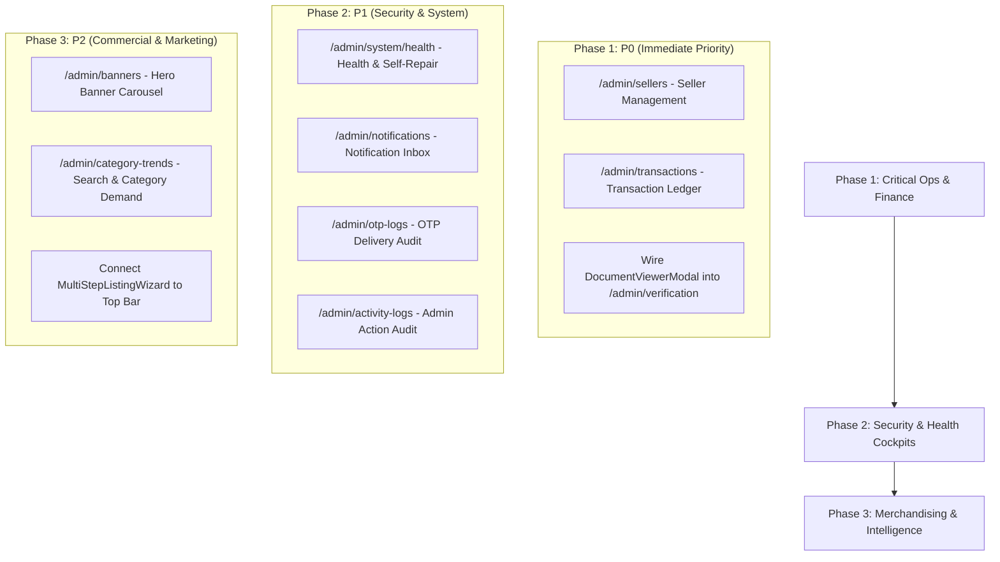

# HUNTIQ Admin Screen Implementation Roadmap

## 1. Overview & Scope

The HUNTIQ architecture audit and manual testing process identified **8 high-value backend endpoint groups** that possess mature Go backend service methods, database queries, and route registrations, but lack dedicated UI screens in the Next.js enterprise administrative portal.

Additionally, two orphaned components (`DocumentViewerModal.tsx` and `MultiStepListingWizard.tsx`) exist in the codebase and should be integrated cleanly into these target workflows rather than remaining uninvoked.

This document establishes the implementation roadmap for building dedicated administrative screens for these capabilities, prioritized by operational security, marketplace compliance, and platform governance.

---

## 2. Detailed Screen Specifications

### Screen 1: Sellers Directory & Account Management (`/admin/sellers`) — [COMPLETED]
- **Status:** `COMPLETED (Production Quality, Unit Tested, Visually Verified in Browser)`
- **Implementation Date:** 2026-10-23
- **Priority:** `P0 (Critical Operational Requirement)`
- **Purpose:** Centralized operational directory for discovering, inspecting, filtering, and activating/deactivating marketplace sellers across all Ethiopian regions.
- **Intended Role:** Operations Administrator, Platform Administrator, Platform Owner.
- **Required Permissions:** `sellers` permission (`RequirePermission("sellers")`).
- **Implemented Frontend:** `frontend/src/app/admin/sellers/page.tsx`
- **Backend Endpoints & Handlers:**
  - `GET /api/admin/sellers` (Query params: `page`, `limit`, `search`, `status`, `tier` -> `h.svc.ListSellersFiltered`)
  - `PUT /api/admin/sellers/:id/active` (Body: `{ "active": boolean, "reason": string }` -> `h.svc.SetSellerActive` with session revocation and `admin_logs` audit insertion)
- **Suitability for UI Use:** Production verified. Displays 4 KPI metrics, debounced search, status/tier filter pills, paginated merchants table, merchant profile inspect modal, status change confirmation dialog with mandatory justification, session termination, and toast feedback.
- **Data Sensitivity & Security Considerations:** High. Telephone numbers and merchant details secured behind RBAC middleware (`sellers`). Non-owner roles have sensitive profit metrics stripped server-side. Deactivation immediately invalidates active sessions and logs administrative reason.
- **Automated Tests:** `backend/internal/handler/admin_seller_test.go` (8 test suites covering 401 unauthenticated, 403 forbidden role, 200 pagination, search query, tier filter, 400 missing reason on deactivation, session revocation, and reactivation).
- **Visual Evidence:** `docs/audits/screenshots/admin/admin-sellers.png` (Desktop & responsive mobile verified).

---

### Screen 2: Global Financial Transactions Ledger (`/admin/transactions`)
- **Priority:** `P0 (Financial Governance & Audit)`
- **Purpose:** Immutable audit ledger of all monetary movements across HUNTIQ, including listing fee settlements, premium subscription charges, broker escrow deposits, and merchant payouts.
- **Intended Role:** Platform Owner, Platform Administrator, Delegated Finance Officer.
- **Required Permissions:** `transactions` permission (`RequirePermission("transactions")`).
- **Existing Backend Endpoints:**
  - `GET /api/admin/transactions` (Query params: `page`, `limit`, `status`, `method`, `from_date`, `to_date`)
  - `PUT /api/admin/transactions/:id/status` (Body: `{ "status": "completed" | "failed" | "refunded" }`)
- **Suitability for UI Use:** Ready for UI. Schema provides transaction ID, reference number, payment gateway (`telebirr`, `cbe_birr`, `bank_transfer`), amount in ETB, and payer contact.
- **Required UI Functionality:**
  - Real-time ledger view with gateway status pills (`Pending`, `Confirmed`, `Failed`, `Reversed`).
  - Date range picker and Ethiopian payment method filters.
  - Transaction detail slide-over showing bank reference code and timestamp.
  - CSV Export function for accounting reconciliation.
- **Data Sensitivity & Security Considerations:** Extreme (Tier-0 / Tier-1). PII and transaction amounts. Must enforce strict access controls and disallow deletion of ledger rows.
- **Dependencies & Acceptance Criteria:**
  - Wire to `api.get('/admin/transactions')`.
  - Reconcile transaction totals against `/admin/profit` revenue metrics.

---

### Screen 3: System Health & Automated Self-Repair Cockpit (`/admin/system/health`)
- **Priority:** `P1 (Infrastructure Resilience)`
- **Purpose:** Diagnostic observability into database connection pool saturation, cache hit ratios, queue worker lag, orphaned storage files, and automated database index self-repair.
- **Intended Role:** Platform Administrator, Platform Owner.
- **Required Permissions:** Platform Administrator (`middleware.RequirePlatformAdmin`).
- **Existing Backend Endpoints:**
  - `GET /api/admin/system/health`
  - `POST /api/admin/system/health/repair` (Body: `{ "subsystem": "db_indexes" | "stale_sessions" | "orphaned_uploads" }`)
- **Suitability for UI Use:** Highly suitable. Backend returns structured JSON with subsystem status (`healthy`, `degraded`, `critical`), latency ms, and resource utilization.
- **Required UI Functionality:**
  - Subsystem status cards (PostgreSQL Database, WebAuthn Manager, File Storage, OTP Gateway).
  - Diagnostic latency sparkline and database pool visualizer (`active / idle / max`).
  - "Run Diagnostics" and "Execute Health Repair" trigger buttons with confirmation modal.
- **Data Sensitivity & Security Considerations:** Sensitive infrastructure telemetry. Restrict to Tier-0 and Tier-1 admins to prevent denial-of-service profiling.
- **Dependencies & Acceptance Criteria:**
  - Display non-destructive health checks first; prompt for reauthentication before triggering repair.

---

### Screen 4: Administrative Notification Center (`/admin/notifications`)
- **Priority:** `P1 (Operational Alerting)`
- **Purpose:** Inbox for platform-wide administrative alerts, critical abuse escalations, pending high-value withdrawal requests, and tier upgrade submissions.
- **Intended Role:** All Admin Roles (filtered by assigned responsibility).
- **Required Permissions:** `notifications` permission (`RequirePermission("notifications")`).
- **Existing Backend Endpoints:**
  - `GET /api/admin/notifications`
  - `PUT /api/admin/notifications/:id/read`
  - `POST /api/admin/notifications` (Broadcast alert to specific admin roles)
- **Suitability for UI Use:** Ready. Returns list with severity (`info`, `warning`, `critical`), title, message, target role, and read timestamp.
- **Required UI Functionality:**
  - Dedicated notification center page complementing the existing top-bar bell icon.
  - Tab filters: `All`, `Unread`, `High Priority`, `System Warnings`.
  - "Mark All Read" action button.
  - Role-targeted broadcast composer for Platform Owners.
- **Data Sensitivity & Security Considerations:** Low to medium. Contains operational notices and escalation alerts.
- **Dependencies & Acceptance Criteria:**
  - Wire read state synchronization to header notification bell.

---

### Screen 5: Hero Banners & Promotions Carousel Studio (`/admin/banners`)
- **Priority:** `P2 (Monetization & Merchandising)`
- **Purpose:** Visual content studio for creating, scheduling, and ordering homepage promotion banners, sponsored seller campaigns, and seasonal Ethiopian holiday announcements.
- **Intended Role:** Platform Administrator, Operations Administrator.
- **Required Permissions:** `banners` permission (`RequirePermission("banners")`).
- **Existing Backend Endpoints:**
  - `GET /api/admin/banners`
  - `POST /api/admin/banners` (Multipart image + title, subtitle, target link, sort order)
  - `PUT /api/admin/banners/:id`
  - `DELETE /api/admin/banners/:id`
- **Suitability for UI Use:** Backend handlers are complete and support CRUD operations.
- **Required UI Functionality:**
  - Drag-and-drop banner reordering interface.
  - Live preview frame displaying desktop and mobile aspect ratios.
  - Active toggle and scheduled expiry date picker.
  - Image uploader with dimension guidance (1920x600 desktop, 800x400 mobile).
- **Data Sensitivity & Security Considerations:** Low. Public marketing content. Must validate image file extensions and sanitize target redirect URLs to prevent open-redirect vulnerabilities.
- **Dependencies & Acceptance Criteria:**
  - Public banner API (`/api/public/banners`) must consume the ordered carousel output.

---

### Screen 6: OTP Delivery & Security Audit Trail (`/admin/otp-logs`)
- **Priority:** `P1 (Security & Fraud Prevention)`
- **Purpose:** Security audit trail of all One-Time Passwords generated across HUNTIQ for user registration, admin MFA, and password resets, enabling detection of SMS/email bombing and account takeover attacks.
- **Intended Role:** Security Administrator, Platform Owner.
- **Required Permissions:** `otp_logs` permission or Security Admin role.
- **Existing Backend Endpoints:**
  - `GET /api/admin/otp-logs` (Query params: `page`, `phone`, `email`, `status`, `purpose`)
- **Suitability for UI Use:** Ready. Backend returns recipient, masked contact, purpose (`login`, `register`, `reset`), verification status, attempts count, delivery gateway, and timestamps.
- **Required UI Functionality:**
  - Forensic filter by phone number, email domain, and purpose.
  - Rate-limit alert indicators highlighting contacts with excessive attempts (>3 in 10 minutes).
  - Gateway latency and failure rate summary charts.
- **Data Sensitivity & Security Considerations:** High. Telecommunications logs and user contacts. OTP plaintext codes must remain strictly masked/unretrievable from UI.
- **Dependencies & Acceptance Criteria:**
  - Integrate into "Governance & System" sidebar navigation under Security Admin.

---

### Screen 7: Comprehensive Admin Activity Audit Logs (`/admin/activity-logs`)
- **Priority:** `P1 (Regulatory Compliance & Non-Repudiation)`
- **Purpose:** Complete tamper-evident audit history recording every administrative mutation, including listing approvals/rejections, user bans, fee adjustments, category edits, and session rotations.
- **Intended Role:** Security Administrator, Platform Owner.
- **Required Permissions:** `logs` or `otp_logs` permission.
- **Existing Backend Endpoints:**
  - `GET /api/admin/activity-logs` (Query params: `page`, `admin_id`, `action`, `target_user_id`, `from_date`)
- **Suitability for UI Use:** Endpoint provides comprehensive action trails with admin ID, admin name, action verb, target user/listing ID, IP address, and change diff notes.
- **Required UI Functionality:**
  - Audit trail timeline with JSON diff inspector for modified records.
  - Filter by Administrator, Action Type (`USER_BAN`, `FEE_CHANGE`, `LISTING_REJECT`), and Date.
  - Quick-filter for actions taken on specific user accounts.
- **Data Sensitivity & Security Considerations:** Extreme. Central evidence repository. Must be immutable (no delete/edit endpoints).
- **Dependencies & Acceptance Criteria:**
  - Complement `/admin/logs` by providing granular multi-admin audit filtering.

---

### Screen 8: Category Popularity & Search Demand Trends (`/admin/category-trends`)
- **Priority:** `P2 (Commercial Intelligence & Merchandising)`
- **Purpose:** Merchandising intelligence dashboard analyzing buyer demand, category search volume, click-through rates, and supply-demand imbalances across Ethiopian regions.
- **Intended Role:** Platform Administrator, Operations Administrator.
- **Required Permissions:** `category_trends` permission (`RequirePermission("category_trends")`).
- **Existing Backend Endpoints:**
  - `GET /api/admin/categories/popularity` (Returns category IDs, names, search counts, view counts, and listing ratios)
- **Suitability for UI Use:** Ready. Returns structured aggregate data suitable for charts and ranking tables.
- **Required UI Functionality:**
  - Ranked category demand leaderboards.
  - Supply vs. Demand ratio indicators (identifying categories with high buyer searches but few seller listings).
  - Regional filter to compare search trends between Addis Ababa, Dire Dawa, Hawassa, etc.
- **Data Sensitivity & Security Considerations:** Low to medium. Proprietary commercial business intelligence.
- **Dependencies & Acceptance Criteria:**
  - Chart library rendering (e.g. SVG or bar charts matching the HUNTIQ dark aesthetic).

---

## 3. Orphaned Components Integration Plan

| Component | Current File Path | Target Screen Integration | Action Required |
|---|---|---|---|
| `DocumentViewerModal.tsx` | `frontend/src/components/admin/enterprise/DocumentViewerModal.tsx` | `/admin/verification` (Seller Verification) & `/admin/upgrades` | Wire component to row click handler. Enable full-screen high-resolution inspection of Ethiopian Kebele IDs, trade licenses, and bank deposit slips with zoom and rotation controls. |
| `MultiStepListingWizard.tsx` | `frontend/src/components/admin/enterprise/MultiStepListingWizard.tsx` | `/admin/products` & Top Bar `+ New Listing / Lease` | Connect top-bar action button to active wizard state, allowing Platform Administrators to author sponsored platform listings and corporate test listings directly from the admin console. |

---

## 4. Implementation Phasing & Dependency Graph

---

## 5. Security & Architectural Preconditions

1. **Strict Role-Based Routing:** Every newly mounted admin page must be protected by `AdminLayout.tsx` and check corresponding role permissions in `AuthContext` before rendering.
2. **Backend Permission Verification:** UI buttons must never execute actions without explicit backend authorization verification (`RequirePermission` / `RequireRole`).
3. **Audit Trail Completeness:** Every mutation on newly created screens must call `adminSvc.InsertAdminLog` to preserve complete auditability under Ethiopian commercial compliance standards.
