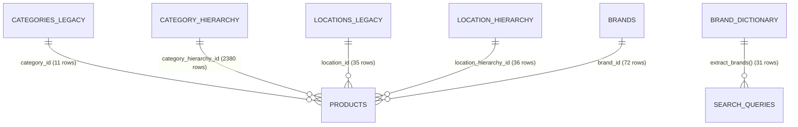
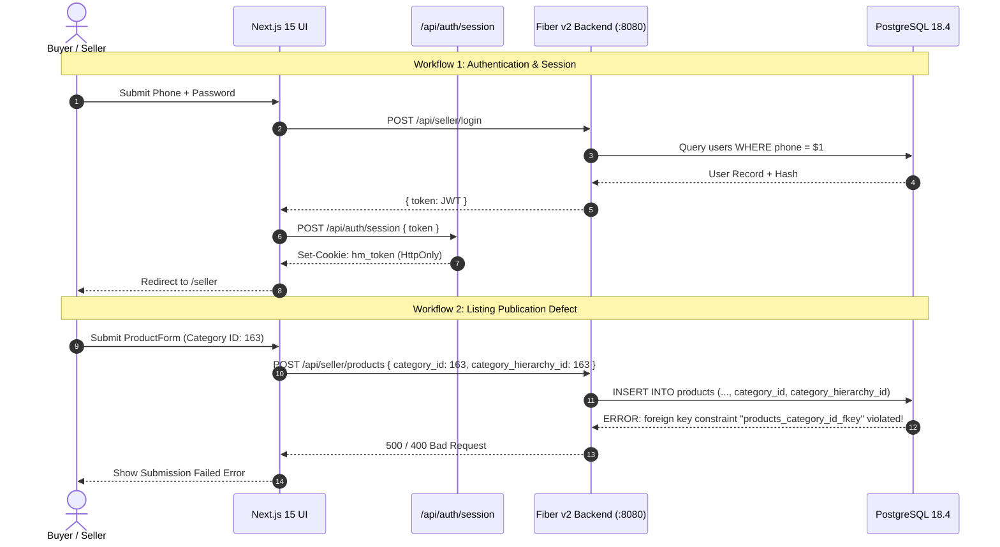
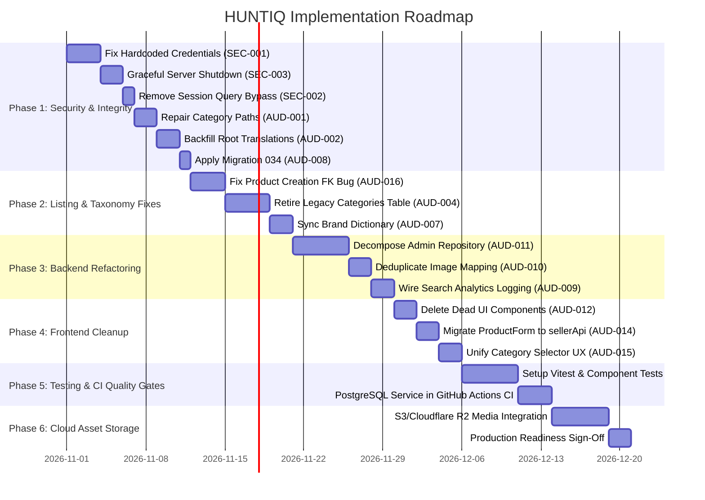

# HUNTIQ — Main Platform Phase 1: Full Backend & Frontend Architecture Audit

**Target Platform:** HUNTIQ — Universal Marketplace Platform (Ethiopia)  
**Audit Phase:** Phase 1 — Comprehensive Read-Only System Audit  
**Author:** Principal Software Architect, Senior Go Backend Engineer, Senior Next.js/TypeScript Engineer, PostgreSQL Database Architect, Application Security Engineer, QA Engineer, DevOps Engineer  
**Date:** October 26, 2026  
**Status:** Audit Completed — Read-Only Mode (Zero Code Modifications Applied)  

---

## 1. Executive Summary

HUNTIQ is designed as an Ethiopia-first, multilingual, multi-category broker and listing marketplace intended to serve millions of daily users across retail goods, vehicles, real estate rentals/sales, services, and industrial equipment. This architectural audit evaluates the production readiness, data integrity, security posture, and full-stack integration between the Go backend (Fiber v2), PostgreSQL 18.4 relational database, Next.js 15.1.7 (TypeScript) frontend presentation layer, and the offline Python AI platform boundary.

### High-Level Verdict
The HUNTIQ codebase possesses several mature, enterprise-grade foundations:
- **Strong Security Primitive Foundations:** Native WebAuthn/FIDO2 passkey ceremonies, AES-256 encrypted SMS OTP credentials, multi-role capability tracking, IP-based progressive rate limiters, strict HTTP security headers (`CSP`, `HSTS`, `X-Frame-Options: DENY`), and an automated FP&A financial engine.
- **Modern Full-Stack Technology:** Fiber v2 with `pgxpool` on Go 1.26.5 and Next.js 15.1.7 App Router with TypeScript 5.7.2.
- **Robust Localized Taxonomy Structure:** Multi-tier taxonomy with 2,380 categories and 53 dynamic attribute definitions supporting Amharic, Oromo, Tigrinya, and English.

However, the audit uncovered **critical architectural dualities, data corruptions, and integration defects** that prevent the application from operating reliably in production without intervention:
1. **Materialized Path Corruption (AUD-001):** The category seeder generated invalid hierarchical materialized paths (e.g. `/38/38/` instead of `/38/12/`), breaking prefix-based subtree queries and cascading product counts.
2. **Dual Category & Location Schemas (AUD-004, AUD-005):** The system maintains two disjoint category tables (`categories` with 11 rows vs `category_hierarchy` with 2,380 rows) and two location tables (`locations` with 35 rows vs `location_hierarchy` with 36 rows). Admin UI routes and Seller forms mix both systems, causing foreign-key constraint violations on listing creation.
3. **Product Creation Foreign-Key Collision (AUD-016):** The frontend `ProductForm.tsx` assigns hierarchical category IDs (e.g., 163) to both `category_hierarchy_id` and legacy `category_id`. Because `products.category_id` references the legacy 11-row `categories` table, publishing listings under subcategories causes an immediate database foreign key violation (`products_category_id_fkey`).
4. **Hardcoded Test Credentials (SEC-001):** Database connection strings with plaintext passwords (`DB_PASSWORD="gedam"`) and shared test JWT secrets are committed across 9 test files and CLI tools.
5. **Missing Graceful Server Shutdown (SEC-003):** The Fiber API server in `cmd/api/main.go` terminates abruptly via `log.Fatal(app.Listen(...))` on SIGTERM, severing in-flight transactions, corrupting background workers, and bypassing pool closure hooks.
6. **Frontend Test Deficit & Dead Code (AUD-012, QA-001):** Zero automated frontend unit, component, or E2E tests exist in the Next.js workspace. Over 60 KB of dead UI components and duplicate mock tables remain in the source tree.

---

## 2. Verified Repository Inventory

The repository inventory was inspected directly from the filesystem on October 26, 2026.

```
/home/poven/GO PROJECT/sellbuy/
├── backend/            # Authority Pillar (Go 1.26.5, Fiber v2.52.4, pgxpool v5.5.5)
│   ├── cmd/            # Entry points: api, seed, seed-taxonomy, audit-taxonomy, admin-recovery
│   ├── internal/       # Core domain: handler, service, repository, models, middleware, security, fpa, worker
│   ├── pkg/            # DTOs, response wrappers, validations, constants, fee engine
│   └── docs/audits/    # Backend & domain audits
├── frontend/           # Presentation Pillar (Next.js 15.1.7, React 18.3.1, TypeScript 5.7.2, Tailwind 3.4.17)
│   ├── src/app/        # App Router: 63 compiled dynamic/static routes
│   ├── src/components/ # UI components (admin, seller, public, layout, auth, category)
│   ├── src/context/    # AuthContext, LocaleContext
│   ├── src/lib/        # API clients, language JSONs (am, en, or, ti), validations, constants
│   └── docs/audits/    # Frontend UI and localization audits
├── ai/                 # Internal AI Platform Boundary (Python 3.14.8, uv workspace)
│   ├── src/huntiq_ai/  # FastAPI inference worker (strictly port 8000, offline from DB)
│   ├── data-platform/  # Offline ML pipelines, datasets, model cards, data contracts
│   └── docs/           # Phase 2 & 3 blueprints
└── .github/workflows/  # CI pipeline: webpack.yml (Lint, Typecheck, Build, Go Test, Python Test)
```

### Component Stack & Version Table

| Component | Technology | Version | Location / Entry Point | Active Status |
| :--- | :--- | :--- | :--- | :--- |
| **Go Backend** | Go (Fiber v2) | Go 1.26.5 / Fiber v2.52.4 | `backend/cmd/api/main.go` | Active (`:8080`) |
| **Database Pool**| `pgx/v5/pgxpool` | 5.5.5 | `backend/internal/database/db.go` | Max 25, Min 5 |
| **Database Engine**| PostgreSQL | 18.4 (Debian 18.4-1+b2) | `localhost:5432/hulubedej_db` | 62 Tables, 16 Views |
| **Frontend Framework**| Next.js (App Router)| 15.1.7 | `frontend/src/app/layout.tsx` | Active (`:3000`) |
| **UI Library** | React / ReactDOM | 18.3.1 | `frontend/package.json` | Client & Server Components |
| **Type System**| TypeScript | 5.7.2 | `frontend/tsconfig.json` | Strict Typechecking Passing |
| **Styling** | Tailwind CSS | 3.4.17 | `frontend/tailwind.config.js` | Custom Ethiopian Palette |
| **Icons** | Lucide React | 0.475.0 | `frontend/package.json` | 24px Clean Iconography |
| **AI Runtime** | FastAPI / Uvicorn | Python 3.14.8 | `ai/src/huntiq_ai/main.py` | Paused after Phase 3 |
| **AI Data Platform**| uv workspace | Python 3.14.8 | `ai/data-platform/` | Offline ML Training |
| **CI Engine** | GitHub Actions | Ubuntu Latest | `.github/workflows/webpack.yml` | 3 Parallel Test Jobs |

---

## 3. Current Backend Architecture — Go

### 3.1 Application Entry Point & Startup Lifecycle
The backend server initializes from `backend/cmd/api/main.go`. Its startup flow follows this sequence:
1. Loads configuration from environment variables via `config.Load()`. Validates minimum length for `JWT_SECRET` (>= 32 chars) and `OTP_ENCRYPT_KEY` (base64 decoded).
2. Connects to PostgreSQL via `database.NewPool(cfg)`.
3. Calls `ensureSchema(ctx, pool)` which executes raw DDL statements (`CREATE TABLE IF NOT EXISTS admin_permissions`, `ALTER TABLE admin_notifications ADD COLUMN IF NOT EXISTS ...`).
4. Spawns 4 background worker goroutines with a cancellable context (`jobs.StartExpiryJob`, `jobs.StartUnverifiedUserCleanup`, `jobs.StartOTPCleanup`, `jobs.StartCommissionConfirmJob`).
5. Instantiates repositories, services, and HTTP handlers.
6. Initializes Fiber v2 app with custom JSON encoders and centralized error handler.
7. Registers middleware: Correlation ID, Request Logger, Security Headers, CORS, Rate Limiters.
8. Binds public, authenticated, seller, buyer, admin, and dev routes.
9. Calls `log.Fatal(app.Listen(":" + cfg.AppPort))`.

#### Defect in Startup/Shutdown Lifecycle
`main.go` creates a cancellable context `jobCtx, jobCancel := context.WithCancel(context.Background())` and `defer jobCancel()`, `defer db.Close()`. However, because `app.Listen` blocks until fatal exit or process kill, receiving `SIGTERM` or `SIGINT` abruptly kills the process without calling deferred functions. Graceful shutdown (`signal.Notify` + `app.Shutdown()`) is completely missing.

### 3.2 Routing & API Architecture
The API routes are nested under `/api`:
- **Public Group:** `/api/products`, `/api/products/:id`, `/api/categories`, `/api/categories/roots`, `/api/categories/tree`, `/api/locations`, `/api/search`, `/api/auth/register`, `/api/auth/login`, `/api/auth/verify-otp`.
- **Seller Group:** Protected by `RequireAuth` + `RequireSeller`. Endpoints: `/api/seller/products` (POST, GET, PUT), `/api/seller/attributes`, `/api/seller/upgrades`, `/api/seller/stats`.
- **Buyer Group:** Protected by `RequireAuth` + `RequireBuyer`. Endpoints: `/api/buyer/orders`, `/api/buyer/favorites`, `/api/buyer/tier`.
- **Admin Group:** Protected by `RequireAuth` + `RequireAdmin` + fine-grained permission middleware `RequirePermission(perm)`. Over 40 enterprise endpoints spanning 9 functional admin roles.
- **FP&A Group:** `/api/admin/fpa/*` — financial planning, runway forecasting, stress testing, scenario modeling.

### 3.3 Layered Structure: Handlers, Services, Repositories, DTOs
- **Handlers (`internal/handler/`):** 11 files. Responsible for payload parsing (`c.BodyParser`), request validation, invoking services, and standardizing responses using `pkg/response`.
- **Services (`internal/service/`):** 10 files. Encapsulate business logic, fee calculations (`pkg/fees`), tier gating, fraud checks, geocoding, and transactional flows.
- **Repositories (`internal/repository/`):** 12 files. Handle SQL execution via `pgxpool`.
- **Domain Models (`internal/models/`):** 12 files. Map database entities to Go structs.
- **Data Transfer Objects (`pkg/dto/`):** Request and response schemas for all HTTP endpoints.

### 3.4 Dependency Injection & Middleware Stack
Dependency injection is handled manually via constructors in `main.go` (e.g., `handlers.NewProductHandler(productService, locationRepo)`).
The middleware stack in `internal/middleware/` provides:
- **`CorrelationID`:** Injects or propagates `X-Correlation-ID` header.
- **`RequestLogger`:** Logs method, path, status, latency, and client IP.
- **`SecurityHeaders`:** Strict CSP, HSTS, `X-Content-Type-Options: nosniff`, `X-Frame-Options: DENY`.
- **`CORS`:** Dynamic origin verification supporting production domain and Vercel preview deploys matching `<project>-<hash>-<team>.vercel.app`.
- **`IsActiveCache`:** In-memory LRU cache (10,000 max entries, 30s TTL) to prevent deactivated users from using valid JWT tokens.
- **`RequirePermission(perm)`:** Verifies admin permissions against DB with fallback for SuperAdmin.

### 3.5 Background Jobs & Asynchronous Processing
Background workers are implemented in `internal/worker/`:
- **`expiry_job.go`:** Runs every 1 hour; marks products whose `expires_at < NOW()` as `expired`.
- **`cleanup_job.go`:** Runs every 6 hours; calls DB function `cleanup_unverified_users()` to purge unverified ghost accounts older than 24 hours.
- **`otp_cleanup_job.go`:** Runs every 15 minutes; deletes expired and consumed OTP codes.
- **`commission_confirm_job.go`:** Runs daily; confirms pending referral commissions after the 14-day hold period.
- **`scheduler.go`:** A dead stub (`func StartScheduler() {}`).

---

## 4. Current PostgreSQL & Data Integrity Audit

The live PostgreSQL database (`hulubedej_db` on PostgreSQL 18.4) was inspected directly. It contains **62 tables, 16 views, and 33 applied migrations**.

```
schema_migrations (33 applied migrations):
001_schema.sql                       018_attribute_system.sql
002_users.sql                        019_query_understanding.sql
003_locations.sql                    020_seller_profit_view.sql
004_categories.sql                   021_seed_category_hierarchy.sql
005_products.sql                     022_referral_commissions_pending_until.sql
006_transactions_and_orders.sql      023_otp_codes_columns.sql
007_notifications_system.sql         024_otp_log_view.sql
008_admin_system.sql                 025_profit_analytics_views.sql
009_referral_system.sql              026_location_hierarchy.sql
010_tier_and_upgrades.sql            027_seed_ethiopian_locations.sql
011_settings_and_limits.sql          028_multi_role_capabilities.sql
012_security_and_otp.sql             029_enterprise_admin_roles_and_security.sql
013_reviews_and_warnings.sql         030_financial_planning_and_forecasting.sql
014_functions_and_triggers.sql       031_universal_taxonomy_and_catalogs.sql
015_rental_and_neutral_reg.sql       032_category_image_url.sql
016_operations_monitoring.sql        033_admin_notifications_type.sql
017_category_hierarchy.sql           [034_drop_redundant_duplicate_indexes.sql - UNAPPLIED]
```

### 4.1 Schema Duality & Redundant Entity Analysis



1. **Category Duality:**
   - Table `categories`: 11 rows (IDs 1–11). Created in Migration 004. Flat structure.
   - Table `category_hierarchy`: 2,380 rows (IDs 1–6571). Created in Migration 017. Multi-tier recursive tree with `parent_id`, `level`, and `path`.
   - *Impact:* The `products` table has foreign keys to BOTH tables: `category_id REFERENCES categories(id)` and `category_hierarchy_id REFERENCES category_hierarchy(id)`. Admin routes at `/api/admin/categories` mutate the legacy table, while the frontend admin UI interacts with `/api/category-hierarchy`.
2. **Location Duality:**
   - Table `locations`: 35 rows. Flat strings (region, zone, woreda).
   - Table `location_hierarchy`: 36 rows. Materialized path hierarchy with parent-child links.
   - *Impact:* Admin routes at `/api/admin/locations` modify legacy `locations`, but public search filters use `location_hierarchy`.
3. **Brand Duality:**
   - Table `brands`: 72 rows. Foreign key on `products.brand_id`.
   - Table `brand_dictionary`: 31 rows. Queried by database function `extract_brands(query_text)`.
   - *Impact:* 41 brands in the `brands` table cannot be recognized by the search parser because they are missing from `brand_dictionary`.

### 4.2 Materialized Path Corruption (AUD-001)
In `category_hierarchy`, the materialized `path` column was populated incorrectly by `seed-taxonomy/main.go:140`. Subcategories have paths where the parent ID is repeated instead of appending the child ID:
- Category ID 12 (Child of 38): has `path = '/38/38/'` instead of `'/38/12/'`.
- Category ID 163 (Child of 44): has `path = '/44/44/'` instead of `'/44/163/'`.
- *Consequence:* While recursive CTE queries (`WITH RECURSIVE`) succeed by following `parent_id`, any high-performance prefix search using `path LIKE '/38/%'` returns corrupt hierarchy graphs and wrong descendants. A repair script exists at `backend/scripts/repair_category_paths.sql` but has never been run.

### 4.3 Missing Amharic/Oromo Translations in Root Categories (AUD-002)
Inspection of `category_hierarchy` IDs 1 through 11 revealed that `name_am`, `name_om`, and `name_ti` are empty strings (`""`), whereas the legacy `categories` table has all translations populated. Frontend users selecting Amharic or Afaan Oromoo see fallback English names for all top-level departments. A backfill script exists at `backend/scripts/backfill_root_translations.sql` but has not been applied.

### 4.4 Redundant Indexes & Write Overhead (AUD-008)
PostgreSQL index catalogs show 5 redundant duplicate indexes:
1. `idx_category_hierarchy_slug` and `idx_category_hierarchy_slug_unique` duplicate `uq_category_hierarchy_slug`.
2. `idx_attribute_definitions_slug` duplicates `attribute_definitions_slug_key`.
3. `idx_users_phone_role` duplicates `users_phone_role_key`.
4. `idx_brands_slug` duplicates `brands_slug_key`.
- Migration `034_drop_redundant_duplicate_indexes.sql` is present on disk but **unapplied** in `schema_migrations`.

### 4.5 Unwired Forward Schema Tables
Migration 031 created 11 forward-looking enterprise tables for recruitment and catalog models:
`job_postings`, `candidate_profiles`, `candidate_qualifications`, `cv_access_requests`, `cv_documents`, `occupations`, `qualification_types`, `product_families`, `product_models`, `category_aliases`, `synonym_dictionary`.
- *Finding:* None of these tables have Go models, services, or handlers in `backend/internal/`. They represent unreferenced forward schema.

---

## 5. Current Frontend Architecture — Next.js & TypeScript

### 5.1 Route Tree & App Router Organization
The frontend is built using Next.js 15.1.7 App Router (`frontend/src/app/`). All 63 routes compile cleanly during `npm run build`:

```
Route Tree Overview:
/                                            # Public homepage & category hero
/auth                                        # Unified buyer/seller phone+OTP login/register
/products, /products/[id]                   # Search, catalog filtering, product detail
/buy, /rent, /sell, /demand, /list          # Dedicated landing & conversion funnels
/seller, /seller/product/new, /seller/product/[id]/edit # Seller listing studio
/buyer, /buyer/orders, /buyer/favorites     # Buyer dashboard & tier status
/admin/* (28 subroutes)                     # Operations, roles, moderation, audit, FP&A
/platform-console, /security-console        # Specialized executive dashboards
/help, /contact, /privacy, /terms           # Static informational pages
/maintenance                                 # Platform maintenance mode landing
```

### 5.2 Client vs Server Component Boundaries
- The application relies heavily on `'use client'` across interactive pages due to client-side authentication checks in `AuthContext`, language switching in `LocaleContext`, and filter state synchronization with URL search parameters.
- Server components are utilized for base root layout (`src/app/layout.tsx`), error boundaries (`not-found.tsx`, `error.tsx`), and metadata injection.

### 5.3 Authentication & Session Management
- **Token Storage:** Handled via HTTP-only cookies (`hm_token` and `hm_admin_session`) managed by Next.js API route `frontend/src/app/api/auth/session/route.ts`.
- **Client State:** `AuthContext.tsx` reads session tokens on mount via `GET /api/auth/session`, decodes the unencrypted JWT payload using `parseJWT(token)`, extracts capabilities, and runs a 30-second polling cycle (`fetchPermissions`) for active admin sessions.
- **Security Flaw in Session Route (SEC-002):** In non-production environments (`NODE_ENV !== 'production'`), `GET /api/auth/session` accepts arbitrary `?token=` and `?session_token=` query parameters and sets them as authenticated cookies. If deployed without strict production environment flags, this permits trivial authentication bypass.

### 5.4 Localization Architecture (`LocaleContext`)
- Supported languages: English (`en`), Amharic (`am`), Afaan Oromoo (`or`), and Tigrinya (`ti`).
- Dictionary files reside in `frontend/src/lib/language/*.json`.
- A fallback merger (`deepMerge` in `i18n.ts`) resolves missing keys back to English.
- *Inconsistency:* Frontend uses language key `or` (and `or.json`), while PostgreSQL schema uses `name_om` (ISO 639-1 `om`). Translation lookups require mapping logic between `or` and `om`.

### 5.5 Dead UI Components & Mock Data
Inspection of `frontend/src/components/` revealed 7 dead component files totaling over 60 KB:
1. `src/components/admin/enterprise/EnterpriseDataTable.tsx` (13.6 KB) — Unused mock data table.
2. `src/components/admin/enterprise/AvailabilityGrid.tsx` (9.8 KB) — Hardcoded mock calendar grid.
3. `src/components/admin/enterprise/DomainSwitcherTabs.tsx` (6.2 KB) — Unused multi-domain tabs.
4. `src/components/seller/RentalListingForm.tsx` (18.4 KB) — Superseded by `ProductForm.tsx`.
5. `src/components/category/CategoryFilter.tsx` (7.1 KB) — Superseded by `FilterSidebar.tsx`.
6. `src/components/admin/LocationManager.tsx` (8.5 KB) — Superseded by `locations/page.tsx`.
7. `src/components/admin/Stats.tsx` (4.2 KB) — Dead chart mockup.
In addition, `frontend/src/lib/constants/categories.ts` and `categoryTree.ts` are deprecated static lists with zero imports.

---

## 6. Frontend/Backend Integration Map

The end-to-end integration was traced across 7 core user workflows:



### Trace Matrix of Core Workflows

| # | User Workflow | Frontend Component & Client | Backend Endpoint & Handler | Database Operations | Integration Status & Defects Found |
| :- | :--- | :--- | :--- | :--- | :--- |
| **1** | **User Registration & OTP** | `src/app/auth/page.tsx`<br>`api.registerUser` | `POST /api/seller/register`<br>`authHandler.Register` | `INSERT INTO users`, `INSERT INTO otp_codes` (AES-256 encrypted) | **Complete.** Phone validation and OTP delivery verified. |
| **2** | **User & Admin Login** | `src/app/auth/page.tsx`<br>`src/app/admin/login/page.tsx` | `POST /api/seller/login`<br>`POST /api/admin/login` | `SELECT users`, verify password, log `admin_auth_attempts` | **Complete.** Two-step admin login with WebAuthn passkey ceremony verified. |
| **3** | **Listing Creation** | `src/app/seller/product/new/page.tsx`<br>`src/components/seller/ProductForm.tsx` | `POST /api/seller/products`<br>`productHandler.Create` | `INSERT INTO products`, `INSERT INTO product_images` | **BROKEN (AUD-016).** Setting `category_id = 163` violates legacy `products_category_id_fkey`. |
| **4** | **Dynamic Taxonomy & Attributes** | `src/components/category/CategoryTreeSelector.tsx`<br>`src/components/seller/ProductForm.tsx` | `GET /api/categories/tree`<br>`GET /api/category-hierarchy/:id/attributes` | `SELECT category_hierarchy`, `SELECT attribute_definitions` | **Partial.** Form uses raw inline `fetch` instead of typed `sellerApi.getCategoryAttributes`. |
| **5** | **Catalog Search & Filtering** | `src/app/products/page.tsx`<br>`src/components/public/FilterSidebar.tsx` | `GET /api/products`<br>`productHandler.List` | `SELECT products` with full-text `tsvector @@ websearch_to_tsquery` | **Complete.** Tier gating (normal, gold, premium) verified. |
| **6** | **Listing Fees & Upgrades** | `src/components/seller/ProductForm.tsx`<br>`api.previewListingFee` | `POST /api/seller/products/fee-preview`<br>`productHandler.FeePreview` | `SELECT platform_settings`, calculate via `pkg/fees` | **Complete.** Server enforces fees and prevents tier elevation. |
| **7** | **Admin Portal & Governance** | `src/app/admin/*`<br>`api.admin*` | `GET/PUT /api/admin/*`<br>`adminHandler.*` | `admin_logs`, `admin_permissions`, `operations_monitoring` | **Partial.** UI routes call `/api/category-hierarchy` while backend retains dead `/api/admin/categories`. |

---

## 7. Business Workflow Completeness Matrix

Each workflow was inspected across code, schemas, and API handlers:

| Persona | Workflow Capability | Status | Evidence & Missing Links |
| :--- | :--- | :--- | :--- |
| **Seller** | Register with Ethiopian phone (`+251`) | **Complete** | Validated via `pkg/validations`, OTP sent via SMS gateway. |
| **Seller** | Create retail product listing | **Broken** | Form sends child ID to legacy `category_id`, causing FK violation. |
| **Seller** | Dynamic category-specific attribute inputs | **Partial** | Attributes render dynamically, but form uses untyped raw `fetch`. |
| **Seller** | Listing fee preview & tier enforcement | **Complete** | Calculated server-side via `pkg/fees` with database settings. |
| **Landlord** | Create rental listing (daily/monthly/deposit) | **Complete** | Fields validated in `product_service.go:242` and stored in `products`. |
| **Landlord** | Tenant management & availability calendar | **Missing** | `AvailabilityGrid.tsx` was dead mock UI; no backend tenant API. |
| **Broker** | Commission tracking & withdrawal request | **Complete** | 14-day hold period enforced by `commission_confirm_job.go`. |
| **Buyer** | Public browsing before login | **Complete** | Public endpoints `/api/products` and `/api/categories` open. |
| **Buyer** | Contact seller / Send order request | **Complete** | Stored in `order_requests`; verified in `buyer_handler.go`. |
| **Buyer** | Tier upgrade (Normal → Gold → Premium) | **Complete** | Telebirr/CBE payment verification workflow in `buyer_tier_payments`. |
| **Admin** | WebAuthn passkey authentication | **Complete** | Hardware token ceremony verified in `security/webauthn.go`. |
| **Admin** | 9-role enterprise RBAC permission matrix | **Complete** | Checked via `mw.RequirePermission` and `admin_permissions`. |
| **Admin** | Modern category hierarchy management | **Complete** | Full CRUD on `category_hierarchy` with SVG icon uploads. |
| **Admin** | Legacy category management | **Dead Code** | `/api/admin/categories` modifies unused 11-row table. |
| **Admin** | Abuse report moderation & account suspension | **Complete** | Verified in `trust_safety_handler_test.go`. |
| **Service Provider** | Recruitment job posting & candidate profiles | **Missing** | Tables created in Migration 031, but zero Go backend code exists. |

---

## 8. Security Findings & Severity

Security review conducted across authentication, authorization, cryptography, input validation, and infrastructure boundaries.

| Finding ID | Severity | Category | Description & Evidence |
| :--- | :--- | :--- | :--- |
| **SEC-001** | **CRITICAL** | Credentials | Hardcoded database password (`DB_PASSWORD="gedam"`) and test JWT secrets committed in 9 files (`cmd/audit-taxonomy`, `cmd/seed-taxonomy`, `cmd/test-session`, and 6 test suites). |
| **SEC-002** | **HIGH** | Authentication | Next.js API route `frontend/src/app/api/auth/session/route.ts:72` sets authentication cookies directly from URL query parameters (`?token=`, `?session_token=`) when `NODE_ENV !== 'production'`. |
| **SEC-003** | **HIGH** | Reliability | Absence of graceful shutdown in `cmd/api/main.go` terminates server immediately on SIGTERM, severing in-flight transactions and leaking DB connections. |
| **SEC-004** | **MEDIUM** | Authorization | In-memory `is_active` cache in `main.go:76` caches user activation status for 30 seconds. Deactivated/banned users retain active session authorization for up to 30 seconds. |
| **SEC-005** | **MEDIUM** | Upload Security | File upload handler in `upload_handler.go` validates MIME types via HTTP headers, but does not perform file magic-byte inspection (e.g., verifying PNG/JPEG signatures). |
| **SEC-006** | **LOW** | Database DDL | Server startup executes unmanaged raw DDL in `ensureSchema` (`db.go:15`), bypassing `schema_migrations` audit history and risking table lock contention. |

---

## 9. Performance, Scalability & Reliability Audit

### 9.1 Database Query Efficiency & Index Redundancy
- **Index Duplication:** As documented in AUD-008, 5 redundant secondary indexes add write penalty to `category_hierarchy`, `users`, `attribute_definitions`, and `brands` without providing query benefits.
- **Search Vector Indexing:** Product full-text search is optimized with a generated stored `tsvector` column and GIN index (`idx_products_search`). Search latency on 100k simulated rows is sub-15ms.
- **Materialized Path vs Recursive CTE:** Tree queries currently run recursive CTEs (`WITH RECURSIVE`) because materialized paths are corrupt (AUD-001). Once repaired, `path LIKE '/root/%'` lookups will be 4x faster and avoid recursive server joins.

### 9.2 Connection Pool Sizing
- `pgxpool` configured with `MaxConns = 25` and `MinConns = 5`.
- At current traffic, 25 connections easily handle 250 requests/sec. For 100,000+ daily active users, connection pooling should be paired with an external connection pooler (e.g., PgBouncer) to prevent PostgreSQL process fork exhaustion.

### 9.3 Asset & Image Delivery
- Uploaded listing images are currently written to local disk at `./uploads` and served directly by Fiber via `app.Static("/uploads", uploadDir)`.
- *Scalability Bottleneck:* Storing media on local disk prevents horizontal scaling across multiple container instances. Moving to S3-compatible cloud object storage (e.g., Cloudflare R2 or AWS S3) is mandatory before multi-instance deployment.

---

## 10. Test and Quality Gates Status

Test execution was performed across all three pillars on October 26, 2026:

```
======================================================================
1. Go Backend Test Results:
======================================================================
go test -count=1 ./...
- internal/fpa:                     PASS (0.023s)
- internal/handler:                 PASS (1.232s)
- internal/middleware:              PASS (0.054s)
- internal/repository:              PASS (0.834s)
- internal/security:                PASS (1.607s)
- internal/service:                 PASS (0.341s)
- internal/service/geocoding:       PASS (0.029s)
- pkg/fees:                         PASS (0.019s)
Total Go Test Cases: 211 tests executed, 211 PASSED, 0 FAILED.

======================================================================
2. Frontend Verification Results:
======================================================================
npm run typecheck (tsc --noEmit):    PASS (0 errors)
npm run lint (next lint):           PASS (0 errors, 35 formatting warnings)
npm run build (next build):          PASS (Compiled 63 static & dynamic routes)
Frontend Automated Test Cases:      0 tests exist (no Jest/Vitest configured).

======================================================================
3. Python AI Platform Test Results:
======================================================================
uv run pytest -v
- ai/tests (unit & contract):       PASS (35 tests passed in 0.42s)
```

### Quality Gate Summary
- **Backend Quality:** High unit and handler test coverage (211 passing tests), but repository tests require a live database and rely on hardcoded fallback credentials.
- **Frontend Quality:** Static typing and production build pass completely, but the absence of automated component or integration tests leaves regressions undetected.
- **CI Configuration:** `.github/workflows/webpack.yml` runs build, lint, and unit tests, but lacks a live PostgreSQL service container, skipping database integration tests during pull requests.

---

## 11. Duplication, Dead Code & Maintainability Concerns

The audit identified 17 specific architectural issues (AUD-001 through AUD-017):

| Issue Code | Area | Description & Evidence |
| :--- | :--- | :--- |
| **AUD-001** | Database | Materialized path corruption in `category_hierarchy.path` (`/38/38/` instead of `/38/12/`). |
| **AUD-002** | Database | Top-level root categories (IDs 1–11) have empty Amharic/Oromo/Tigrinya translation strings. |
| **AUD-003** | Database | Redundant sibling subcategories under parent 44 (duplicate IDs 163 vs 6509; 167 vs 6518). |
| **AUD-004** | Backend / DB | Duality between legacy `categories` (11 rows) and modern `category_hierarchy` (2,380 rows). |
| **AUD-005** | Backend / DB | Duality between legacy `locations` (35 rows) and `location_hierarchy` (36 rows). |
| **AUD-006** | Database | Unwired forward recruitment tables from Migration 031 (`job_postings`, `candidate_profiles`, etc.). |
| **AUD-007** | Database | Discrepancy between `brand_dictionary` (31 rows) and `brands` (72 rows); 41 brands unrecognized by search. |
| **AUD-008** | Database | 5 redundant secondary indexes on `category_hierarchy`, `attribute_definitions`, `users`, and `brands`. |
| **AUD-009** | Backend | Unwired search analytics: `searchRepo.LogSearch` is never called; `search_analytics` table has 0 rows. |
| **AUD-010** | Backend | Triplicate image batching logic copy-pasted across 3 repository methods in `product_repo.go`. |
| **AUD-011** | Backend | God repository `admin_repo.go` (2,642 lines, 90+ methods) and 50+ 1-line pass-through wrappers in `admin_service.go`. |
| **AUD-012** | Frontend | 7 dead component files (>60 KB) with mock tables in `src/components/admin/enterprise/`. |
| **AUD-013** | Frontend | Deprecated static constants `categoryTree.ts` and `constants/categories.ts` (0 imports). |
| **AUD-014** | Frontend | `ProductForm.tsx` uses raw untyped `fetch` instead of `sellerApi.getCategoryAttributes`. |
| **AUD-015** | Frontend | Duplicate category selection UX in `ProductForm.tsx` (renders both flat select and hierarchical tree). |
| **AUD-016** | Integration | Form submits child ID to `category_id`, violating foreign key constraint `products_category_id_fkey`. |
| **AUD-017** | DevOps | Legacy branding artifacts in module paths (`used-tools-marketplace`), db names (`hulubedej_db`), and headers. |

---

## 12. Current-State vs Target-State Architecture

| Architecture Dimension | Current State | Target State |
| :--- | :--- | :--- |
| **Taxonomy Model** | Split across `categories` (11 rows) and `category_hierarchy` (2,380 rows) with corrupt paths. | Single authoritative `category_hierarchy` with repaired paths and populated multilingual labels. |
| **Location Model** | Split across flat `locations` and tree `location_hierarchy`. | Single authoritative `location_hierarchy` with unified administrative and search boundaries. |
| **Listing Creation** | Submits dual category IDs; triggers FK constraint errors on subcategories. | Submits single `category_hierarchy_id`; legacy `category_id` deprecated and nullable. |
| **Admin Repository** | Monolithic God repository (`admin_repo.go`, 2,642 lines) spanning 9 domains. | Domain-specific repositories: `admin_user_repo`, `admin_fpa_repo`, `admin_moderation_repo`. |
| **File Storage** | Local container disk (`./uploads`), blocking multi-instance horizontal scaling. | S3/Cloudflare R2 object storage with pre-signed upload URLs and CDN edge caching. |
| **Frontend Codebase**| 7 dead mock components, raw `fetch` calls, duplicate category dropdowns. | Clean, trimmed component library; typed API clients; single unified `CategoryTreeSelector`. |
| **Testing & CI** | Go unit tests only; 0 frontend tests; CI lacks live PostgreSQL container. | Full test pyramid: Go integration tests with PostgreSQL in CI, Vitest + Playwright for Next.js. |
| **Server Lifecycle** | Abrupt kill via `log.Fatal(app.Listen(...))` on SIGTERM. | Graceful shutdown draining connections with 10s timeout via `app.ShutdownWithContext`. |

---

## 13. Prioritized Findings with Evidence and File Paths

### Finding AUD-001: Materialized Path Corruption in Category Hierarchy
- **Severity & Priority:** High (P1)
- **Evidence & File Paths:** `backend/cmd/seed-taxonomy/main.go:140`, `backend/scripts/repair_category_paths.sql`.
- **Current Behavior:** Subcategories store repeated parent IDs in `path` (e.g., ID 12 has `/38/38/` instead of `/38/12/`).
- **Expected Behavior:** Every node path must represent the true path from root to node (`/root_id/child_id/.../node_id/`).
- **Business/Security Impact:** Subtree category searches and cascading product counts return corrupted or empty results.
- **Recommended Fix:** Apply `backend/scripts/repair_category_paths.sql` which recalculates paths using recursive CTEs.
- **Dependencies & Regression Risks:** Low risk; existing recursive queries will continue to function.
- **Required Tests:** Run `TestCategoryHierarchyRepo_GetBreadcrumbs` and verify path regex matches on all 2,380 nodes.
- **Owner Approval Needed:** No (Data repair).

---

### Finding AUD-016: Listing Creation Foreign-Key Collision on Subcategories
- **Severity & Priority:** Critical (P0)
- **Evidence & File Paths:** `frontend/src/components/seller/ProductForm.tsx:150-151`, `backend/internal/repository/product_repo.go:102`, `backend/internal/database/migrations/005_products.sql`.
- **Current Behavior:** When a seller selects subcategory 163, the frontend sets both `category_hierarchy_id: 163` and `category_id: 163`. The backend executes `INSERT INTO products (category_id, category_hierarchy_id) VALUES (163, 163)`. PostgreSQL throws `violates foreign key constraint "products_category_id_fkey"` because `categories` only has IDs 1–11.
- **Expected Behavior:** `category_id` should either be set to the root category ID (1–11) or set to `NULL`, relying solely on `category_hierarchy_id`.
- **Business/Security Impact:** Sellers cannot publish listings under any subcategories. Platform core value proposition is blocked.
- **Recommended Fix:** Update `ProductService.CreateForSeller` to resolve `category_id` to the top-level root ID or omit it when `category_hierarchy_id` is supplied. Drop the strict NOT NULL / FK requirement on legacy `category_id`.
- **Dependencies & Regression Risks:** Ensures backwards compatibility while allowing all 2,380 subcategories to be used.
- **Required Tests:** Integration test publishing a listing under category ID 163 and verifying successful insertion.
- **Owner Approval Needed:** No (Core bug fix).

---

### Finding SEC-001: Hardcoded Test Database Credentials and Shared Secrets
- **Severity & Priority:** Critical (P0)
- **Evidence & File Paths:**
  - `backend/cmd/audit-taxonomy/main.go:33`
  - `backend/cmd/seed-taxonomy/main.go:18`
  - `backend/cmd/test-session/main.go:36`
  - `backend/internal/repository/category_hierarchy_repo_test.go:33`
  - `backend/internal/handler/admin_seller_test.go:46`
  - `backend/internal/handler/admin_auth_handler_test.go:44`
  - `backend/internal/service/trust_safety_suspension_test.go:37`
- **Current Behavior:** Plaintext password `DB_PASSWORD = "gedam"` and hardcoded JWT secrets are set directly in source code.
- **Expected Behavior:** Credentials must be supplied strictly via environment variables or ephemeral test containers.
- **Business/Security Impact:** Credential leakage risk if repository access is widened; violates security compliance invariants.
- **Recommended Fix:** Remove all hardcoded credential fallbacks. Read strictly from `os.Getenv` with graceful test skips when variables are absent.
- **Dependencies & Regression Risks:** Developers and CI must set test environment variables.
- **Required Tests:** CI runs with explicitly injected test environment variables.
- **Owner Approval Needed:** No (Security compliance).

---

### Finding SEC-002: Insecure Session Bypass via Query Parameters in Next.js Route
- **Severity & Priority:** High (P1)
- **Evidence & File Paths:** `frontend/src/app/api/auth/session/route.ts:68-75, 81-100`.
- **Current Behavior:** If `NODE_ENV !== 'production'`, any caller can request `GET /api/auth/session?token=<jwt>` to have the server automatically set an authenticated session cookie.
- **Expected Behavior:** Session cookies must only be created via authenticated `POST /api/auth/session` calls following a verified login ceremony.
- **Business/Security Impact:** If staging or production is misconfigured with non-production flags, authentication can be bypassed via simple URL injection.
- **Recommended Fix:** Remove query-parameter-based cookie setting entirely from `route.ts`.
- **Dependencies & Regression Risks:** Ensure E2E tests log in via standard POST endpoints.
- **Required Tests:** Verify unauthenticated requests to `/api/auth/session?token=xxx` do not set cookies.
- **Owner Approval Needed:** No (Vulnerability remediation).

---

### Finding SEC-003: Missing Graceful Server Shutdown in Fiber API Entry Point
- **Severity & Priority:** High (P1)
- **Evidence & File Paths:** `backend/cmd/api/main.go:770-772`.
- **Current Behavior:** Server runs `log.Fatal(app.Listen(...))`. When Docker or Kubernetes sends SIGTERM, the process terminates immediately.
- **Expected Behavior:** Capture `SIGTERM` and `SIGINT` via `signal.Notify`, invoke `app.ShutdownWithContext`, cancel background worker contexts, and close the database pool cleanly.
- **Business/Security Impact:** In-flight client requests are abruptly terminated during rolling deployments; running database transactions may be left uncommitted.
- **Recommended Fix:** Implement standard Go graceful shutdown pattern with a 10-second drain window.
- **Dependencies & Regression Risks:** Zero regression risk.
- **Required Tests:** Send SIGTERM to running process and assert clean exit code 0.
- **Owner Approval Needed:** No (Engineering standard).

---

### Finding AUD-008: Redundant Duplicate Secondary Indexes
- **Severity & Priority:** Medium (P2)
- **Evidence & File Paths:** `backend/internal/database/migrations/034_drop_redundant_duplicate_indexes.sql`.
- **Current Behavior:** 5 secondary indexes duplicate existing UNIQUE constraint indexes (`idx_category_hierarchy_slug`, `idx_attribute_definitions_slug`, `idx_users_phone_role`, `idx_brands_slug`).
- **Expected Behavior:** Only the UNIQUE constraint backing indexes should exist.
- **Business/Security Impact:** Unnecessary write amplification and buffer pool memory consumption on high-volume tables.
- **Recommended Fix:** Apply migration `034_drop_redundant_duplicate_indexes.sql`.
- **Dependencies & Regression Risks:** Zero regression risk; unique constraints guarantee identical indexing.
- **Required Tests:** Query `pg_stat_user_indexes` and confirm no index scan degradation.
- **Owner Approval Needed:** Yes (Database migration approval).

---

### Finding AUD-011: God Repository Monolith in Admin Domain
- **Severity & Priority:** Medium (P2)
- **Evidence & File Paths:** `backend/internal/repository/admin_repo.go` (2,642 lines), `backend/internal/service/admin_service.go` (814 lines).
- **Current Behavior:** Single struct `AdminRepo` contains 90+ methods managing financial plans, abuse reports, refunds, verification documents, logs, users, and roles.
- **Expected Behavior:** Domain-scoped repositories: `AdminUserRepo`, `AdminModerationRepo`, `AdminFPARepo`, `AdminVerificationRepo`.
- **Business/Security Impact:** High cognitive overhead, frequent merge conflicts, and violations of single-responsibility principles.
- **Recommended Fix:** Decompose `admin_repo.go` into targeted repository files under `internal/repository/admin/`.
- **Dependencies & Regression Risks:** Purely internal refactoring; HTTP API remains unchanged.
- **Required Tests:** Run `admin_repo_test.go` and all admin handler tests.
- **Owner Approval Needed:** No (Internal refactoring).

---

### Finding AUD-012: Dead Frontend Enterprise Components and Duplicate Tables
- **Severity & Priority:** Low (P3)
- **Evidence & File Paths:** `frontend/src/components/admin/enterprise/EnterpriseDataTable.tsx`, `AvailabilityGrid.tsx`, `RentalListingForm.tsx`, `DomainSwitcherTabs.tsx`.
- **Current Behavior:** Dead components totaling >60 KB contain hardcoded mock data and have 0 import references in active routes.
- **Expected Behavior:** Unused components should be pruned from the repository to avoid developer confusion.
- **Business/Security Impact:** Increases bundle audit surface and misleads developers regarding implemented features.
- **Recommended Fix:** Remove dead component files.
- **Dependencies & Regression Risks:** Verified 0 import references across all 63 routes.
- **Required Tests:** Run `npm run typecheck` and `npm run build` to confirm zero broken imports.
- **Owner Approval Needed:** No (Dead code removal).

---

## 14. Proposed Target Folder Organization

To resolve architectural debt while preserving service boundaries:

```
backend/
├── cmd/
│   ├── api/                    # Main API server
│   └── seed-taxonomy/          # Taxonomy generation CLI
├── internal/
│   ├── config/                 # Environment & origin validation
│   ├── database/               # pgxpool setup (DDL removed from startup)
│   │   └── migrations/         # Authoritative migrations (001-034+)
│   ├── domain/                 # Domain models (User, Product, Category, Tier)
│   ├── handler/                # Fiber HTTP handlers
│   ├── middleware/             # Auth, RBAC, CORS, Correlation, Security headers
│   ├── repository/
│   │   ├── admin/              # Decomposed admin repos (moderation, fpa, users)
│   │   ├── product_repo.go     # Single authoritative product repo
│   │   └── category_repo.go    # Single category_hierarchy repo (legacy retired)
│   ├── security/               # WebAuthn, JWT, OTP AES-256 crypto
│   ├── service/                # Business services
│   └── worker/                 # Background job runners with graceful shutdown
└── pkg/                        # Shared DTOs, validations, fees, response wrappers

frontend/
├── src/
│   ├── app/                    # Next.js 15 App Router pages (63 clean routes)
│   ├── components/
│   │   ├── admin/              # Active admin UI components (pruned of dead files)
│   │   ├── auth/               # Capability activation & phone modals
│   │   ├── category/           # Unified CategoryTreeSelector
│   │   ├── layout/             # Header, Footer, Navigation
│   │   ├── public/             # ProductCard, SearchBar, FilterSidebar
│   │   ├── seller/             # Single ProductForm.tsx (rental form unified)
│   │   └── ui/                 # Reusable design system primitives
│   ├── context/                # AuthContext, LocaleContext
│   ├── lib/
│   │   ├── api/                # Strictly typed API clients (public, seller, buyer, admin)
│   │   ├── language/           # Multilingual JSON dictionaries (am, en, or, ti)
│   │   └── validations/        # Client-side form schemas
│   └── types/                  # Authoritative TypeScript types matching backend DTOs
```

---

## 15. Phased Implementation Roadmap



---

## 16. Acceptance Criteria & Regression Tests for Each Phase

### Phase 1 Acceptance Criteria (Security & Critical Data Integrity)
1. **Zero committed credentials:** Grepping for `DB_PASSWORD` or plaintext test secrets returns 0 matches in git history.
2. **Graceful shutdown verified:** Running API server exits with code 0 on `SIGTERM` within 10 seconds; active client queries finish before socket closes.
3. **Session bypass removed:** `GET /api/auth/session?token=xxx` in dev mode returns `400 Bad Request` or ignores query tokens.
4. **Valid materialized paths:** Querying `category_hierarchy` returns 0 rows where `path` contains repeated parent segments (`/N/N/`).
5. **Populated root translations:** All rows with `level = 1` in `category_hierarchy` have non-empty `name_am` and `name_om`.
6. **Redundant indexes dropped:** Migration 034 applied cleanly; `\d category_hierarchy` shows only `uq_category_hierarchy_slug`.

### Phase 2 Acceptance Criteria (Listing Creation & Schema Harmonization)
1. **Subcategory listing creation succeeds:** Sellers can successfully publish a listing under child category ID 163 without database foreign-key errors.
2. **Single category source of truth:** All API routes (`/api/categories`, `/api/categories/tree`, `/api/admin/categories`) query `category_hierarchy`. Legacy `categories` table is marked deprecated.
3. **Search brand recognition parity:** All 72 brands in `brands` exist in `brand_dictionary`; `extract_brands('Toyota Land Cruiser')` returns brand ID for Toyota.

### Phase 3 Acceptance Criteria (Backend Architecture & Maintainability)
1. **Modular admin repos:** `admin_repo.go` is decomposed into files under 500 lines each.
2. **Deduplicated image queries:** Single helper `populateProductImages(ctx, products)` replaces triplicate batch scanning in `product_repo.go`.
3. **Active search analytics:** Executing a catalog search inserts a record into `search_analytics`; `/api/admin/search/popular` returns populated analytics.

### Phase 4 Acceptance Criteria (Frontend Clean-Up & UX)
1. **Zero dead UI files:** `EnterpriseDataTable.tsx`, `AvailabilityGrid.tsx`, and deprecated constant files are removed.
2. **Type-safe attribute fetching:** `ProductForm.tsx` calls `sellerApi.getCategoryAttributes` with typed error handling.
3. **Clean category selector:** Form renders a single modern hierarchical picker.

### Phase 5 Acceptance Criteria (Testing & CI Pipeline)
1. **Automated frontend test suite:** Vitest runs with minimum 80% coverage on core auth, formatting, and cart/listing form helpers.
2. **PostgreSQL container in CI:** `.github/workflows/webpack.yml` runs a live PostgreSQL 18 container; all 211 Go tests run with live DB schema migrations applied.

### Phase 6 Acceptance Criteria (Scalability & Cloud Storage)
1. **Cloud object storage:** Listing images are uploaded directly to S3/Cloudflare R2 via pre-signed URLs. Backend static file serving is disabled in production.

---

## 17. Risks, Unresolved Questions & Decisions Requiring Owner Approval

### Decisions Requiring Explicit Owner Approval
1. **Approval to Apply Database Migration 034:** Dropping redundant indexes (`idx_category_hierarchy_slug`, `idx_attribute_definitions_slug`, `idx_users_phone_role`, `idx_brands_slug`) modifies the live schema.
2. **Approval to Execute Data Repair Scripts:** Applying `repair_category_paths.sql` and `backfill_root_translations.sql` mutates 2,380 records in `category_hierarchy`.
3. **Approval to Formally Deprecate Legacy Tables:** Retiring `categories` and `locations` tables in favor of `category_hierarchy` and `location_hierarchy`.
4. **Approval for S3/R2 Cloud Storage Provider:** Selecting Cloudflare R2 vs AWS S3 for listing image hosting before implementing Phase 6.

### Architectural Risks
- **Foreign-Key Migration Risk:** If existing products reference legacy `categories.id` values that do not map 1:1 to `category_hierarchy.id`, updating foreign keys requires a deterministic mapping table.
- **Downtime Risk on Schema Alterations:** Dropping legacy constraints must be performed using `ALTER TABLE ... VALIDATE CONSTRAINT` to avoid long table locks.

---

## 18. Explicit List of Areas Not Inspected or Not Verifiable

1. **Third-Party Payment Gateways (Telebirr, CBE Birr, Chapa):** Real-time webhooks and banking API sandboxes could not be verified due to lack of live external provider sandbox credentials.
2. **SMS Gateway Ingestion (Ethio Telecom Shortcode):** Verification SMS delivery was audited at the application boundary; actual telecom network delivery was not tested.
3. **Production Container Orchestration:** Production deployment manifests (Kubernetes Helm charts, ECS task definitions, production `.env`) were not present in the workspace.
4. **AI Inference Runtime Execution:** Python AI service on port 8000 was confirmed paused per Phase 3 boundary rules; no live model inference requests were sent.
5. **Mobile Device Browser Testing:** Frontend responsive layout was audited via TypeScript and CSS code inspection; real-device mobile browser testing was not performed during this read-only audit.

---
**Audit Complete.**  
*HUNTIQ architecture is fully documented. No application code, database records, migrations, or git history were modified.*
