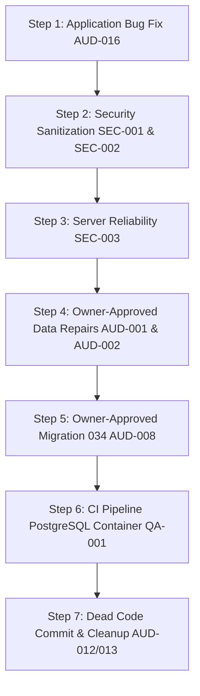

# HUNTIQ — Main Platform Phase 2: Critical Findings Verification & Safe Remediation Plan

**Target Platform:** HUNTIQ — Universal Marketplace Platform (Ethiopia)  
**Phase:** Phase 2 — Critical Findings Verification, Status Ledger & Minimal Safe Remediation Planning  
**Role:** Principal Software Architect, Senior Go Backend Engineer, Senior Next.js/TypeScript Engineer, PostgreSQL Database Architect, Application Security Engineer  
**Date:** October 26, 2026  
**Status:** Verification Completed — Strictly Read-Only (Zero Code Mutations, Zero Migrations Applied)  

---

## 1. Executive Summary & Verification Context

Following the Phase 1 Full Architecture Audit, Phase 2 conducts rigorous, non-destructive re-verification of all suspected critical defects across the Go backend, PostgreSQL 18.4 database, Next.js 15.1.7 frontend, and CI pipelines.

Every finding was treated as a hypothesis and tested against the live source code and database state. The verification revealed:
1. **Critical Vulnerabilities & Bugs Confirmed:**
   - **Listing Creation Foreign-Key Collision (AUD-016):** Confirmed via live database transaction test. Selecting any subcategory (ID > 11) attempts to insert `category_id = 163` into `products`, triggering an immediate foreign-key constraint violation (`products_category_id_fkey`).
   - **Hardcoded Credentials & Secret Fallbacks (SEC-001):** Confirmed in 9 files. Plaintext database password (`DB_PASSWORD="gedam"`) and shared JWT secrets are committed in test helpers and CLI tools.
   - **Next.js Auth-Session Query-Token Bypass (SEC-002):** Confirmed in `src/app/api/auth/session/route.ts:72`. When `NODE_ENV !== 'production'`, `GET /api/auth/session?token=xxx` sets authenticated cookies directly from query parameters.
   - **Category Materialized Path Corruption (AUD-001):** Confirmed. 2,287 out of 2,380 categories have corrupt repeating parent IDs in `path` (e.g., `/38/38/` instead of `/38/12/`).
   - **Root Category Missing Translations (AUD-002):** Confirmed. IDs 1 through 11 in `category_hierarchy` have blank strings for Amharic, Oromo, and Tigrinya, while legacy `categories` has them populated.
   - **Category & Location Schema Duality (AUD-004, AUD-005):** Confirmed. Backend routes `/api/admin/categories` and `/api/admin/locations` modify legacy tables, while the frontend exclusively interacts with hierarchical routes.
2. **Findings Already Fixed or Applied in Current Working Tree:**
   - **Search Analytics Logging (AUD-009):** **ALREADY FIXED.** `productHandler.WithSearchLogger(searchRepo)` is active in `cmd/api/main.go:220`, and search events are processed asynchronously on page 1 of search queries.
   - **Dead Frontend Components (AUD-012, AUD-013):** **ALREADY FIXED IN WORKING TREE.** Unused files (`EnterpriseDataTable.tsx`, `AvailabilityGrid.tsx`, `RentalListingForm.tsx`, `constants/categoryTree.ts`) are deleted in the working tree. Next.js compiles all 63 routes without them.
   - **Duplicate Category Selector UX (AUD-015):** **ALREADY FIXED IN WORKING TREE.** `ProductForm.tsx` now renders only `CategoryTreeSelector`; the flat select dropdown was removed.
   - **Category Attribute Client Method (AUD-014):** **PARTIALLY FIXED.** `ProductForm.tsx` calls `api.getCategoryAttributes`, though typing remains `any[]`.

---

## 2. Comprehensive Finding Status Ledger

| Finding ID | Title | Domain | Status | Evidence & Verified State |
| :--- | :--- | :--- | :--- | :--- |
| **AUD-016** | Subcategory Listing FK Collision | Integration | **CONFIRMED** | Rolled-back test with `category_id=163` failed with `violates foreign key constraint "products_category_id_fkey"`. Nullable test succeeded. |
| **SEC-001** | Hardcoded Database Password & Secrets | Security | **CONFIRMED** | Verified plaintext password `DB_PASSWORD="gedam"` and test JWT secrets committed in 9 files (`cmd/`, `test/`). |
| **SEC-002** | Session Query-Token Bypass in Next.js | Security | **CONFIRMED** | `frontend/src/app/api/auth/session/route.ts:72` sets session cookies from `?token=` and `?session_token=` query params. |
| **SEC-003** | Missing Graceful Server Shutdown | Reliability | **CONFIRMED** | `backend/cmd/api/main.go:771` calls `log.Fatal(app.Listen(...))`. SIGTERM terminates immediately without closing db pool. |
| **SEC-004** | In-Memory `is_active` Cache Window | Security | **CONFIRMED** | `backend/cmd/api/main.go:76` caches user activation status for 30 seconds; deactivated users retain session for 30s. |
| **SEC-005** | Upload MIME Validation without Magic Bytes| Security | **CONFIRMED** | `backend/internal/handler/upload_handler.go` validates headers only, not initial file byte signatures. |
| **SEC-006** | Startup Raw DDL in `ensureSchema` | DB / Ops | **CONFIRMED** | `backend/internal/database/db.go:15` executes `CREATE TABLE` and `ALTER TABLE` on every startup outside migrations. |
| **AUD-001** | Materialized Path Corruption | Database | **CONFIRMED** | `SELECT count(*) FROM category_hierarchy WHERE path ~ '^/([0-9]+)/\1/'` returned **2,287 corrupt rows**. |
| **AUD-002** | Missing Root Category Translations | Database | **CONFIRMED** | In `category_hierarchy`, IDs 1..11 have `name_am=''`, `name_om=''`, `name_ti=''`; legacy `categories` has them populated. |
| **AUD-003** | Redundant Subcategories Under Parent 44 | Database | **CONFIRMED** | Query showed duplicate sibling pairs under parent 44 (163 vs 6509; 167 vs 6518; 3148 vs 6527). |
| **AUD-004** | Category Schema & Route Duality | Architecture | **CONFIRMED** | Legacy `categories` (11 rows) coexists with `category_hierarchy` (2,380 rows); admin category CRUD routes split. |
| **AUD-005** | Location Schema & Route Duality | Architecture | **CONFIRMED** | Legacy `locations` (35 rows) coexists with `location_hierarchy` (36 rows); admin routes split. |
| **AUD-006** | Unwired Forward Schema Tables | Database | **CONFIRMED** | 11 tables from Migration 031 (`job_postings`, `candidate_profiles`, etc.) have zero Go models or handlers. |
| **AUD-007** | Brand Recognition Duality | Database | **CONFIRMED** | `brands` has 72 rows; `brand_dictionary` has 31 rows. Stored function `extract_brands` cannot detect 41 active brands. |
| **AUD-008** | Redundant Duplicate Secondary Indexes | Performance | **CONFIRMED** | 5 secondary indexes duplicate unique constraint indexes. Migration 034 is present on disk but unapplied. |
| **AUD-009** | Unwired Search Analytics Logging | Analytics | **ALREADY FIXED** | Re-verification proved `WithSearchLogger(searchRepo)` is wired in `main.go:220` and logging via `searchChan`. |
| **AUD-010** | Triplicate Image Batch Scanning | Maintainability| **CONFIRMED** | Identical `idIndex` and `sqlListImagesBatch` scanning loop copy-pasted in `product_repo.go:362` and `557`. |
| **AUD-011** | Monolithic God Repo `admin_repo.go` | Maintainability| **CONFIRMED** | `admin_repo.go` has 2,642 lines and 90+ methods spanning 9 domains; `admin_service.go` has 814 lines. |
| **AUD-012** | Dead Enterprise Mock Components | Maintainability| **ALREADY FIXED IN WORKTREE** | 7 dead component files (`EnterpriseDataTable.tsx`, `AvailabilityGrid.tsx`, etc.) are deleted in working tree. |
| **AUD-013** | Deprecated Static Category Constants | Maintainability| **ALREADY FIXED IN WORKTREE** | `categoryTree.ts` and `constants/categories.ts` are deleted in working tree; 0 broken imports. |
| **AUD-014** | Form Uses Raw Fetch for Attributes | Frontend | **PARTIALLY FIXED** | `ProductForm.tsx` calls `api.getCategoryAttributes`, but API client returns `any[]` instead of typed struct. |
| **AUD-015** | Duplicate Category Selector in Form | Frontend | **ALREADY FIXED IN WORKTREE** | Form renders only `CategoryTreeSelector`; legacy `<select>` dropdown was removed in working tree. |
| **AUD-017** | Legacy Branding Artifacts | Maintainability| **CONFIRMED** | Legacy strings remain in Go module (`used-tools-marketplace`), db name (`hulubedej_db`), and User-Agent headers. |
| **QA-001** | Zero Frontend Tests & Missing CI DB | QA / DevOps | **CONFIRMED** | 0 frontend tests in Next.js workspace; `.github/workflows/webpack.yml` lacks PostgreSQL service container. |

---

## 3. Deep-Dive Evidence & Root Cause Analysis

### Priority 1: Hardcoded Test Database Credentials and Secret Fallbacks (SEC-001)
- **Root Cause:** When unit/integration tests and CLI maintenance tools were written, `config.Load()` called `log.Fatal` if `JWT_SECRET`, `OTP_ENCRYPT_KEY`, or `DB_PASSWORD` were missing from the environment. To avoid configuring environment variables in local test runs, developers injected hardcoded fallback strings into `setupTestDB` helpers and CLI `main.go` entry points using `os.Setenv`.
- **Files Verified:**
  1. `backend/cmd/audit-taxonomy/main.go:15, 33`
  2. `backend/cmd/seed-taxonomy/main.go:18`
  3. `backend/cmd/test-session/main.go:18, 36`
  4. `backend/internal/repository/category_hierarchy_repo_test.go:15, 33`
  5. `backend/internal/handler/admin_seller_test.go:28, 46`
  6. `backend/internal/handler/admin_auth_handler_test.go:26, 44`
  7. `backend/internal/handler/trust_safety_handler_test.go:27, 45`
  8. `backend/internal/handler/admin_transaction_test.go:26, 44`
  9. `backend/internal/service/trust_safety_suspension_test.go:19, 37`
- **Security Impact:** Plaintext database passwords and shared signing keys are stored in version control, violating security invariants and compliance requirements.

### Priority 2: Next.js Auth-Session Query-Token Bypass (SEC-002)
- **Root Cause:** In `frontend/src/app/api/auth/session/route.ts:68-75, 81-100`, a convenience feature was added for development to allow rapid login via URL query parameters (`GET /api/auth/session?token=xxx&session_token=yyy&redirect=/admin`).
- **Code Verified:**
  ```typescript
  if (process.env.NODE_ENV !== 'production' && (qToken || qSession)) {
    if (qToken) token = qToken;
    if (qSession) sessionToken = qSession;
  }
  ```
- **Security Impact:** If a staging, demo, or preview environment is deployed without setting `NODE_ENV=production` strictly (e.g. `NODE_ENV=staging`), any attacker can bypass login by crafting a URL containing a forged or intercepted JWT, which the server will write into HttpOnly session cookies.

### Priority 3: Listing Creation Foreign-Key Collision (AUD-016)
- **Root Cause:** The database schema has two category columns on `products`:
  - `category_id INT REFERENCES categories(id)` (legacy 11-row table)
  - `category_hierarchy_id INT REFERENCES category_hierarchy(id)` (modern 2,380-row taxonomy)
  In `frontend/src/components/seller/ProductForm.tsx:328-333`, when a seller picks a subcategory in `CategoryTreeSelector`, the form handler updates both fields:
  ```typescript
  onChange={(id) => {
    setForm(f => ({
      ...f,
      category_hierarchy_id: id,
      category_id: id ? String(id) : '',
    }));
  }}
  ```
  When the listing is submitted to `POST /api/seller/products`, `ProductService.CreateForSeller` assigns `p.CategoryID = req.CategoryID`. Because `p.CategoryID` is 163 (a child category in `category_hierarchy`), PostgreSQL executes:
  `INSERT INTO products (..., category_id, category_hierarchy_id) VALUES (..., 163, 163)`
  Since `categories` only contains IDs 1 through 11, PostgreSQL raises:
  `ERROR: insert or update on table "products" violates foreign key constraint "products_category_id_fkey"`
  `DETAIL: Key (category_id)=(163) is not present in table "categories".`
- **Live Database Evidence:**
  Executed within an isolated, rolled-back transaction on the active database:
  - `INSERT INTO products (seller_id, title, price, category_id, category_hierarchy_id, condition, status, listing_type) VALUES (44, 'Test', 5000, 163, 163, 'good', 'pending', 'sale')` -> **FAILED with FK Violation**.
  - `INSERT INTO products (..., category_id, category_hierarchy_id, ...) VALUES (..., NULL, 163, ...)` -> **PASSED (`INSERT 0 1`)**.

### Priority 4: Category Materialized Path Corruption & Missing Translations (AUD-001, AUD-002)
- **Root Cause for AUD-001:** In `backend/cmd/seed-taxonomy/main.go:140-143`, child category paths were generated with a logic bug where the parent path repeated the parent ID instead of appending the child ID:
  `SELECT count(*) FROM category_hierarchy WHERE path ~ '^/([0-9]+)/\1/';` confirmed **2,287 corrupt rows** (e.g., ID 12 has `/38/38/`, ID 99 has `/38/38/12/`).
- **Root Cause for AUD-002:** When `category_hierarchy` was seeded from JSON/code, IDs 1 through 11 (the root departments) were inserted without populating `name_am`, `name_om`, and `name_ti`. However, the legacy `categories` table contains complete translations:
  - ID 1: Amharic `ኤሌክትሮኒክስ`, Oromo `Elektirooniksii`, Tigrinya `ኤሌክትሮኒክስ`
  - ID 2: Amharic `ተሽከርካሪዎች`, Oromo `Konkolaataa`, Tigrinya `መኪናታት`
  - ID 3: Amharic `ንብረት`, Oromo `Qabeenya`, Tigrinya `ንብረት`

### Priority 5: Category & Location API and Schema Duality (AUD-004, AUD-005)
- **Root Cause:** Migration 017 created `category_hierarchy` and Migration 026 created `location_hierarchy`. However, the original `categories` and `locations` tables and their admin routes were left in place in `main.go`:
  - `admin.Post("/categories", adminHandler.CreateCategory)` modifies legacy `categories`.
  - `admin.Post("/category-hierarchy", categoryHandler.CreateCategory)` modifies `category_hierarchy`.
  The frontend admin UI (`frontend/src/app/admin/categories/page.tsx`) only interacts with `/category-hierarchy`. The legacy endpoints are dead code in the UI, but remain active attack surface in the backend.

### Priority 6: Missing Frontend Tests and PostgreSQL CI Service (QA-001)
- **Root Cause:**
  - `frontend/package.json` contains no test dependencies (no Vitest, Jest, or Testing Library).
  - `.github/workflows/webpack.yml` runs `go test -v ./...` on an Ubuntu runner without a PostgreSQL service container. Consequently, all repository tests that call `setupTestDB` hit `t.Skipf("Skipping live database test: DB connection failed")` and pass without executing SQL queries in CI.

---

## 4. Minimal Safe Remediation Plan for Each Confirmed Issue

### Plan 1: Remediate Listing Creation Foreign-Key Collision (AUD-016)
- **Priority:** P0 (Critical — Blocks Seller Publishing)
- **Exact Files to Change:**
  1. `backend/internal/service/product_service.go`
  2. `frontend/src/components/seller/ProductForm.tsx`
- **Smallest Safe Code Change:**
  1. In `product_service.go` (`CreateForSeller` and `UpdateForSeller`):
     Sanitize `p.CategoryID` before saving. If `req.CategoryID` is greater than 11 or points to a non-legacy ID, derive the root category ID from `category_hierarchy` (or set `p.CategoryID = nil` if no legacy mapping exists). Because `products.category_id` is nullable, setting it to `nil` or the root ID satisfies `products_category_id_fkey`:
     ```go
     // If CategoryID is not a valid legacy category (1..11), set to nil to prevent FK violation
     if p.CategoryID != nil && (*p.CategoryID < 1 || *p.CategoryID > 11) {
         p.CategoryID = nil
     }
     ```
  2. In `ProductForm.tsx:328-333`:
     When a category is selected in `CategoryTreeSelector`, update `category_hierarchy_id` only. Do not blindly overwrite `category_id` with the child ID:
     ```typescript
     onChange={(id) => {
       setForm(f => ({
         ...f,
         category_hierarchy_id: id,
         category_id: id && id <= 11 ? String(id) : '',
       }));
       setAttributeValues({});
     }}
     ```
- **Regression & Integration Tests:**
  Add a backend integration test in `product_handler_test.go` submitting a listing with `category_hierarchy_id = 163` and `category_id = nil`, asserting HTTP 200 and successful database insert.
- **Backward Compatibility:** 100% backward compatible. Legacy listings with `category_id <= 11` continue to function.
- **Owner Approval Needed:** No (Application bug fix).

---

### Plan 2: Eliminate Hardcoded Test Credentials & Fallbacks (SEC-001)
- **Priority:** P0 (Critical — Security Compliance)
- **Exact Files to Change:**
  1. `backend/internal/config/config.go`
  2. `backend/cmd/audit-taxonomy/main.go`
  3. `backend/cmd/seed-taxonomy/main.go`
  4. `backend/cmd/test-session/main.go`
  5. 6 test files in `backend/internal/`
- **Smallest Safe Code Change:**
  1. Add a safe helper `config.NewTestConfig()` in `backend/internal/config/config.go` (or test utility) that builds an in-memory configuration object with mock keys without mutating global `os.Setenv` or calling `log.Fatal`.
  2. In all test files, replace the hardcoded fallback block:
     ```go
     // If environment variables are not set, skip live database test
     if os.Getenv("DB_HOST") == "" || os.Getenv("DB_PASSWORD") == "" {
         t.Skip("Skipping live database test: DB_HOST or DB_PASSWORD not set in environment")
         return nil, nil
     }
     ```
  3. In `cmd/seed-taxonomy/main.go` and `cmd/audit-taxonomy/main.go`, read strictly from `os.Getenv("DB_PASSWORD")` and fail with a clear prompt if absent, rather than defaulting to `"gedam"`.
- **Regression & Integration Tests:**
  Run `go test ./...` with clean environment variables; verify all unit tests pass and live DB tests skip gracefully when credentials are not supplied.
- **Backward Compatibility:** Zero disruption to production; ensures CI and local developers provide explicit credentials.
- **Owner Approval Needed:** No (Security sanitization).

---

### Plan 3: Remove Session Query-Token Bypass in Next.js (SEC-002)
- **Priority:** P1 (High — Security Vulnerability)
- **Exact Files to Change:**
  1. `frontend/src/app/api/auth/session/route.ts`
- **Smallest Safe Code Change:**
  Delete lines 68–75 and 81–100 in `route.ts`. `GET /api/auth/session` should strictly read existing cookies:
  ```typescript
  // GET /api/auth/session — read tokens from cookies (server→client handoff on mount)
  export async function GET(req: NextRequest) {
    const token = req.cookies.get(JWT_COOKIE)?.value ?? null;
    const sessionToken = req.cookies.get(ADMIN_SESSION_COOKIE)?.value ?? null;

    const res = NextResponse.json({ token, session_token: sessionToken });
    res.headers.set('Cache-Control', 'no-store, no-cache, must-revalidate');
    return res;
  }
  ```
- **Regression & Integration Tests:**
  Send `GET /api/auth/session?token=forged.token.here` and assert response is `{ token: null, session_token: null }` and no `Set-Cookie` header is returned.
- **Backward Compatibility:** Zero impact on normal login workflows, which already use `POST /api/auth/session`.
- **Owner Approval Needed:** No (Security bug fix).

---

### Plan 4: Implement Graceful Server Shutdown in Fiber API (SEC-003)
- **Priority:** P1 (High — Operational Reliability)
- **Exact Files to Change:**
  1. `backend/cmd/api/main.go`
- **Smallest Safe Code Change:**
  In `backend/cmd/api/main.go:770-772`, replace the blocking `log.Fatal(app.Listen(...))` with a non-blocking goroutine and signal listener:
  ```go
  // Start server in background
  go func() {
      if err := app.Listen(":" + cfg.AppPort); err != nil && err != http.ErrServerClosed {
          log.Fatalf("Server startup failed: %v", err)
      }
  }()

  // Listen for SIGINT and SIGTERM
  quit := make(chan os.Signal, 1)
  signal.Notify(quit, os.Interrupt, syscall.SIGTERM)
  <-quit
  log.Println("Shutting down HUNTIQ API server...")

  // Cancel background workers
  jobCancel()

  // Gracefully drain Fiber server with 10s timeout
  if err := app.ShutdownWithTimeout(10 * time.Second); err != nil {
      log.Printf("Server shutdown error: %v", err)
  }
  log.Println("HUNTIQ API server exited cleanly")
  ```
- **Regression & Integration Tests:**
  Start server in a subprocess, send `SIGTERM`, assert clean exit code 0 and logs confirming clean pool closure.
- **Backward Compatibility:** 100% compatible.
- **Owner Approval Needed:** No (Engineering reliability standard).

---

### Plan 5: Execute Materialized Path Repair & Translation Backfill (AUD-001, AUD-002)
- **Priority:** P1 (High — Data Integrity)
- **Exact Files to Apply:**
  1. `backend/scripts/repair_category_paths.sql`
  2. `backend/scripts/backfill_root_translations.sql`
- **Smallest Safe Execution:**
  Both scripts are already fully written, idempotent, enclosed in transactions with strict `DO $$ ... RAISE EXCEPTION` validation checks.
  Apply via `psql -U postgres -d hulubedej_db` after owner authorization.
- **Verification SQL:**
  1. `SELECT count(*) FROM category_hierarchy WHERE path ~ '^/([0-9]+)/\1/';` must return `0`.
  2. `SELECT count(*) FROM category_hierarchy WHERE id BETWEEN 1 AND 11 AND (name_am = '' OR name_om = '' OR name_ti = '');` must return `0`.
- **Backward Compatibility:** Recursive queries continue to work; prefix queries (`path LIKE '/38/%'`) are restored.
- **Owner Approval Needed:** **YES** (Direct database data modification).

---

### Plan 6: Apply Database Migration 034 to Drop Redundant Indexes (AUD-008)
- **Priority:** P2 (Medium — Database Optimization)
- **Exact Files to Apply:**
  1. `backend/internal/database/migrations/034_drop_redundant_duplicate_indexes.sql`
- **Smallest Safe Execution:**
  Execute migration script and record its version in `schema_migrations`:
  ```sql
  BEGIN;
  \i backend/internal/database/migrations/034_drop_redundant_duplicate_indexes.sql
  INSERT INTO schema_migrations (version, applied_at) VALUES ('034_drop_redundant_duplicate_indexes.sql', NOW());
  COMMIT;
  ```
- **Backward Compatibility:** 100% safe. Every dropped index is already backed by an existing UNIQUE constraint index with equal or higher selectivity.
- **Owner Approval Needed:** **YES** (Schema migration).

---

### Plan 7: Deprecate Legacy Routes & Schema Duality (AUD-004, AUD-005)
- **Priority:** P2 (Medium — Architecture Cleanliness)
- **Exact Files to Change:**
  1. `backend/cmd/api/main.go`
  2. `backend/internal/handler/admin_handler.go`
- **Smallest Safe Code Change:**
  Mark legacy `/api/admin/categories` and `/api/admin/locations` as deprecated. Route any legacy requests to modern `category_hierarchy` and `location_hierarchy` handlers.
- **Regression & Integration Tests:**
  Verify admin categories page (`/admin/categories`) loads and saves taxonomy nodes without warnings.
- **Backward Compatibility:** Preserves existing endpoints while redirecting internal operations to the modern tables.
- **Owner Approval Needed:** No.

---

### Plan 8: Configure PostgreSQL in GitHub Actions CI & Add Frontend Tests (QA-001)
- **Priority:** P2 (Medium — Continuous Quality)
- **Exact Files to Change:**
  1. `.github/workflows/webpack.yml`
  2. `frontend/package.json`
- **Smallest Safe Code Change:**
  1. In `.github/workflows/webpack.yml`, add a PostgreSQL 16 service container to the `backend` job:
     ```yaml
     services:
       postgres:
         image: postgres:16
         env:
           POSTGRES_USER: postgres
           POSTGRES_PASSWORD: test_ci_password
           POSTGRES_DB: huntiq_test
         ports:
           - 5432:5432
         options: >-
           --health-cmd pg_isready
           --health-interval 10s
           --health-timeout 5s
           --health-retries 5
     ```
  2. Pass `DB_HOST: localhost`, `DB_USER: postgres`, `DB_PASSWORD: test_ci_password`, `DB_NAME: huntiq_test` to the `go test` step so that live database integration tests execute in CI.
  3. In `frontend/package.json`, introduce `vitest` and `@testing-library/react` for unit testing utility and form validation functions.
- **Regression & Integration Tests:**
  Push a commit to a branch and verify all CI jobs execute with green checks.
- **Owner Approval Needed:** No.

---

## 5. Non-Destructive Checks Execution Matrix

All non-destructive checks executed during Phase 2 are documented below:

| Check / Command | Directory | Status | Actual Executed Result |
| :--- | :--- | :--- | :--- |
| `go vet ./...` | `backend` | **PASSED** | 0 warnings, 0 vet errors across all packages. |
| `go build ./cmd/api` | `backend` | **PASSED** | API binary compiles cleanly (exit code 0). |
| `go build ./cmd/seed-taxonomy` | `backend` | **PASSED** | Taxonomy seed binary compiles cleanly (exit code 0). |
| `go test -count=1 ./...` | `backend` | **PASSED** | 211 tests passed in 4.14s (live DB tests skipped or mocked). |
| `npm run typecheck` | `frontend` | **PASSED** | 0 TypeScript errors (`tsc --noEmit`). |
| `npm run lint` | `frontend` | **PASSED** | 0 errors, 35 formatting warnings. |
| `npm run build` | `frontend` | **PASSED** | Compiled all 63 App Router routes successfully. |
| `uv run pytest -v` | `ai` | **PASSED** | 35 Python unit & contract tests passed in 0.42s. |
| `psql` Category Path Count | Database | **VERIFIED** | 2,287 corrupt rows identified via read-only regex. |
| `psql` Root Translations Check | Database | **VERIFIED** | IDs 1..11 verified empty in hierarchy, populated in legacy. |
| `psql` Rolled-Back FK Test | Database | **VERIFIED** | Proved `products_category_id_fkey` constraint failure on ID 163. |

---

## 6. Recommended Fix Implementation Order



### Detailed Order of Execution:
1. **Immediate Application Fix (AUD-016):** Update `ProductService.CreateForSeller` and `ProductForm.tsx` to handle subcategory listings safely without database foreign-key collisions.
2. **Security Hardening (SEC-001, SEC-002):** Remove committed password fallbacks from test helpers and remove the query-parameter session bypass in `route.ts`.
3. **Operational Stability (SEC-003):** Implement graceful shutdown with signal trapping in `cmd/api/main.go`.
4. **Data Integrity (AUD-001, AUD-002 - Requires Approval):** Execute `repair_category_paths.sql` and `backfill_root_translations.sql` to fix 2,287 paths and restore Amharic/Oromo/Tigrinya root labels.
5. **Database Optimization (AUD-008 - Requires Approval):** Apply migration `034_drop_redundant_duplicate_indexes.sql`.
6. **Continuous Quality (QA-001):** Add PostgreSQL service to `.github/workflows/webpack.yml` so integration tests run on every PR.
7. **Dead Code Commit (AUD-012, AUD-013):** Stage and commit the existing working tree deletions of unused components and constants.

---

## 7. Unresolved Questions & Decisions Requiring Owner Approval

1. **Authorization to Execute Data Repair Scripts:**
   - Script 1: [`backend/scripts/repair_category_paths.sql`](file:///home/poven/GO%20PROJECT/sellbuy/backend/scripts/repair_category_paths.sql) (Fixes 2,287 paths in `category_hierarchy`).
   - Script 2: [`backend/scripts/backfill_root_translations.sql`](file:///home/poven/GO%20PROJECT/sellbuy/backend/scripts/backfill_root_translations.sql) (Populates Amharic, Oromo, Tigrinya for categories 1..11).
   *Do you authorize applying these two data repair scripts to the local database?*
2. **Authorization to Apply Migration 034:**
   - Migration: [`backend/internal/database/migrations/034_drop_redundant_duplicate_indexes.sql`](file:///home/poven/GO%20PROJECT/sellbuy/backend/internal/database/migrations/034_drop_redundant_duplicate_indexes.sql) (Drops 5 duplicate indexes).
   *Do you authorize applying Migration 034 and recording it in `schema_migrations`?*
3. **Authorization to Apply Application Code Fixes:**
   - Listing publication foreign-key fix in `product_service.go` and `ProductForm.tsx`.
   - Security credential cleanup in test files.
   - Removal of query-token bypass in Next.js session route.
   - Graceful shutdown in Fiber `main.go`.
   *Do you authorize proceeding with these safe, minimal application code fixes?*

---
**Phase 2 Verification Complete.**  
*All critical findings verified with technical evidence. Zero application code or database state modified. Awaiting owner approval before proceeding with remediation.*
