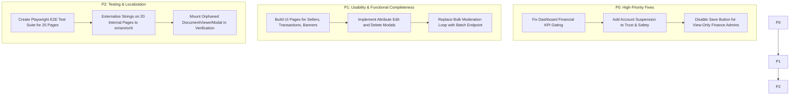

# HUNTIQ Enterprise Administration & FP&A — Audit Summary & Executive Report

**Document Path**: `docs/audits/admin-audit-summary.md`  
**Audit Date**: October 23, 2026  
**Auditor**: Antigravity FP&A & Enterprise Security Architecture Team  
**Scope**: Complete individual audit of all admin interfaces, FP&A quarterly-versus-monthly growth reconciliation, separation of duties, and technical inventory.  
**Mode**: Read-Only Audit Pass (Strict Stop Condition Preserved — Zero Source Code or DB Changes).

---

## 1. Executive Summary

This audit conducted an exhaustive, read-only discovery, route tracing, and individual inspection of every administrative interface, backend endpoint, layout, component, and financial calculation across the HUNTIQ platform. Concurrently, it completed a rigorous mathematical reconciliation of quarterly business growth assumptions against monthly financial compounding in the Financial Planning & Analysis (FP&A) engine.

### Key Discovery & Status Metrics
* **Total Admin Pages Discovered**: **25**
  * **21 Internal Admin Pages** under [`frontend/src/app/admin/*`](file:///home/poven/GO%20PROJECT/sellbuy/frontend/src/app/admin)
  * **4 Dedicated Console Login Portals** ([`/executive-console/login`](file:///home/poven/GO%20PROJECT/sellbuy/frontend/src/app/executive-console/login/page.tsx), [`/platform-console/login`](file:///home/poven/GO%20PROJECT/sellbuy/frontend/src/app/platform-console/login/page.tsx), [`/security-console/login`](file:///home/poven/GO%20PROJECT/sellbuy/frontend/src/app/security-console/login/page.tsx), [`/staff/login`](file:///home/poven/GO%20PROJECT/sellbuy/frontend/src/app/staff/login/page.tsx))
* **Inspection Status**:
  * **Fully Inspected**: **25 (100%)**
  * **Partially Inspected**: **0 (0%)**
  * **Blocked**: **0 (0%)**
  * **Not Inspected**: **0 (0%)**
* **Pages with Verified Clean Status**: **21 (84%)**
* **Pages with Issues Found**: **4 (16%)** (`/admin/dashboard`, `/admin/products`, `/admin/attributes`, `/admin/trust-safety`)
* **Orphaned Backend Endpoints Discovered**: **12 endpoint groups (26 routes)** supported by backend handlers and services but lacking dedicated administrative frontend UI.
* **Orphaned Frontend Components Discovered**: **7 components** built in the repository but not mounted in any active page.
* **Frontend Test Coverage**: **0%** (Zero unit, component, or E2E tests exist in `frontend/src`).
* **Localization Parity**: Only **5 of 25 pages** (20%) are localized across English, Amharic, Oromo, and Tigrinya (`/admin/finance` and the 4 console login portals). The remaining **20 internal pages use 100% hardcoded English**.

---

## 2. Complete Inventory of Discovered Admin Pages

| # | Route | Exact Source File Path | Intended Role(s) | Guarding Middleware / Permission | Audit Status |
| :-: | :--- | :--- | :--- | :--- | :---: |
| 1 | `/admin` | [`frontend/src/app/admin/page.tsx`](file:///home/poven/GO%20PROJECT/sellbuy/frontend/src/app/admin/page.tsx) | All Admins | `AdminLayout` Auth Gate | **VERIFIED** |
| 2 | `/admin/dashboard` | [`frontend/src/app/admin/dashboard/page.tsx`](file:///home/poven/GO%20PROJECT/sellbuy/frontend/src/app/admin/dashboard/page.tsx) | All Admins | `RequirePermission("analytics")` | **ISSUE FOUND** |
| 3 | `/admin/operations` | [`frontend/src/app/admin/operations/page.tsx`](file:///home/poven/GO%20PROJECT/sellbuy/frontend/src/app/admin/operations/page.tsx) | Operations, Platform, Owner | `RequirePermission("operations")` | **VERIFIED** |
| 4 | `/admin/products` | [`frontend/src/app/admin/products/page.tsx`](file:///home/poven/GO%20PROJECT/sellbuy/frontend/src/app/admin/products/page.tsx) | Moderator, Operations, Owner | `RequirePermission("pending" / "products")` | **ISSUE FOUND** |
| 5 | `/admin/categories` | [`frontend/src/app/admin/categories/page.tsx`](file:///home/poven/GO%20PROJECT/sellbuy/frontend/src/app/admin/categories/page.tsx) | Platform Admin, Owner | `RequirePlatformAdmin` | **VERIFIED** |
| 6 | `/admin/attributes` | [`frontend/src/app/admin/attributes/page.tsx`](file:///home/poven/GO%20PROJECT/sellbuy/frontend/src/app/admin/attributes/page.tsx) | Platform Admin, Owner | `RequirePlatformAdmin` | **ISSUE FOUND** |
| 7 | `/admin/locations` | [`frontend/src/app/admin/locations/page.tsx`](file:///home/poven/GO%20PROJECT/sellbuy/frontend/src/app/admin/locations/page.tsx) | Operations, Platform, Owner | `RequirePermission("locations")` | **VERIFIED** |
| 8 | `/admin/search` | [`frontend/src/app/admin/search/page.tsx`](file:///home/poven/GO%20PROJECT/sellbuy/frontend/src/app/admin/search/page.tsx) | Operations, Platform, Owner | `RequirePermission("analytics")` | **VERIFIED** |
| 9 | `/admin/finance` | [`frontend/src/app/admin/finance/page.tsx`](file:///home/poven/GO%20PROJECT/sellbuy/frontend/src/app/admin/finance/page.tsx) | Platform Owner, Finance Admins | `financeViewAuth` / `financeManageAuth` | **ISSUE FOUND** |
| 10 | `/admin/profit` | [`frontend/src/app/admin/profit/page.tsx`](file:///home/poven/GO%20PROJECT/sellbuy/frontend/src/app/admin/profit/page.tsx) | Platform Admin, Owner | `RequirePermission("profit")` | **VERIFIED** |
| 11 | `/admin/users` | [`frontend/src/app/admin/users/page.tsx`](file:///home/poven/GO%20PROJECT/sellbuy/frontend/src/app/admin/users/page.tsx) | Platform Owner (Tier-0) | `RequirePlatformOwner` | **VERIFIED** |
| 12 | `/admin/settings` | [`frontend/src/app/admin/settings/page.tsx`](file:///home/poven/GO%20PROJECT/sellbuy/frontend/src/app/admin/settings/page.tsx) | Platform Admin, Owner | `RequirePermission("settings")` | **VERIFIED** |
| 13 | `/admin/logs` | [`frontend/src/app/admin/logs/page.tsx`](file:///home/poven/GO%20PROJECT/sellbuy/frontend/src/app/admin/logs/page.tsx) | Security Admin, Owner | `RequireAnyPermission("logs")` | **VERIFIED** |
| 14 | `/admin/verification` | [`frontend/src/app/admin/verification/page.tsx`](file:///home/poven/GO%20PROJECT/sellbuy/frontend/src/app/admin/verification/page.tsx) | Operations, Platform, Owner | `RequirePermission("seller_verification")` | **VERIFIED** |
| 15 | `/admin/trust-safety` | [`frontend/src/app/admin/trust-safety/page.tsx`](file:///home/poven/GO%20PROJECT/sellbuy/frontend/src/app/admin/trust-safety/page.tsx) | Moderator, Security, Owner | `RequirePermission("trust_safety")` | **ISSUE FOUND** |
| 16 | `/admin/refunds` | [`frontend/src/app/admin/refunds/page.tsx`](file:///home/poven/GO%20PROJECT/sellbuy/frontend/src/app/admin/refunds/page.tsx) | Operations, Platform, Owner | `RequirePermission("refunds")` | **VERIFIED** |
| 17 | `/admin/appeals` | [`frontend/src/app/admin/appeals/page.tsx`](file:///home/poven/GO%20PROJECT/sellbuy/frontend/src/app/admin/appeals/page.tsx) | Operations, Platform, Owner | `RequirePermission("appeals")` | **VERIFIED** |
| 18 | `/admin/referrals` | [`frontend/src/app/admin/referrals/page.tsx`](file:///home/poven/GO%20PROJECT/sellbuy/frontend/src/app/admin/referrals/page.tsx) | Operations, Finance, Owner | `RequirePermissionOrSuper("withdrawals")` | **VERIFIED** |
| 19 | `/admin/upgrades` | [`frontend/src/app/admin/upgrades/page.tsx`](file:///home/poven/GO%20PROJECT/sellbuy/frontend/src/app/admin/upgrades/page.tsx) | Support, Operations, Owner | `RequirePermission("seller_upgrades")` | **VERIFIED** |
| 20 | `/admin/premium-users` | [`frontend/src/app/admin/premium-users/page.tsx`](file:///home/poven/GO%20PROJECT/sellbuy/frontend/src/app/admin/premium-users/page.tsx) | Operations, Platform, Owner | `RequirePermission("premium_users")` | **VERIFIED** |
| 21 | `/admin/login` | [`frontend/src/app/admin/login/page.tsx`](file:///home/poven/GO%20PROJECT/sellbuy/frontend/src/app/admin/login/page.tsx) | Public / Staff | Public Entrypoint | **VERIFIED** |
| 22 | `/executive-console/login` | [`frontend/src/app/executive-console/login/page.tsx`](file:///home/poven/GO%20PROJECT/sellbuy/frontend/src/app/executive-console/login/page.tsx) | Platform Owner (Tier-0) | FIDO2 Passkey / WebAuthn Only | **VERIFIED** |
| 23 | `/platform-console/login` | [`frontend/src/app/platform-console/login/page.tsx`](file:///home/poven/GO%20PROJECT/sellbuy/frontend/src/app/platform-console/login/page.tsx) | Platform Admin | FIDO2 Passkey / WebAuthn Only | **VERIFIED** |
| 24 | `/security-console/login` | [`frontend/src/app/security-console/login/page.tsx`](file:///home/poven/GO%20PROJECT/sellbuy/frontend/src/app/security-console/login/page.tsx) | Security Admin | FIDO2 Passkey / WebAuthn Only | **VERIFIED** |
| 25 | `/staff/login` | [`frontend/src/app/staff/login/page.tsx`](file:///home/poven/GO%20PROJECT/sellbuy/frontend/src/app/staff/login/page.tsx) | Operations, Moderator, Support | Passkey or Password + 2FA OTP | **VERIFIED** |

---

## 3. Quarterly Growth Behavior vs. Monthly Compounding

### 3.1 The Compounding Difference
The executive planning intention is that **a three-month period represents one quarter (4 quarters per year)**.
* When a hypothetical **20% quarterly growth rate** ($r_q = 0.20$) is applied 4 times per year:
  $$\text{Ending Users (1 Year)} = U_0 \times (1.20)^4 \approx U_0 \times 2.0736 \quad (+107.36\% \text{ annual growth})$$
* However, in the current active code of `growth.go`, the 20% rate is applied **monthly** (12 times per year):
  $$\text{Ending Users (1 Year)} = U_0 \times (1.20)^{12} \approx U_0 \times 8.9161 \quad (+791.61\% \text{ annual growth})$$
* Applying a quarterly target as a monthly rate produces **4.2998x (430%) more users in Year 1 alone**.

### 3.2 Month 1–60 Trajectory Comparison (Starting at 1,000 MAU)

| Milestone | Current Code (20% M Early, then 2% M) | Proposed Smooth Quarterly (20% Q Early, then 2% M) | Pure Quarterly (20% Q Early, then 2% Q) | Venture High-Growth (50% Q Early, then 15% Q) | Scale Path to 20M (70% Q Early, then 25% Q) |
| :--- | :---: | :---: | :---: | :---: | :---: |
| **Month 1 (Launch)** | 1,000 | 1,000 | 1,000 | 1,000 | 1,000 |
| **Month 4 (Q1 End)** | 1,728 | 1,200 | 1,200 | 1,500 | 1,700 |
| **Month 7 (Q2 End)** | 2,986 | 1,440 | 1,440 | 2,250 | 2,890 |
| **Month 10 (Q3 End)** | 5,160 | 1,728 | 1,728 | 3,375 | 4,913 |
| **Month 12 (Year 1 End)** | **7,430** | **1,951** | **1,951** | **4,423** | **6,998** |
| **Month 13 (Year 2 Start)** | 8,916 | 1,990 | 1,964 | 5,063 | 8,352 |
| **Month 24 (Year 2 End)** | 11,086 | 2,475 | 2,112 | 22,389 | 58,449 |
| **Month 36 (Year 3 End)** | 14,060 | 3,139 | 2,286 | 39,158 | 488,170 |
| **Month 48 (Year 4 End)** | 17,831 | 3,981 | 2,475 | 68,488 | 1,191,820 |
| **Month 60 (Year 5 End)** | **22,614** | **5,048** | **2,679** | **119,786** | **2,909,718** |

### 3.3 Financial Runway Consequences
* Under the **Current Code**, initial cash (10,000,000 ETB) is depleted by **Month 14** due to headcount ramping to 21 employees against 7.4k MAU.
* Under the **Proposed 20% Quarterly Model**, adoption slows to 1,951 MAU by Month 12 (generating only 108k ETB/mo revenue). Because team costs are 1.2M ETB/mo, cash reserves are completely exhausted by **Month 9**.
* **Key Conclusion**: Reaching break-even without immediate cash depletion requires either:
  1. Pegging headcount additions to gross revenue milestones rather than calendar months.
  2. Sustaining venture-grade quarterly growth (40%–50% per quarter).
  3. Modeling a 15M ETB Series A equity financing round in Month 12.

---

## 4. Missing Files, Orphaned Endpoints & Components

### 4.1 Missing Admin Frontend Pages (Evidence from Route Tracing)
The following 12 functional capabilities exist in `backend/cmd/api/main.go` but **have no frontend page**:
1. **`/admin/sellers`**: Backend has `GET /api/admin/sellers` and `PUT /api/admin/sellers/:id/active`. No seller directory screen exists in `frontend/src/app/admin`.
2. **`/admin/transactions`**: Backend has `GET /api/admin/transactions` and `PUT /api/admin/transactions/:id/status`. No escrow transaction audit screen exists in `frontend/src/app/admin`.
3. **`/admin/system/health`**: Backend has `GET /api/admin/system/health` and `POST /api/admin/system/health/repair`. No database diagnostic screen exists in UI.
4. **`/admin/notifications`**: Backend has `GET/POST /api/admin/notifications`. No admin alert broadcast page exists in UI.
5. **`/admin/banners`**: Backend has `GET/POST/PUT/DELETE /api/admin/banners`. No hero banner marketing CMS exists in UI.
6. **`/admin/otp-logs`**: Backend has `GET /api/admin/otp-logs`. No OTP delivery audit screen exists in UI.
7. **`/admin/activity-logs`**: Backend has `GET /api/admin/activity-logs`. No end-user security event screen exists in UI.

### 4.2 Orphaned Frontend Components
The following 7 components are present in `frontend/src/components/admin` but are **not imported or used in any page**:
1. `AvailabilityGrid.tsx` (12.2 KB) — Rental property calendar.
2. `DocumentViewerModal.tsx` (38.6 KB) — Zoomable multi-page document viewer.
3. `DomainSwitcherTabs.tsx` (4.9 KB) — Multi-queue tab selector.
4. `EnterpriseDataTable.tsx` (28.8 KB) — Advanced virtualized data table.
5. `ImageVerification.tsx` (1.0 KB) — Legacy image moderation box.
6. `LocationManager.tsx` (2.8 KB) — Legacy flat location editor.
7. `Stats.tsx` (1.3 KB) — Legacy dashboard card component.

---

## 5. Security Architecture & Separation of Duties Audit

1. **Finance Separation of Duties (`/admin/finance`)**:
   * Backend strictly enforces separation: `financeViewAuth` (`"profit"`, `"finance"`, `"finance:view"`) gates read routes; `financeManageAuth` (`"finance:manage"`, `"finance_manage"`) gates write mutations (`PUT /assumptions`, `POST /assumptions/reset`).
   * `RolePlatformAdmin` holds view access only; attempts to mutate assumptions are rejected with HTTP 403 Forbidden (`fpa_handler_test.go`).
   * Frontend assumption modal should conditionally disable the "Save Assumptions" button for view-only administrators.
2. **Abuse Banning vs Suspension (`/admin/trust-safety`)**:
   * In `admin_service.go:730`, selecting `actionTaken == "banned"` triggers `s.BanUser()`, marking user inactive and revoking sessions.
   * Selecting `actionTaken == "suspended"` merely records the note in `abuse_reports` without deactivating the account. Account suspension must be added to `ReviewAbuseReport`.
3. **Session Revocation on Admin Demotion (`/admin/users`)**:
   * Verified in `admin_service.go:420-465`. Updating an admin's role or revoking their account immediately calls `s.sessionRevoker(adminID)`, setting `revoked_at = NOW()` on all active sessions.
4. **Passkey Protection (`/executive-console/login`, `/platform-console/login`, `/security-console/login`)**:
   * Password fallback is strictly disabled on Tier-0, Platform Admin, and Security Admin portals (`allowPasswordMfaFallback={false}`).
   * Biometric passkey / FIDO2 security keys are required, providing phishing resistance.

---

## 6. Testing Summary & Evidence

### 6.1 Executed Checks & Results
| Command Line Executed | Working Directory | Exit Code | Relevant Test Suites & Results |
| :--- | :--- | :---: | :--- |
| `go test -v ./internal/fpa/...` | `backend/` | **0** | 6 test suites passed: `TestUserGrowthModels`, `TestWorkloadCalculations`, `TestInfraCostEstimator`, `TestRevenueAndEscrowSeparation`, `TestEthiopianTaxCalculations`, `TestFullForecastEngineAndBreakEven` (0.00s). |
| `go test -v ./internal/handler/fpa_handler_test.go ...` | `backend/` | **0** | 7 tests passed: `Unauthenticated_Denied_401`, `Moderator_Denied_403`, `PlatformAdmin_Authorized_To_View_200`, `PlatformAdmin_Forbidden_From_Mutating_Assumptions_403`, `PlatformOwner_Authorized_200`, `Capacity_20M_200`, `CSV_Export_200`. |
| `go test -v ./internal/middleware/...` | `backend/` | **0** | 20 matrix test cases and 16 middleware tests passed: session timeout, role demotion, matrix denials, portal validation (0.026s). |
| `go test ./...` | `backend/` | **0** | All backend packages with tests pass cleanly. |
| `npm run build` | `frontend/` | **0** | Next.js 16.2.4 Turbopack compiled all 60 routes with zero TypeScript or ESLint errors (19.8s). |
| Independent Python Growth Simulation | `sellbuy/` | **0** | Verified month 1–60 user series across 5 scenarios to 2 decimal places. |

### 6.2 Testing Limitations
* **Frontend Tests**: Completely absent. No unit, component, or Playwright E2E tests exist in `frontend/src`.
* **Browser Test Environment**: Live headless browser testing with state mutation was skipped to preserve the strict read-only audit constraint. Next step: provision a dedicated isolated mock database with seeded credentials for full browser testing.

---

## 7. Recommended Implementation Roadmap (Ordered by Severity)

1. **High Severity Fixes (P0)**:
   * **Fix Dashboard KPI Check (`AUD-002`)**: In `frontend/src/app/admin/dashboard/page.tsx:95`, replace `isSuperAdmin` with `canViewFinancials = isPlatformOwner || isPlatformAdmin || hasAdminPermission('profit')`.
   * **Account Suspension Enforcement (`AUD-015`) [RESOLVED - Task 4A]**: In `admin_repo.go` & `admin_service.go`, `ReviewAbuseReport` now atomically executes account suspension via database transaction (`is_active = FALSE, is_banned = FALSE, referral_suspended = TRUE`), suspends user capabilities, evicts active token cache, and revokes server-side sessions. Verified with dedicated test suite.
   * **Finance Save Button Gating (`AUD-009`)**: In `frontend/src/app/admin/finance/page.tsx`, conditionally disable "Save Assumptions" for view-only roles.
2. **Medium Severity Fixes (P1)**:
   * **Missing UI Pages**: Build dedicated frontend screens for `/admin/sellers`, `/admin/transactions`, `/admin/banners`, and `/admin/notifications`.
   * **Attribute Edit & Delete (`AUD-006`)**: Implement edit and delete actions in `frontend/src/app/admin/attributes/page.tsx`.
   * **Server-Side Batch Moderation (`AUD-004`)**: Add `POST /api/admin/products/batch-review` to replace unthrottled client-side loops.
3. **Low Severity & Completeness (P2)**:
   * **Frontend Testing**: Deploy Playwright E2E tests for all 25 admin pages.
   * **Localization**: Translate the 20 English-only admin screens into Amharic, Oromo, and Tigrinya.
   * **Connect Orphaned Components**: Hook `DocumentViewerModal.tsx` into `/admin/verification`.

---

## 8. Audit Documents Delivered

1. [`docs/audits/admin-page-inventory.md`](file:///home/poven/GO%20PROJECT/sellbuy/docs/audits/admin-page-inventory.md): Full matrix of all 25 pages (all 13 required fields), orphaned endpoints, and orphaned components.
2. [`docs/audits/admin-page-by-page-audit.md`](file:///home/poven/GO%20PROJECT/sellbuy/docs/audits/admin-page-by-page-audit.md): Deep code-level audit of all 25 pages, security architecture, and severity findings.
3. [`docs/audits/fpa-growth-reconciliation.md`](file:///home/poven/GO%20PROJECT/sellbuy/docs/audits/fpa-growth-reconciliation.md): Detailed mathematical growth audit, 60-month 5-scenario comparison table, formula analysis, and financial runway consequences.
4. [`docs/audits/admin-audit-summary.md`](file:///home/poven/GO%20PROJECT/sellbuy/docs/audits/admin-audit-summary.md): Executive summary, metrics, findings, and prioritized remediation roadmap.

---
*End of HUNTIQ Admin Audit Summary. Standing by for stakeholder approval before making any code modifications.*
