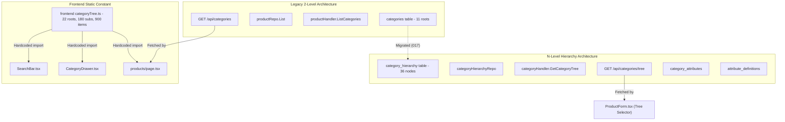

# HUNTIQ Universal Marketplace Taxonomy & Localization Initial Audit

**Date:** October 24, 2026  
**Auditor:** HUNTIQ Architecture & Engineering Team  
**System:** HUNTIQ Ethiopia Universal Marketplace (`sellbuy`)  
**Scope:** PostgreSQL Schemas, Go Fiber Services, Category Hierarchies, Dynamic Attributes, Localization Dictionaries, Frontend Navigation, Search Indexing, and Responsive UI Components.

---

## 1. Executive Summary & Ground Truth Verification

An exhaustive audit of the PostgreSQL database, Go backend, Next.js frontend, and localization bundles was executed to establish the exact baseline before undertaking the Universal Marketplace Taxonomy expansion.

### Key Audit Findings

1. **Severe Database vs. Frontend Fragmentation:**
   - The live PostgreSQL database contains **only 11 root categories** in the legacy `categories` table and **36 total rows** (11 roots, 25 level-1 leaves, 0 level-2+ nodes) in `category_hierarchy`.
   - In contrast, the Next.js frontend possesses a hard-coded static TypeScript tree (`frontend/src/lib/constants/categoryTree.ts`) containing **22 top-level category keys, 180 subcategories, and 900+ item strings**.
   - Public search (`SearchBar.tsx`), public category drawers (`CategoryDrawer.tsx`), and marketplace filters (`products/page.tsx`) consume this static TypeScript constant rather than querying the database.
   - Meanwhile, listing creation (`ProductForm.tsx`) renders **two conflicting category selectors side-by-side**: a legacy flat dropdown linked to `categories.id` and a tree selector linked to `category_hierarchy.id`.

2. **Zero Model & Family Hierarchy:**
   - In the frontend tree, prominent brands are flattened as terminal items under subcategories (e.g., `electronics` → `phones` → items: `['samsung', 'apple', 'tecno', 'infinix', 'xiaomi', 'huawei', 'oppo', 'vivo']`).
   - There is **no product family, series, or exact model resolution** (e.g., Samsung Galaxy A-series vs. S-series vs. Z-series; Toyota Land Cruiser vs. Corolla vs. Hilux).
   - No tables exist for `brands`, `models`, `product_models`, or `category_aliases`.

3. **Recruitment & Professional Talent Is Non-Existent:**
   - Jobs are represented only as a generic subcategory string in the frontend (`jobs` → `it`, `engineering`, `construction`...) with flat strings (`developer`, `nurse`, `doctor`).
   - The database contains **zero tables or endpoints** for job vacancies, employer profiles, candidate profiles, CV documents, educational qualifications, diplomas, degrees, or skill taxonomies.

4. **Critical Localization Gaps for Ethiopian Languages:**
   - The legacy `categories` table supports English (`name_en`), Amharic (`name_am`), Afaan Oromo (`name_or`), and Tigrinya (`name_ti`).
   - However, the `category_hierarchy` table created in Migration 017 **omitted Tigrinya entirely** (`name_ti` does not exist) and renamed Oromo to `name_om`.
   - The Go service `CategoryHierarchyRepo.GetCategoryTree` only evaluates `lang == "am"` and `lang == "om"`; requesting `lang=ti` silently falls back to English.
   - Across frontend TSX files, English strings are hard-coded in category forms, placeholders, and administrative tools.

---

## 2. Live Database Ground Truth Metrics

The audit script (`backend/cmd/audit-taxonomy/main.go`) directly queried the live PostgreSQL database (`hulubedej_db`). The exact counts are recorded below:

### Table Row Counts

| Database Table | Total Persisted Rows | Active Rows | Root Nodes | Leaf Nodes | Max Depth Level |
|---|---|---|---|---|---|
| `categories` (Legacy Flat Table) | 11 | 11 | 11 | 0 | 0 |
| `category_hierarchy` (N-Level Table) | 36 | 36 | 11 | 25 | 1 |
| `attribute_definitions` (Global Specs) | 28 | 28 | — | — | — |
| `category_attributes` (Category Mappings) | 55 | 55 | — | — | — |
| `product_attributes` (Listing Spec Values) | 0 | 0 | — | — | — |
| `brand_dictionary` (Search Dictionary) | 31 | 31 | — | — | — |
| `synonym_dictionary` (Search Synonyms) | 19 | 19 | — | — | — |
| `products` (Marketplace Listings) | 1 | 1 | — | — | — |
| `brands` / `models` / `product_models` | **0 (Table does not exist)** | — | — | — | — |
| `jobs` / `resumes` / `cvs` / `qualifications` | **0 (Table does not exist)** | — | — | — | — |

### Depth Breakdown of `category_hierarchy`

- **Level 0 (Root Domains):** 11 nodes (0 leaf nodes)
  1. `electronics` (5 children)
  2. `vehicles` (4 children)
  3. `property` (5 children)
  4. `home` (2 children)
  5. `fashion` (4 children)
  6. `agriculture` (3 children)
  7. `business` (**0 children**)
  8. `services` (2 children)
  9. `lifestyle` (**0 children**)
  10. `education` (**0 children**)
  11. `other` (**0 children**)
- **Level 1 (Subcategories):** 25 nodes (all 25 are marked `is_leaf = true`).
- **Level 2+: 0 nodes.** The database has zero depth beyond Level 1.

---

## 3. Detailed Structural & Architecture Audit

### 3.1 Dual Category Model Disconnect

The codebase currently maintains two conflicting category systems:



1. **Data Desynchronization:**
   - If an administrator adds a category through the Admin Portal (`/admin/categories`), it is written to `category_hierarchy`.
   - However, the public homepage search (`SearchBar.tsx`), Category Drawer (`CategoryDrawer.tsx`), and the popular categories strip ignore `category_hierarchy` and read from `categoryTree.ts`.
   - Consequently, categories added in the database **never appear** in public frontend search or navigation.

2. **Listing Associations:**
   - In `products` table, there are two foreign key columns:
     - `category_id` (references legacy `categories.id`)
     - `category_hierarchy_id` (references `category_hierarchy.id`, added in Migration 017)
   - When a seller creates a listing in `ProductForm.tsx`, both fields are submitted. If `category_hierarchy_id` is missing, it falls back to `category_id`.

### 3.2 Electronics & Mobile Phone Model Resolution Deficiency

- **The Problem:** The task specifically highlights:
  > *"Electronics → Phones → Samsung does not reliably provide the appropriate Galaxy family, series, model, and specification hierarchy."*
- **Audit Findings:**
  - In `frontend/src/lib/constants/categoryTree.ts`:
    ```ts
    phones: ['samsung', 'apple', 'tecno', 'infinix', 'xiaomi', 'huawei', 'oppo', 'vivo']
    ```
    Brands are literally treated as leaf items of `phones`. Selecting `samsung` leaves the user at a dead end.
  - In `category_hierarchy` table:
    `electronics` has only one subcategory for phones: `mobile-phones` (`id=12`). It has no children.
  - In `attribute_definitions`:
    - Attribute #1 (`slug=brand`, type `text`)
    - Attribute #2 (`slug=model`, type `text`)
    - Attribute #3 (`slug=storage`, type `select`)
    - Attribute #4 (`slug=ram`, type `select`)
  - Because `brand` and `model` are freeform text fields, sellers manually type arbitrary strings (e.g., "samsng a15", "Galaxy A 16", "samsung a-16").
  - There is no model catalog entity linking `Samsung` → `Galaxy` → `A Series` → `Galaxy A16` with verified default specifications (RAM, display size, battery, 4G/5G).

### 3.3 Vehicles Model Resolution Deficiency

- **Audit Findings:**
  - Same deficiency as phones: `vehicles.cars` in `categoryTree.ts` lists manufacturer names as items: `['toyota', 'hyundai', 'nissan', 'honda', 'bmw', 'mercedes', 'ford', 'kia']`.
  - There is no structured path: `Vehicles` → `Automobiles` → `Toyota` → `Land Cruiser` / `Corolla` / `Hilux` → Trim / Year.
  - Attributes #9 (`make`) and #10 (`vehicle-model`) are unstructured text fields.

### 3.4 Recruitment, Jobs, CVs & Professional Profiles Deficiency

- **Audit Findings:**
  - In `category_hierarchy`, there is NO top-level `jobs` category. Services and Jobs are awkwardly conflated into `services` (`slug=services`, name `Services & Jobs`), with only two children: `professional-services` and `repair-maintenance`.
  - In `categoryTree.ts`, `jobs` exists with 10 subcategories (`it`, `engineering`, `construction`, etc.), but each item is an unvalidated role string (`developer`, `mason`, `nurse`).
  - No database schema exists to represent:
    - Vacancy details (salary range, employment type, remote/on-site, education requirements, application deadline).
    - Candidate profiles (work history, skills, language proficiencies, portfolio).
    - Educational qualifications (PhD, Master's, Bachelor's, TVET/Diploma, High School, Certifications).
    - Private CV documents (safe upload/download, consent tracking, access logs).

### 3.5 Dynamic Specification Engine Audit

- Table `attribute_definitions` has 28 attributes:
  - Phone: `brand`, `model`, `storage`, `ram`, `screen-size`, `processor`, `color`, `battery`.
  - Vehicle: `make`, `vehicle-model`, `year`, `mileage`, `fuel-type`, `transmission`, `engine-size`, `doors`.
  - Property: `property-type`, `bedrooms`, `bathrooms`, `area-size`, `furnished`, `parking`, `floor`.
  - Agriculture/Machinery: `equipment-type`, `horsepower`, `working-hours`, `livestock-type`, `age`.
- **Gaps Identified:**
  - Attribute definitions are mapped to `category_hierarchy(id)` via `category_attributes`.
  - **No inheritance engine:** If an attribute is mapped to root `electronics` (`level=0`), it is NOT automatically inherited by `mobile-phones` (`level=1`) unless explicitly re-mapped.
  - Only 55 mappings exist in `category_attributes`.
  - No multi-level cascading attribute rules exist.
  - Missing domains: Zero attributes exist for apparel/fashion (size, gender, material, condition), food/agriculture (grade, variety, processing state, packaging), construction (grade, standards, dimensions), or jobs (experience level, degree level).

---

## 4. Localization Audit & Multilingual Integrity

### 4.1 Schema Localization Gaps

| Entity | `name_en` | `name_am` (Amharic) | `name_or` / `name_om` (Oromo) | `name_ti` (Tigrinya) | Status |
|---|---|---|---|---|---|
| `categories` (Legacy) | Yes (`name_en`) | Yes (`name_am`) | Yes (`name_or`) | Yes (`name_ti`) | Complete |
| `category_hierarchy` (Current) | Yes (`name_en`) | Yes (`name_am`) | Yes (`name_om`) | **MISSING COLUMN** | **Defective** |
| `attribute_definitions` | Yes (`name_en`) | Yes (`name_am`) | Yes (`name_om`) | **MISSING COLUMN** | **Defective** |
| `brand_dictionary` | Yes (`name`) | No | No | No | English-only |
| `synonym_dictionary` | Yes (`term`) | No | No | No | English-only |

- **Critical Flaw:** When Migration 017 created `category_hierarchy` and Migration 018 created `attribute_definitions`, they omitted `name_ti` (Tigrinya) and used the column name `name_om` instead of `name_or`.
- In `backend/internal/repository/category_hierarchy_repo.go`:
  ```go
  name := fc.NameEn
  if lang == "am" && fc.NameAm != "" {
      name = fc.NameAm
  } else if lang == "om" && fc.NameOm != "" {
      name = fc.NameOm
  }
  // lang == "ti" is completely absent!
  ```

### 4.2 Frontend Dictionaries (`frontend/src/lib/language/*.json`)

- Total keys per dictionary: ~2,584 lines.
- `en.json`, `am.json`, `or.json`, and `ti.json` contain the 22 top categories and their 180 subcategories.
- **Gaps Identified:**
  - Specification labels in `ProductAttributes.tsx` rely on API responses (`attribute.name_en`, `attribute.name_am`), but lack Tigrinya and Oromo fallbacks.
  - Category forms in `/admin/categories` only have inputs for English, Amharic, and Oromo.
  - Category breadcrumbs on product details page use raw slugs if locale lookup fails.

---

## 5. Responsive Design & Frontend Component Defects

1. **`CategoryTreeSelector.tsx`:**
   - Renders nested tree using naive inline styling: `style={{ marginLeft: `${depth * 20}px` }}`.
   - At depth 4 or 5, this creates severe horizontal clipping on mobile viewports (360px - 414px).
   - Lacks search filtering: finding an item requires expanding every parent node manually.
   - Lacks keyboard navigation (accessibility failure).
   - Closes abruptly or traps scroll state on small touch devices.

2. **`ProductForm.tsx` (Seller Listing Flow):**
   - Shows dual category selectors, causing user confusion.
   - Dynamic attribute inputs render in an unformatted grid that wraps awkwardly on mobile viewports.

3. **`CategoryDrawer.tsx` (Mobile Navigation):**
   - Hardcoded to the 22 keys of `CATEGORY_TREE`.
   - On small screens (<360px), accordion headers wrap into multiple lines, overlapping icons.

4. **`SearchBar.tsx`:**
   - Builds in-memory index from `CATEGORY_TREE`.
   - In-memory index of 900+ items slows down initial bundle evaluation and cannot scale to 6,000+ leaf entries.

---

## 6. Actionable Blueprint & Migration Plan for Phases B–E

To fulfill the requirements of the master task without disrupting existing listings:

1. **Phase B (Architecture & Design):**
   - Design unified database-backed taxonomy model supporting up to 6+ levels of depth.
   - Distinguish Categories from Brands, Models, and Attributes.
   - Design structured job vacancy, candidate talent profile, and private CV workflows.
   - Align Ethiopian multilingual naming convention (`name_en`, `name_am`, `name_or`, `name_ti`).

2. **Phase C (Database Schema & Migrations):**
   - Add `name_ti` to `category_hierarchy` and `attribute_definitions`.
   - Add catalog tables: `brands`, `product_families`, `product_models`.
   - Add recruitment tables: `job_postings`, `candidate_profiles`, `qualifications`, `cv_documents`.
   - Add `category_aliases` table for search synonyms and phonetic misspellings in Ethiopian languages.

3. **Phase D (6,000+ Verified Leaf Entries Data Package):**
   - Create deterministic, idempotent seed data importer covering at least 50 meaningful roots and 6,000+ distinct valid leaf entries.

4. **Phase E (Frontend & Localization Unification):**
   - Deprecate hard-coded `categoryTree.ts` and connect search, drawers, filters, and forms to the unified database API.
   - Replace dual selector in `ProductForm.tsx` with a high-performance, searchable, accessible `UniversalCategorySelector`.
   - Complete multilingual translation coverage across English, Amharic, Oromo, and Tigrinya.

---

## 7. Relevant Codebase Files Inventory

| Subsystem | File Path | Current Status / Remediation Required |
|---|---|---|
| **DB Migrations** | `backend/internal/database/migrations/004_categories.sql` | Legacy 2-level categories schema. Keep for backward compat. |
| **DB Migrations** | `backend/internal/database/migrations/017_category_hierarchy.sql` | N-level hierarchy table. Add `name_ti` and repair indices. |
| **DB Migrations** | `backend/internal/database/migrations/018_attribute_system.sql` | Dynamic attributes schema. Add `name_ti` and inheritance. |
| **DB Migrations** | `backend/internal/database/migrations/019_query_understanding.sql` | Search brand/synonym tables. |
| **DB Migrations** | `backend/internal/database/migrations/021_seed_category_hierarchy.sql` | Initial 25 subcategories. Expand to 50+ roots and 6,000+ leaves. |
| **Backend Repo** | `backend/internal/repository/category_hierarchy_repo.go` | Add Tigrinya support, search by alias, dynamic depth queries. |
| **Backend Repo** | `backend/internal/repository/category_repo.go` | Legacy repository. Provide unified bridge. |
| **Backend Service** | `backend/internal/service/category_hierarchy_service.go` | Add catalog, recruitment, and attribute inheritance logic. |
| **Backend Handler**| `backend/internal/handler/category_handler.go` | Add searchable picker endpoints, model resolution, recruitment endpoints. |
| **Backend Models** | `backend/internal/models/category.go` | Update `CategoryHierarchy` struct with `NameTi`. |
| **Backend Models** | `backend/internal/models/attribute.go` | Update `AttributeDefinition` with `NameTi`. |
| **Frontend Tree**  | `frontend/src/lib/constants/categoryTree.ts` | Legacy hardcoded constant. Phase out in favor of dynamic API. |
| **Frontend Search**| `frontend/src/components/public/SearchBar.tsx` | Connect search bar to server-side taxonomy/alias index. |
| **Frontend Nav**   | `frontend/src/components/public/CategoryDrawer.tsx` | Fetch category tree dynamically with caching. |
| **Frontend Form**  | `frontend/src/components/seller/ProductForm.tsx` | Eliminate dual selector; integrate `UniversalCategorySelector`. |
| **Frontend Component** | `frontend/src/components/category/CategoryTreeSelector.tsx` | Rebuild as responsive, searchable, accessible category picker. |
| **Frontend Component** | `frontend/src/components/category/CategoryFilter.tsx` | Upgrade filter to support deep hierarchy drill-down. |
| **Frontend Admin** | `frontend/src/app/admin/categories/page.tsx` | Add Tigrinya inputs, search, and deep node management. |
| **Frontend Admin** | `frontend/src/app/admin/attributes/page.tsx` | Add Tigrinya inputs and category inheritance mapping. |
| **Localization**   | `frontend/src/lib/language/{en,am,or,ti}.json` | Expand translation dictionaries for new roots and categories. |
